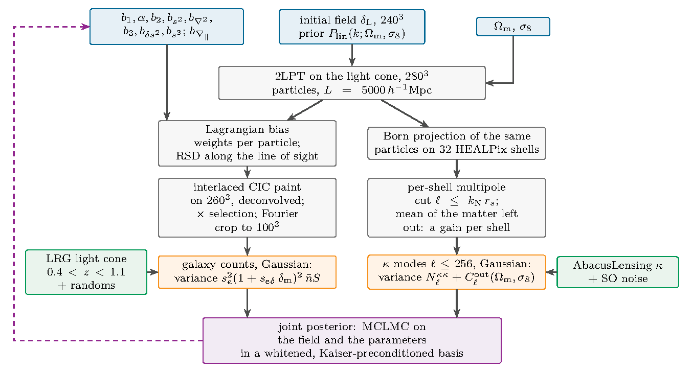

# GALAXY Clustering × CMB Lensing Field-Level Inference

Field-level Bayesian inference of cosmology, primordial non-Gaussianity, galaxy bias, and the initial density field from galaxy clustering **jointly with** CMB-lensing convergence (κ) maps. The forward model evolves a
Gaussian initial field to a galaxy overdensity and a κ map; an MCLMC sampler conditions on the data
(closure or AbacusSummit) to constrain the parameters and the field.

---

## 1. Overview



**Dataflow.** initial field δ_ini → gravitational evolution (LPT/N-body) → galaxy bias + RSD → galaxy
overdensity δ_g; the same evolved matter field is Born-integrated along the line of sight → κ map.
Both observables enter a joint likelihood compared against the data (illustrated here with future real DESI × Planck/ACT data).

**Modules.**
- `desi_cmb_fli.model` — `FieldLevelModel`: probabilistic model, forward pass (`evolve`), likelihood,
  reparametrization, preconditioning, config loader (`get_model_from_config`).
- `desi_cmb_fli.bricks` — bias, RSD, PNG, painting, coordinate/geometry helpers.
- `desi_cmb_fli.nbody` — growth/distance background (emulated), LPT/N-body integrators, Fourier utils.
- `desi_cmb_fli.cmb_lensing` — Born projector, HEALPix masks, κ/galaxy data loaders, theory spectra.
- `desi_cmb_fli.metrics` — power/angular spectra, MASTER decoupling, log-binning.
- `desi_cmb_fli.samplers` — MCLMC / NUTS warmup and sampling loops.
- `desi_cmb_fli.validation`, `desi_cmb_fli.chains`, `desi_cmb_fli.plot` — diagnostics & plotting.

---

## 2. Forward model

All forward-model grids share the same physical box; only the cell resolution changes (see the
oversampling table in §2.5).

### 2.1 Initial conditions

A 3-D Gaussian random field on the **init grid** (`init_oversamp` × the final grid; its Nyquist
frequency is the highest k the model infers, and it sets the per-shell κ cut, §2.6).
The field is the inference latent
`init_mesh` (sampled as `init_mesh_` in the Kaiser-whitened basis, see §5). Mesh dimensions are
auto-adjusted (`get_model_from_config`) so all axes have an **even** number of cells: the real↔complex
Gaussian repacking `utils._rg2cgh`/`cgh2rg` asserts `all(shape % 2 == 0)`, because the
hermitian-symmetry bookkeeping (self-conjugate modes at 0 and Nyquist) assumes an exact Nyquist plane.

**Linear power spectrum (ACE emulator).** `bricks.lin_power_interp` is the linear CDM+baryon spectrum
P_cb at z = 1 of the ACE emulator (jaxmapse network `mnuw0wacdm_class`, trained on CLASS; weights in
`data/ace_pk_lin_cb/`, Zenodo 21328528), normalised to the sampled σ8 and grown with D(a) (§2.3). It emulates
the CLASS spectrum the Abacus ICs were drawn from (`data/abacus_cosm000_CLASS_power.txt`, §4): their
ratio is 1.000 ± 0.002 over k 0.002–0.24 h/Mpc (§7.19).
- Inputs: AbacusSummit c000 (h, Ω_b, n_s, w0, wa fixed in `get_cosmology`). `Omega_m` includes one
  0.06 eV neutrino: ω_cdm = (Ω_m − Ω_b) h² − M_ν/93.14.
- Range: trained for ω_cdm ∈ [0.08, 0.18] (`Omega_m` 0.227–0.447). The `Omega_m` prior must lie in
  `ACE_OMEGA_M_RANGE` = [0.2, 0.55], or the model refuses. Accuracy: §7.11.
- Evaluated in `bricks._ace_power` (the network, its scalings and PCA, jaxmapse's analytic transfer)
  rather than by importing jaxmapse, which turns on float64 globally and conflicts with our pins; it
  reproduces jaxmapse to 10⁻¹⁴ (`test_ace_evaluator_reproduces_jaxmapse`).
- Every linear spectrum of the code is this one: prior, preconditioner, PNG transfer, Kaiser model and
  warm start, the κ out-of-model term, the Fisher. The diagnostic Limber C_ℓ multiply it by jax_cosmo's
  halofit boost (`cmb_lensing.nonlinear_power`).

### 2.2 Primordial non-Gaussianity

**Theory.**

**Local-type PNG.** The primordial (matter-era) Bardeen potential is made non-Gaussian by

$$\Phi(\mathbf{x}) = \phi(\mathbf{x}) + f_\mathrm{NL}\left[\phi^2(\mathbf{x}) - \langle\phi^2\rangle\right],$$

with $\phi$ Gaussian. Note the normalisation of $\phi$ **in the matter era** — this is the
**CMB convention** of $f_\mathrm{NL}^\mathrm{loc}$; the LSS convention (normalising at $z=0$)
differs by $g(a\!\to\!0)/g(a\!=\!1) \simeq 1.28$. Any comparison to an external simulation or to
published constraints must state which convention is used.

**Potential → density transfer** (`bricks.trans_phi2delta_interp`):

$$\delta_L(k,a) = M(k,a)\,\Phi(k), \qquad
M(k,a) = \frac{2\,r_h^2\,k^2\,T(k)\,D_\mathrm{norm}(a)}{3\,\Omega_m},$$

with $r_h = c/H_0 = 2997.92\ \mathrm{Mpc}/h$, $T(k)$ the linear transfer function normalised to
1 as $k\to0$ (obtained as $T(k)=\sqrt{P_\mathrm{lin}(k)/k^{n_s}}$, renormalised at the lowest
tabulated $k$), and $D_\mathrm{norm}(a) = D(a)/D(a_\mathrm{norm})\times a_\mathrm{norm}$ with
$a_\mathrm{norm}$ in matter domination (`z_norm = 10`).

**Two physical effects.**

1. *Matter channel* (`bricks.add_png`): $\phi\to\Phi$ above, mapped back through $M(k)$. This is a
   second-order effect on the matter field, only captured by the LPT/N-body path (not by `kaiser`).

2. *Scale-dependent galaxy bias.* The Lagrangian bias expansion (`bricks.lagrangian_weights`,
   after [Modi+2020](http://arxiv.org/abs/1910.07097)) gains two PNG terms:

$$w(\mathbf{q}) = 1 + b_1\delta_L + \tfrac{b_2}{2}\left(\delta_L^2-\langle\delta_L^2\rangle\right)
 + b_{s^2}\left(s^2-\langle s^2\rangle\right) + b_{\nabla^2}\nabla^2\delta_L
 + f_\mathrm{NL} b_\phi\,\phi
 + f_\mathrm{NL} b_{\phi\delta}\left(\phi\delta_L-\langle\phi\delta_L\rangle\right).$$

   In Eulerian Fourier language the $b_\phi$ term is the familiar $1/k^2$ scale-dependent bias

$$\Delta b(k,a) = \frac{f_\mathrm{NL}\,b_\phi}{M(k,a)} \;\propto\; \frac{f_\mathrm{NL} b_\phi}{k^2\,T(k)\,D(a)} .$$

**Universality relations** (`bricks.b_phi`, `bricks.b_phi_delta`), used when `png_type: 'fNL'`:

$$b_\phi = 2\delta_c\,(b_1 + 1 - p) = 2\delta_c\,(b_1^E - p), \qquad
  b_{\phi\delta} = 2\,(\delta_c b_2 - b_1),$$

with $\delta_c = 1.686$, $b_1,b_2$ **Lagrangian** ($b_1^E = 1+b_1$, $b_2$ in the
$\tfrac{b_2}{2}\delta^2$ normalisation) and $p=1$ for a halo-mass-selected sample
($p\simeq1.6$ recent mergers, $p\simeq0.55$ stellar-mass selected).

**What is actually measurable.** From clustering alone only the *products*
$f_\mathrm{NL}b_\phi$ and $f_\mathrm{NL}b_{\phi\delta}$ enter the scale-dependent bias; $f_\mathrm{NL}$
by itself is fixed only through the (much weaker) matter $\phi^2$ channel. This is why
`png_type: 'fNL_bias'` samples the products directly, and why under that option `fNL` alone is
weakly identified.

**Caveat — super-box modes.** $P_\phi(k)\propto k^{n_s-4}$ makes $\langle\phi^2\rangle$
logarithmically divergent: modes with $k < k_\mathrm{fund}$ are absent from the box, so
$f_\mathrm{NL}$ is defined *within the simulated volume*. The missing long-wavelength modulation is
absorbed into the constant bias parameters.

**Implementation.** Local PNG has two effects, both controlled by `model.png_type`:

- **Matter φ² term** (`bricks.add_png`, always uses `fNL`): in the primordial potential
  φ → φ + f_NL(φ² − ⟨φ²⟩), mapped back to the density field via the φ→δ transfer. Applied on the evol
  grid, then **re-band-limited** to the init Nyquist (`chreshape` to init_shape then back) to drop the
  spurious φ² power above the IC resolution ("PNG anti-aliasing").
- **Scale-dependent galaxy bias** amplitudes `fNL_bp = f_NL b_φ`, `fNL_bpd = f_NL b_{φδ}`, entering
  `lagrangian_weights` / `kaiser_boost` as Δb(k) ∝ 1/M(k), with M(k) the φ→δ conversion.

`png_type` values:
- `None` — Gaussian (no PNG).
- `'fNL'` — **universality**: `b_φ = 2δ_c(b₁+1−p)`, `b_{φδ} = 2(δ_c b₂ − b₁)`, so `f_NL` is the only
  free PNG parameter.
- `'fNL_bias'` — infers `fNL`, `fNL_bp`, `fNL_bpd` as **free** latents (group `png`), not derived from
  b₁,b₂. `add_png` still uses `fNL` for the matter channel.

### 2.3 Gravitational evolution

The init field is `chreshape`d up to the **evol grid** (`evol_oversamp`) and evolved with:
- **LPT** (1st/2nd order, default `lpt_order: 2`), or
- **N-body** (BullFrog integrator, `diffrax`) — snapshot only, no lightcone.

**Lightcone** (`lightcone: true`, `a_obs: null`): each particle evolves at the scale factor `a(χ)` of
its Lagrangian (undisplaced) position, which also sets its bias weights and Finger-of-God term; the RSD uses the
displaced position; snapshot mode uses a scalar `a_obs`.

**Background emulator (`nbody.BackgroundEmulator`).** Growth `D`, `D₂`, rates `f`, `f₂`, and the
distance maps `χ(a)`/`a(χ)` are served — **in `nbody` only** — by a **bilinear emulator** rather than
the `jax_cosmo` ODE solvers: the jax_cosmo fork serves growth and distances through host callbacks
that re-solve for every new cosmology, and with `Omega_m` sampled they exhaust the compiler's memory
and threads. Every background quantity in the sampled graph comes from the emulator — including `χ_s`
in `convergence_Born_spherical` (`nbody.a2chi`) — or is evaluated where it is known exactly (the
growth at a = 1 in the linear spectrum, §2.1); `test_sampling_omega_m_puts_no_jax_cosmo_callback_in_the_graph`
checks the full lightcone model with galaxies, κ (the out-of-model term following the cosmology,
§3.2) and PNG. Tables are
precomputed once on CPU over `n_Om=100` values of `Ω_m ∈ [0.05, 0.7]` (`χ` on `logspace(-4,0,512)`),
then bilinearly interpolated in `(Ω_m, a)`. Activated automatically when the fixed background matches
the Abacus fiducial (`_is_abacus_background`: `Ω_b, h, n_s, w0=−1, wa=0, Ω_k=0`) — i.e. the Abacus
runs where only `Ω_m` (and `σ8`, which does not enter the background) vary. Otherwise the exact
`jax_cosmo` background is used, through its callbacks: a sampled `Omega_m` with another background
(real data, another simulation) needs the emulator rebuilt for it. Exact in `σ8`; its accuracy,
measured against the exact background in §7.11, is far below what the inference resolves.

### 2.4 Galaxy bias & redshift-space distortions

**Lagrangian bias expansion** (Modi+2020), weights read at the initial particle positions from the
evol-grid **Gaussian** field:
- linear `b₁`, quadratic `b₂`, tidal shear `b_{s²}`, higher-derivative `b_{∇²}` (`bn2`).
- `b₂` uses the montecosmo convention `weights += b₂·(δ²−⟨δ²⟩)/2`.
- On the light cone each operator is taken at its particle's `a` (`δ·D(a)`, `s²·D(a)²`, …) and its
  mean is subtracted at that `a`: `b₂·D(a)²(δ² − ⟨δ²⟩)/2` with `δ` the `a = 1` field, likewise
  `b_{s²}·D(a)²(s² − ⟨s²⟩)` and the PNG `φδ` term. Subtracting one mean over the particles of every
  `a` instead leaves each operator a mean that changes with `D(a)`, a radial modulation of the model's
  mean density that the selection does not have (§7.19). At a single `a` (snapshot) the two agree.

**Redshift evolution of the bias (`model.bias_evolution`).** One key sets it: `redshift` (default)
evolves `b₁`, `b₂` and `b_{s²}` across the light cone; `none` keeps every bias constant and does not
sample α. In snapshot mode (`a_obs` set) there is a single `a`, nothing evolves and α is not sampled.
Under `redshift`:
- **Linear bias, α = `b1_alpha`.** The `b₁` term is `b₁(a)·D(a)·δ_L` with
  `1 + b₁(a) = (1 + b₁)(D(a_fid)/D(a))^α`, `a_fid` the growth-weighted mean scale factor of the survey
  cells (the loader's, the redshift where the Kaiser preconditioner is built): `b₁` is the linear bias
  at `a_fid`. α = 0 is a z-independent Eulerian bias `1 + b₁`, α = 1 a constant clustering amplitude
  `b_E·D`. α is a bias latent, prior N(1, 1), `scale_fid` 0.05 (`bricks.lagrangian_weights` takes
  `b1_alpha` and `a_b1`; the Kaiser evolution applies the same factor to its `bE` mesh). Why: across a
  broad shell a fixed `1 + b₁` makes the galaxy amplitude fall as `D(χ)`; the Abacus LRG amplitude
  stays flat, and with α fixed at 0 `Omega_m`, the only parameter that changes `D(χ)` across the
  shell, absorbs the difference (§7.14).
- **Quadratic and tidal biases follow `b₁`.** `b₂(a)` and `b_{s²}(a)` move with `b₁(a)` along the
  bias relations of quenched galaxies, the LRG-like sample of Shiferaw, Kokron & Wechsler
  (arXiv:2412.06886, Table 1), fitted on the Lagrangian field-level biases of IllustrisTNG and
  UniverseMachine galaxies at z = 0–1.5:

  `b₂^SKW(b₁) = 0.40 b₁² − 0.06 b₁ − 0.09`,  `b_{s²}^SKW(b₁) = −0.12 b₁² + 0.04 b₁ + 0.03`,

  with Lagrangian `b₁` (`b_E = 1 + b₁`, as here). Their `b₂` multiplies `δ² − σ²`, ours
  `(δ² − ⟨δ²⟩)/2`, so `f₂ = 2 b₂^SKW`; `b_{s²}` multiplies `s² − ⟨s²⟩` in both (`f_s = b_{s²}^SKW`).
  The model uses the relations' shape up to a constant (how much `b₂`, `b_{s²}` change when `b₁` does):

  `b₂(a) = b₂ + f₂(b₁(a)) − f₂(b₁)`,  `b_{s²}(a) = b_{s²} + f_s(b₁(a)) − f_s(b₁)`,

  so `b₂` and `b_{s²}` stay free at `a_fid` and no latent is added (`bricks.quenched_bias_relation`).
  Why: on the light cone the galaxy likelihood at the true Abacus ICs prefers higher-order biases that
  change with redshift, beyond what α gives `b₁` (§7.19); a relation of the higher-order biases to
  `b₁` is the physical expectation for tracers whose bias is set by their host halos, and the galaxy
  relations differ from those of halos (Lazeyras et al. 2016, arXiv:1511.01096) because the occupation
  weights the halo masses. Up to a constant, because the level of `b₂` at given `b₁` depends on the
  galaxy-formation model (the paper's scatter, and the relations' own level does not fit the Abacus
  LRGs, §7.19), and with the cut-off of the operators (their fields are smoothed at 1 Mpc/h, ours cut at the
  init-grid Nyquist); the change across the shell is what the data need.
  With `model.b2_slope_free: true` the slope of `b₂`'s change is a latent, `b₂(a) = b₂ + λ₂ [f₂(b₁(a)) −
  f₂(b₁)]` (`b2_slope`, prior N(1, 1); `b_{s²}` keeps the relation): it replaces the relation's fixed
  slope for `b₂`, which the Abacus LRGs exceed (§7.19), so that `b1_alpha`, which sets `b₁(a)`, does not
  absorb the difference. It needs the redshift evolution on the light cone (refused otherwise).
  `b∇²`, `bnpar` and the PNG terms (`b_φ` from `b₁`, i.e. at `a_fid`) do not evolve.
DESI full-shape analyses avoid the question with narrow redshift bins and free biases per bin; the
evolution above is the counterpart for a single broad light-cone shell.

**Third-order biases (`model.bias_order: 3`).** The default `bias_order: 2` keeps the expansion above;
`3` adds montecosmo's third-order Lagrangian terms (`lagrangian_bias` of H. Simon-Onfroy's code), each
operator taken at its particle's `a` like `b₂` (factor `D(a)³` on the `a = 1` field):
`b3 (δ³ − 3⟨δ²⟩δ)/6 + bds2 δ (s² − ⟨s²⟩) + bs3 · 3 det s`, with `s_ij = (k_i k_j/k² − δ_ij/3) δ` the
traceless tidal tensor (the sign convention of `b_{s²}` and of montecosmo) and det by the Sarrus rule;
priors N(0, 10³), `scale_fid` 1, as montecosmo. One deliberate difference: the renormalised `s²` inside the
`bds2` term is the one of `b_{s²}` here, minus the particle mean of `s²`, where montecosmo subtracts its
Gaussian expectation `2⟨δ²⟩/3`; `δ³` and `det s` have zero Gaussian mean and are not shifted, as there.
`b3` does not follow `b₁(a)`: tying it to the quenched-galaxy `b3(b1)` gains nothing at the true ICs
(§7.19). Why: at the galaxy grids of §7.19 the third-order terms are the largest missing part of the model
measured at the true ICs (mesh 100), ahead of the initial modes beyond the init cutoff. With the `kaiser`
evolution (no particles) `bias_order: 3` is refused. `tests/test_galaxy_bias.py` checks each term against
its operator built independently, and that zero third-order biases give the second-order weights.

**Finger-of-God higher-derivative LOS bias `bnpar` (b_∇∥).** Implemented as a **velocity** term, not a
painting weight. `bricks.lagrangian_fog_velocity` returns `dvel = bnpar·∇δ_L·D(a)` as a
full 3-vector at the initial positions. `bricks.rsd` adds it to the peculiar velocity **before** the
LOS projection `(v·n̂)n̂`, so the projection turns `∇δ` into the effective `∇²_∥δ` FoG term. The
projection LOS `n̂` is the **observer-dependent per-particle line of sight** (`los_part` from
`tophysical_pos`, using `box_center = box_shape/2 − observer_position`), so `bnpar` respects the
observer geometry automatically. It is only constrained with RSD on (`los` set); for snapshot/no-RSD
runs the FoG FFTs are skipped and `bnpar` must stay in `mcmc.fixed_params`.

**Finger-of-God damping counterterm `bfog` (`model.gxy_fog: true`).** The redshift-space galaxy field on
the paint grid, before the selection multiplies it, becomes `g + (bfog/2) n_i n_j ∂_i∂_j g`, with `n̂` the
observer's line of sight at each paint node (`tophysical_mesh`; along radial lines of sight this is
`∂²g/∂r²`), the derivatives spectral (`bricks.los_second_derivative`: one rfftn, six irfftn on the paint
grid). Locally it is the factor `1 − bfog k²μ²/2`: `bfog > 0` damps the modes along the line of sight, and
for a Gaussian velocity dispersion σ along the line of sight `bfog = σ²` to leading order. Why: `bnpar`
moves the linear field, so the galaxy amplitude it can take is `b + fμ² + bnpar k²μ²`; the damping
multiplies the whole field, `(b + fμ²)(1 − bfog k²μ²/2)`, and adds the k²μ⁴ term `−f bfog k²μ⁴/2` that
`bnpar` cannot produce — the counterterm of the k²μ⁴ dependence that EFT redshift-space analyses fit,
the small-scale velocity dispersion of the tracers that 2LPT velocities lack (the field-level model of
H. Simon-Onfroy's montecosmo has `bnpar` only; this term is a deliberate addition). On the Abacus LRGs at
the true ICs the counts want it, with `bnpar` changing sign once it is there (§7.19). Prior N(0, 100²),
`scale_fid` 1, as `bnpar`; it does not evolve with redshift. Off by default (`bfog` is then not a latent
and the model is unchanged); refused without RSD (`los: null`) and with the `kaiser` evolution (no paint
grid). The galaxy Fisher of §6 takes it as `(1 − bfog k²μ²/2)²` on the power.
`tests/test_galaxy_bias.py` checks the operator on plane waves (one line of sight and radial ones, unequal
cells), that `bfog = 0` is the model without the term, and that with one line of sight the galaxy field is
the field without it times `1 − bfog k∥²/2` mode by mode.

**RSD** (`bricks.rsd`): peculiar velocity from the growth-time integrator (`v ∝ D·f`), projected onto
the local LOS; on the lightcone the LOS and `a` are per-particle. `los: null` disables RSD.

### 2.5 Painting & anti-aliasing (oversampling)

Particles are painted to the galaxy/matter mesh with **interlaced order-2 CIC + Fourier deconvolution**
at the oversampled `paint` resolution, then Fourier-cropped (`chreshape`) to the final grid
(`model.paint_and_deconv`, `bricks.interlace_paint_deconv`). The galaxy mesh is divided by
`prod(ptcl_shape)/prod(paint_shape)` to recover `1 + δ_g` (robust to particle count). The crop is
deferred: the painted field stays on the paint grid (`paint_and_deconv(..., crop=False)`) so that
the survey selection multiplies it there, and `band_limit` averages the product onto the final grid
(§3.1). With no selection the two orders are identical.

| Grid | Factor (montecosmo) | Carries |
|------|---------------------|---------|
| init  | `init_oversamp` (3/2) | the inferred linear field and its preconditioner (`kaiser_post` builds on the final grid, padded) |
| evol  | `evol_oversamp` (7/4) | LPT/N-body evolution, all bias products (δ², s², ∇²δ, φδ), `add_png` |
| ptcl  | `ptcl_oversamp` (7/4) | particle cloud density (`regular_pos(evol_shape, ptcl_shape)`) |
| paint | `paint_oversamp` (7/4)| interlaced+deconvolved CIC paint grid, cropped to final |

Under `evolution: lpt`, `ptcl_oversamp` **must equal** `evol_oversamp` (`__post_init__` raises
otherwise): jaxpm's `cic_read` reshapes the particle array to the force-grid shape, so LPT needs
exactly one particle per evol cell.

**The particle count and the paint grid are chosen together.** Montecosmo's 7/4 is too coarse
here: at 7/4 of a coarse final grid the displaced particle lattice and the bias products leave
structure in the predicted band that grows with the displacement amplitude, so that on Abacus the
galaxy likelihood at the true field prefers a smaller field (`sigma8` biased low) and the κ model holds
too much power at the top of the band (§7.12, §7.14). More particles at the same init grid remove both
for the cost of the particles alone; the inferred field is unchanged. The particle count follows the κ
spacing rule below, and the paint grid must then not be commensurate with it (montecosmo's equal
`ptcl_oversamp` and `paint_oversamp` are): the configs state their grids and the rules in the comment
above `evol_oversamp`, and the measured cases are in §7.14–7.16 and §7.19.

**The particle lattice: two artifacts, two rules.** The particles start on a regular cubic lattice
of spacing `d = box/N` (`N` per side, even: `get_scaled_shape`). A regular lattice is a crystal: its
density has harmonics at wavevectors `2π m/d`, far above the band, and the displacements damp them
(roughly `exp[−(2π m/d)² σ²/2]`, σ ≈ 4.8 Mpc/h, §7.15) without removing them. They reach the
likelihood by two routes, with different rules.

- *Galaxies — the lattice folded into the band by the paint grid.* CIC sampling on the paint grid
  (`P` cells per side) folds every frequency by whole paint periods: harmonic `m` lands at index
  `a = m·N − n·P` for some fold `n`. Order-2 interlacing (the paint and a copy shifted by half a cell
  along the diagonal) cancels the folds of odd total index, not the even ones; the crop to the final
  grid (`F` cells) keeps `|a| ≤ F/2`, the Nyquist plane included (`chreshape`). Where a harmonic lands
  at `a = 0` — `N = P` (`m = n = 2`) or `N = 2P` (`m = 1`, `n = 2`) — the displaced lattice's echo falls
  on the field's own wavevector and adds to it in phase: a coherent transfer error at the top of the
  band, growing with `k` and damped by the displacements. The galaxy amplitude is read precisely there:
  at linear order it is degenerate with `b1`, and the non-linear terms that separate them weigh most at
  the highest `k`, the corners of the final cube, so a fraction of a per cent in the transfer moves the
  amplitude at the true ICs by several of its σ (§7.16). Where `a ≠ 0` the echo lands on another
  wavevector, a pattern uncorrelated with the field that the displacements damp: at a spacing of
  18 Mpc/h it leaves the amplitude unchanged; at the coarser spacings of meshes 54–80 (25 Mpc/h and
  above) the damping is weaker and those patterns moved the profile too (the spike of the closure
  matter `P(k)` on the axis modes, §7.16). The model refuses a first or second harmonic at `a = 0`
  when the paint grid is oversampled (`_check_lattice_aliases`: an error naming the nearest paint
  grids without it) and reports the other entries of `bricks.lattice_aliases`; the plain grid (paint =
  final = evolution) is commensurate by construction and only reported. The rule is set by `N` against
  `P` and `F`, not by the density: a few particles more or less move a harmonic in or out.
- *Galaxies — the bias products on the evolution grid.* δ², s², the third-order operators and the
  2LPT source are formed on the evolution grid (one node per particle) from a field band-limited at
  the init Nyquist, so they reach twice it and fold back into the final band from index
  `evol − init`. The model warns when that is below a quarter of the final grid (§7.16 for the case
  measured).
- *CMB lensing — the lattice projected on the sphere.* The Born projection scatters the particles onto
  HEALPix shells with no paint grid; the lattice leaves a κ template whose weight in the likelihood
  falls with the spacing `d` (§2.6, §7.15). The rule is a density: `d ≤ 25 Mpc/h`, the spacing at which
  the κ-only Abacus posterior is debiased (`bricks.KAPPA_LATTICE_MAX_SPACING`).

At construction the model applies the galaxy rules when galaxies are on, and warns when κ is on and
`d` exceeds 25 Mpc/h (with the count that meets it). The rules say what is understood; the check of a
grid or a selection before a run is the joint minimum in (A, biases) of the galaxy likelihood at the
true ICs (`galaxy_likelihood_profile.py --mode newton`, minutes on a CPU node), within about its σ_A of
A = 1 (§7.16).

Flow in `FieldLevelModel.evolve`: init field → chreshape→evol → `add_png` + PNG re-band-limit → LPT
displacement → paint+crop to final; `lagrangian_weights` comes **after** and is handed `init_mesh_evol_grid`, i.e. the **pre-`add_png`**
Gaussian field, which is why the bias products read the Gaussian field and why `phi` is recovered
correctly there.

### 2.6 CMB lensing convergence

`cmb_lensing.convergence_Born_spherical` Born-integrates the evolved matter field over radial shells
**directly on HEALPix pixels** (curved-sky). Particles are painted to their shell support, converted
to δ, and accumulated with the lensing kernel
$$W_\kappa(\chi,a) = \tfrac{3}{2}\,\Omega_m\left(\tfrac{H_0}{c}\right)^2 \frac{\chi}{a}\,\frac{\chi_s-\chi}{\chi_s}.$$
Ray–box intersection intervals (`t_enter`, `t_exit`) restrict the sum to physically supported
shell/pixel contributions. The mean density `n̄` is derived from the actual particle count
(`pos.shape[0]`), so the normalisation is correct under particle oversampling.

**Shell assignment (single pass).** A particle's HEALPix pixel and bilinear angular weights
(`jax_healpy.vec2ang`, `get_interp_weights`) do not depend on which shell it falls in, so they are
computed once per particle; the shell index follows from its radius, and pixel, angular weight and
shell index are scattered together into one `(n_shells, npix)` array, which the per-shell volume,
mask and kernel then reduce to κ. Painting shell by shell would redo the angular work `n_shells`
times, and differentiating through that repetition is what makes the κ channel expensive.

**Per-pixel normalisation.** Counts become a density by dividing each pixel by the volume it
collects: the shell volume per pixel (`Ω_pix ∫ w_shell(r) r² dr`) times `bilinear_weight_norm`, the
bilinear weight that pixel receives from directions spread uniformly over the sphere, relative to
the mean. HEALPix's bilinear weights sum to one per particle but not to the same total per pixel:
the four pixels of each polar cap collect 1.167 × the mean at every nside, the others stay within
0.4 % at nside 64 (3 % at nside 8). A uniform solid angle per pixel — what jaxpm's
`paint_particles_spherical_bilinear` divides by — would read uniform matter as δ = +0.167 in those
eight pixels in every shell, a fixed convergence at the two poles that no field produces: it cancels
in closure, where data and model share it, but not against a map made otherwise (AbacusLensing,
real data), and the sampler would have to dig the field along the polar axis to hide it. The map is
computed once per nside by quadrature over the pixel centres of a grid 16 × finer (error ∝
oversampling⁻², 6·10⁻⁴ at the poles) and cached; it is a constant, so the gradient is unchanged.
The Abacus loader brings the data map to the projection sphere through the same kernel with the
same per-pixel division (`bilinear_resample_healpix`, §4), and the diagnostic galaxy map from
particles divides by it too (§6), so all three read a uniform field as uniform.
`tests/test_born_shell_scatter.py` checks that isotropic matter gives the same κ in every pixel,
polar caps included.

`jax_healpy.get_interp_weights` agrees with healpy on generic directions (2·10⁶ random directions,
identical weights) but not on a direction whose longitude equals a pixel centre's to machine
precision, where it gives a neighbour's weight to the wrong pixel. Particles never land there; a
test grid aligned with the HEALPix axes does, hence the rotated grid in that test.

Because each particle lands in exactly one radial bin, the shells must **tile
`[chi_matter_min, chi_boundary]` exactly**: an overlap would count the mass inside it twice, a gap
would drop it. `convergence_Born_spherical` raises rather than accept either, and bin membership is
half-open, so a particle sitting on an interior edge is counted once
(`tests/test_born_shell_scatter.py`).

**Radial range (`cmb_lensing.chi_matter_min`, default 0; `chi_high_z_max`).** The shells start
where the matter of the observed map starts and stop at the box edge. On real data that is the
observer (0). A simulated light cone may stop before z = 0: the AbacusSummit HUGE one stops at
z = 0.1 (`FinalRedshift` in `abacus.par`), so its κ holds no matter below χ = 292.6 Mpc/h and the
Abacus configs set `chi_matter_min: 292.6`. It is the counterpart of `chi_high_z_max`, where the
map's matter stops: the CMB for real data, 3750 Mpc/h for the AbacusLensing HUGE map, whose
light cone is full-sky only to the half box (z = 2.18; §3.2). The matter the shells leave out of
that range is in the out-of-model term of the covariance (§3.2); below `chi_matter_min` the map holds
nothing, so no term. The closure configs copy the AbacusLensing range at both ends (292.6 and 3750),
so that closure and Abacus runs share their κ geometry.
`FieldLevelModel.low_z_matter_start` is `chi_matter_min`, floored at 1 Mpc/h for the Limber
integrands that start there.

**The shells near the observer.** Two problems come from them. *Stiffness*: a near shell subtends a
small volume per pixel, so it holds far fewer particles than there are pixels, and one particle
contributes `W_κ/(n̄ Ω_pix χ²)` to the pixels it touches; with `W_κ ∝ χ`, the sensitivity of κ to a
single particle grows as 1/χ and its curvature as 1/χ². A handful of particles within a few hundred
Mpc/h of the observer would dominate the curvature of the whole posterior — in a region the galaxy
survey does not cover — and cap the MCLMC step size (§7.7, §7.12); preconditioning around it does not work, because the stiff direction
rotates as those few particles move between pixels. *Resolution*: a multipole ℓ of a shell at
distance χ is a transverse scale of about πχ/ℓ; where that is smaller than what the inferred field
resolves, the shell's κ at that ℓ is the particles' discreteness rather than the matter's structure,
and a nearer shell reaches it at a lower ℓ (excess model power at the top of the band, §7.6).

**Lattice discreteness and the lattice template.** The particles start on a regular lattice of
spacing d = box / N_ptcl, and the LPT displacements are small against d, so the lattice survives
evolution — the same small-displacement regime that keeps 2LPT accurate. The 3-D painting does not
see it (one particle per cell of a grid aligned with the lattice paints to a constant); the HEALPix
pixels are not aligned with it. Seen from a centred observer, a shell at distance χ adds spurious
power around ℓ ≈ 2πχ/d — inside the band for near shells, above it for far ones — and rays running
along the lattice planes draw lines on the three coordinate great circles and their diagonals, which
have power at every ℓ, so far shells keep an in-band part. Averaged over the field it does not
vanish: the model's κ carries a deterministic mean E_z[κ](θ), the lattice damped by the
displacements, that a real map lacks. A power spectrum sees it at second order (power small against
the cosmic variance of a band); the field-level likelihood sees it at first order, coherently over
every mode of the band, as a mean the data must contain. Its amplitude grows with `Omega_m` (the
lensing kernel and the mass per particle) and depends little on `sigma8`, so data without it pull
`Omega_m` down along the κ degeneracy. Its size is set by d, not by the cell, hence the spacing rule
d ≤ 25 Mpc/h (§2.5, §7.15) and the 5000 Mpc/h box, where the particle counts that meet it fit one GPU
(§7.15, §7.19). In closure data and model
share it. E_z[κ] is measured with antithetic pairs, (κ(z) + κ(−z))/2, which cancel the part of κ odd
in the field.

**Per-shell multipole cut (`cmb_lensing.shell_kmax`; W. Kabalan's `resolution_cut` in jax-fli).**
Both problems are handled per multipole: each shell is low-passed above the multipole the model
resolves at its distance, ℓ_res = `shell_kmax`·r_eff, r_eff the mass-weighted radius of the shell
under its radial profile (top hat or tent). `shell_kmax` defaults to the Nyquist frequency of the
inferred (init) grid, π / (init cell); the final-grid Nyquist sends structure the model resolves
to the covariance, and a lower cut makes the out-of-model gain grow and the coherence fall (§7.12,
§7.19). `shell_kmax: 0` switches the
cut off, and without `full_los_correction`, which carries the removed power, it defaults to off and a
`shell_kmax > 0` is refused. A shell with
ℓ_res below the band edge 2·nside gets the cosine taper of jax-fli: 1 up to ℓ_cut − max(ℓ_cut//4, 1), 0 from
ℓ_cut = ⌊ℓ_res⌋; a shell that resolves no multipole is removed whole (jax-fli floors ℓ_cut at 4
instead). The shells cut are those with r_eff < 2·nside/`shell_kmax`: at fixed init grid, a higher
nside cuts more of them, out to the galaxy shell at nside 128 (§7.19). The Born projector
returns its shells separately (`convergence_Born_spherical(per_shell=True)`), `cut_shells` transforms
each cut shell (`map2alm`, `iter=0`, batched), applies its taper, sums the a_ℓm and returns to the
map, to which the untouched shells are added, so `kappa_pred` is the cut map everywhere downstream
(closure data, `pixel_exact`, figures). The `iter=0` round trip of a cut shell costs 4·10⁻⁴ (rms,
relative) on the observable a_ℓm of a band-limited shell, its worst pixels at the poles. The power
removed — the model's discreteness, and on AbacusLensing or a real map real structure the model does
not resolve — is part of the out-of-model term `C_ℓ^out` of the covariance, the matter the map holds and
the shells do not (§3.2), so it follows `cl_out_mode` like it. Inside the taper's roll-off the removed part of a mode is proportional
to its kept part: the likelihood's mean restores it through each shell's gain (§3.2), and the covariance
keeps it as well, on the safe side. The cut removes the near-shell discreteness and the near-observer
stiffness, so that where the shells start no longer matters, at the price of a costlier κ gradient
(§7.12). It leaves the far shells' in-band discreteness, the lattice template, which shrinks with the
particle spacing (above, §7.15). The covariance term carries the bilinear window of
the projection sphere, like the data and model maps (§3.2). On a cut sky the filter acts on the
zero-filled shell maps.

**Why the removed power is variance, and why particles do not replace the cut.** The cut is set by
the inferred field, not by the particles: the field is band-limited at the init Nyquist frequency, so
above ℓ_res a shell's model κ holds no structure whatever the particle count. More particles take
away the discreteness there, not the missing power, which the data hold and the covariance has to
carry either way. The cut makes that split exact — above ℓ_res a shell is wholly in the term, below
wholly in the mean, and the term is the Limber power of a known kernel; without it the model would
keep an uncomputable part of those multipoles (the corners of the Fourier cube, power the LPT couples
upward) and the covariance would have to hold the rest. On a real map, whose matter reaches the
observer, the near shells' multipoles are also where LPT fails, so a cut is needed at any particle
count. Putting the removed power in the variance makes three approximations, measured in §7.12 and
§7.18: its power spectrum, linear theory times the halofit boost at the fiducial (§3.2; halofit
matters more the higher the nside, since the cut then removes higher k, §7.18, §7.19), and the model
at the Abacus ICs keeps its error against the non-linear AbacusLensing map
inside the covariance where the cut holds a large share of the power; independence from the kept
field (the map's transfer on the model at the true ICs is one, so data − model is uncorrelated with
the model at two-point level); and the taper's roll-off (above). Its weight is not small because the
lensing kernel is small near the observer: the cut holds a large share of the map's power at the top
of the band, more the higher the nside (§7.12, §7.19).
Not measured: a non-Gaussian residual or one modulated by the kept field (a trispectrum), which a
power spectrum and a transfer do not see.

**Abandoned: an inner cut-off `chi_min`.** Before the per-shell cut the shells started at a
`chi_min` (350, then 700 Mpc/h) and the dropped range entered the covariance as a low-z Limber term.
It worked — with the tents it made the joint sample like the galaxies alone (§7.7) and passed the
κ-only validation at 700 (§7.4) — but it gave up the near shells at every ℓ, its Limber term was
inaccurate at low ℓ, and its value was a resolution tuning (§7.6). W. Kabalan's per-shell cut does
the same per multipole and replaced it; a config that still holds `chi_min` or `chi_low_z_min` is
rejected, and the code of those runs is the git tag `pre-shell-cut`.

**Radial shell weights (`cmb_lensing.shell_weights`).** `nearest` assigns each particle entirely to
the shell containing it; `linear` splits it between the two shells whose centres bracket its radius,
with the tent weight `max(0, 1 − |r − c_i| / d_r)`.

`linear` exists because the sampler differentiates through κ. Under `nearest`, a particle crossing a
shell edge moves its whole weight from one kernel to the next, so the log-density is discontinuous in
the particle radii everywhere in the box; MCLMC's energy error scales as ε⁶ only for a smooth target,
and a jumping one degrades it towards ε¹, capping the step size however the mass matrix is tuned. The
projector already interpolates bilinearly in angle over four HEALPix pixels — `linear` makes the
radial direction cloud-in-cell too, putting both directions in the same smoothness class as the
galaxy painting. Both ends of the radial range matter, since a particle switches on at
`chi_matter_min` and off at `chi_boundary`, and the outer end dominates: the number of particles crossing a given radius
per unit radial distance grows as χ².

The `linear` tents therefore span the range apex to apex —
`d_r = (chi_boundary − chi_matter_min)/(n_shells + 1)`, centres from `chi_matter_min + d_r` to
`chi_boundary − d_r` — so each end tent's support stops exactly on a range boundary and a particle
enters and leaves the integration continuously at both, at the cost of a taper of one `d_r` of path
length at each end. Each shell is normalised by the volume its tent actually sees,
`Ω_pix ∫ w_i(r) r² dr = Ω_pix (r_i² d_r + d_r³/6)` (`linear_shell_volumes`; with x = r − r_i the
odd term of `(r_i + x)²` cancels on the symmetric tent, `∫ w = d_r` and `∫ w x² = d_r³/6`), what
uniform matter of density n̄ deposits in the pixel over n̄, so that it reads δ = 0 (`nearest`:
`r_i² d_r + d_r³/12`); its in-box mask uses
the support `r_i ± d_r`. Uniform shells only. `nearest` is the default and keeps its own layout,
`n_shells` bins of width `(chi_boundary − chi_matter_min)/n_shells` tiling the range. Known gap:
`compute_shell_support_fractions`, used only for the closure-mode theory curve, still assumes
`r_i ± d_r/2` supports.

**What the shell count sets.** Each particle is scattered in its own direction; the shells discretise
only its radial weight, the lensing kernel over the shell's volume per pixel, which the tents
interpolate linearly (`nearest` steps it). The shell count sets the accuracy of that interpolation of
a kernel smooth in χ, not the angular resolution of the map, so it does not have to grow with `nside`.
At mesh 160 / nside 128 the forward model on the Abacus ICs, 32 shells, shows no model error above
the covariance term in any band (§7.19).

**Projection anti-aliasing (`cmb_lensing.proj_oversamp`, default 1).** The κ observable is the packed
pseudo-a_lm with ℓ ≤ 2·nside, obtained by `map2alm` of the masked map — a transform that assumes the
map is band-limited to that ℓ. The model's map is not: the Born projection scatters a finite number
of particles, so its κ carries shot noise down to the pixel scale, and `map2alm` folds that sub-pixel
power into the very modes the likelihood compares. The sampler then fits it, by building structure in
the field that the data does not contain.

Filtering the a_lm cannot fix this — the band cut is already there, and it acts after the fold.
Anti-aliasing has to precede the transform, exactly as it already does for the 3-D mesh (§2.5: paint
fine, then Fourier-crop). `proj_oversamp` is the spherical analogue: the particles are scattered onto
`nside × proj_oversamp` (a power of two), the transform runs at that sphere's own
`lmax = 2·nside·proj_oversamp` — jax_healpy's `map2alm` supports no other ratio — and only the (ℓ, m)
pairs of the observable band are selected, so the extra modes hold the sub-pixel power instead of
folding it in. The MASTER coupling matrix stays on the observable sphere; the model's map is masked
on the refined sphere (`cmb_proj_mask`: the in-box mask times the external mask at that nside), and
the shell in-box mask and the ray entry/exit distances are recomputed there. The refined counts
array is small beside the evolution grids and the spherical transform is not where a log-density
gradient spends its time, so a modest refinement costs a few percent of the gradient — but the
transform's own cost climbs steeply with `nside`, so that balance is worth re-checking before
refining much further. Not available with `likelihood_mode: pixel_exact`, which is defined on the
observable pixels. The per-shell multipole cut (above) does not replace it: `cut_shells` transforms
each cut shell on the projection sphere, so the fold has happened when its taper acts, and the shells
whose ℓ_res lies above the band are not cut at all.

The return to the observable is a sharp harmonic cut, not a pixel average: `map2alm` at the refined
sphere's `lmax`, then only ℓ ≤ 2·`cmb_nside` is kept, so it adds no window inside the band. The one
smoothing the observable carries is that of the bilinear scatter itself, whose window
(`cmb_lensing.bilinear_window`, measured on a band-limited Gaussian field) falls with the pixel
size: in amplitude at ℓ = 30 / 50 / 64 it is 0.906 / 0.778 / 0.668 at nside 32, 0.977 / 0.936 / 0.898
at nside 64 and 0.994 / 0.984 / 0.974 at nside 128. `proj_oversamp: 2` therefore also halves the
in-band smoothing of scattering straight onto the observable sphere. The likelihood stays
consistent under it as long as data and model carry the same window: in closure by construction,
on Abacus because the loader brings the map through the same kernel (§4). A real κ map does not
carry this window.

**Line-of-sight depth.** `kappa_pred` integrates matter only to `chi_boundary`, which is
`box_shape[2]` for `observer_mode: face`/`corner` but **`box_shape[2]/2` for `observer_mode: center`**
(the observer sits mid-box, so only half the depth lies ahead) — that is the full-sky/huge
configuration (3750 Mpc/h in the 7500 box, 2500 in the 5000 box). The radial shells (`cmb_r_shells`)
span exactly that range. The residual depth `χ_box → χ_high_z_max` is in the likelihood covariance
(§3.2): 2500 → 3750 Mpc/h for the HUGE map in the 5000 box. For AbacusSummit base,
`chi_high_z_max: 3990` Mpc/h (matter simulated to z≈2.45), not `χ_CMB`.

---

## 3. Likelihood

### 3.1 Galaxy likelihood

A per-cell Gaussian on the galaxy **counts**, restricted to the survey mask via `dist.mask`:

```
obs ~ Normal( m = n̄·α·⟨(1+δ_g)·S⟩_cell ,  s_e·(1 + s_ed·max(δ_m, −1))·√(n̄·α·S) ),   δ_m = m/(n̄·α·S) − 1
```

with `n̄ = model.gxy_count` the mean count per cell at full completeness, `S` the selection, `α` the
per-radial-bin amplitude and `s_e`, `s_ed` the noise level and its density slope (below); `s_e = 1`,
`s_ed = 0` is the Poisson variance at the mean density. The observable
`truth["obs"]` is the painted count mesh; `model.obs_to_delta` recovers `δ_g` for the warm start
and the diagnostics.

**Why counts and not `1+δ`.** The two are the same likelihood — dividing the data by `n̄S` and the
residual by `√(n̄S)` leaves `χ²` unchanged, so the posterior is identical up to a
parameter-independent Jacobian (`tests/test_counts_likelihood.py`). What differs is low
completeness: `obs = N/(n̄S)` and its variance `1/(n̄S)` both diverge as `S → 0`, so a partly covered
cell has to be discarded, whereas multiplying the prediction by `S` stays finite however small `S`
gets. That is what makes the completeness threshold a modelling choice rather than a numerical
necessity. This follows montecosmo (`intens_mesh = gxy_mesh * selec_mesh`, then a count likelihood);
we keep a Gaussian rather than its Poisson, since the cell occupancies here are far inside the
Gaussian regime and the Gaussian has smoother gradients; its variance follows the prediction only
through `s_ed` (below). Its
`posit_fn = |·|` on the intensity is not used either: nothing here divides by the intensity.

**The selection multiplies at paint resolution.** `S` is carried on the paint grid
(`model.selec_paint`) as well as the final one (`model.selec_mesh`), and the predicted intensity is
`band_limit(gxy_paint · selec_paint)` — the cell average of the *product*, not the product of the
cell averages. The two differ by the sub-cell correlation between galaxy density and coverage, which
is exactly what a partly covered edge cell consists of: the coarse product predicts the whole-cell
mean density times the mean coverage, when the count actually observed comes from the covered
sub-region alone. `band_limit` preserves the mean, so the predicted total count is right by
construction. This is why the Fourier crop is deferred in `paint_and_deconv` (§2.5): `crop=False`
returns the field on the paint grid, and `gxy_mesh` is exactly `band_limit` of it
(`tests/test_counts_likelihood.py`).

**Galaxy noise `s_e`, `s_ed` (`model.gxy_stoch_noise`, default on).** The noise std of a cell is
`s_e·(1 + s_ed·max(δ_m, −1))·√(n̄S)`, with `δ_m = m/(n̄S) − 1` the model's count contrast in that
cell. `s_e` (truncated normal `loc 1, scale 1, [0, 10]`, `scale_fid` 3e-3) sets the level, `s_ed`
(truncated normal `loc 0, scale 1, [0, 0.9]`, `loc_fid` 0.2, `scale_fid` 1e-2) the relative rate at
which the noise grows with the predicted density; `s_e = 1`, `s_ed = 0`, the values when the flag is
off, is the Poisson variance at the mean density in every cell. A Poisson noise has variance `m`,
i.e. `s_ed ≈ 1/2` to first order. Why: the residual of the Abacus LRG counts about the model at the
true ICs has a variance that rises with `δ_m`, slower than Poisson and below it at the mean density,
alike in every shell of χ, and the form follows its curvature (§7.19). It is the
form of montecosmo's `quad_gauss` std, `|s_e + s_ed·δ_m|`, made positive by construction: there the
std vanishes where `δ_m = −s_e/s_ed`, which a model with negative predicted counts (the truncated
bias expansion, the band limit) reaches in some cell, and a chain then diverges (§7.19). Here `δ_m`
is floored at −1 (a cell predicted below zero counts has the noise of an empty cell) and `s_ed`
bounded below 1, so the std stays above `s_e·(1 − s_ed)·√(n̄S)`; the slope is relative to `s_e`
(montecosmo's `s_ed` is `s_e·s_ed` here). The predicted counts themselves are not changed: the
Gaussian likelihood accepts a negative mean. Montecosmo's skewness term `s_e2` and PNG term `s_ep`
(std `+ s_ep·φ`, for `f_NL`, §8) are not implemented. A closure with the flag on needs `s_e` and
`s_ed` in its `truth_params` (the run refuses to draw them from their prior) and must recover them.
`s_ed = 0` is the edge of its prior, where the density vanishes: a constant-amplitude noise is the
flag off, not `s_ed` held at 0 (hold it inside the bounds, e.g. 1e-4, if `s_e` alone must be free).

**The noise level: held at its fit on the simulation.** With `s_e`, `s_ed` free, chains fit the data better
than the model at the truth while `s_e`, `s_ed` fall, on the Abacus counts and also on data whose mean is the
model at the truth and whose noise follows this law exactly (§7.19, the noise model at the production step);
held at their maximum-likelihood fit to the residual at the true ICs, the chains' fit stays the truth's. An
informative prior does not stop the fall: the likelihood resolves the noise level to about `s_e/√(2N)` over
the N survey cells, far narrower than a prior width that reflects how well the level is known, so the
prior is flat against it and `s_e` follows the chain's χ²/N down (ph202 under a prior of width 0.03, §7.19).
The field-level literature meets the same collapse of the noise amplitude (arXiv:2511.05484; 2403.03220
bounds it from below). The production configs therefore hold `s_e`, `s_ed` at that fit
(`mcmc.fixed_params`, held at their `loc_fid`): `abacus/abacus_gxyonly_cosmo_box5000_m100_ph202_noiseheld.yaml`
and the ph202 joint. The earlier configs at the finer grids (`…_m{100,160}.yaml` on ph201, `…_m100_ph202.yaml`)
centre a prior of width 0.03 on the fit to their own sky; the mesh-54 configs keep the broad default prior.
The fit is measured on the simulation's true ICs, which real data do not have, so for real data the level
has to come from simulations spanning the galaxy–halo connections the data allow (every HUGE LRG is a
central, §4). Holding the noise does not stop the slide of `sigma8` along `b1`–`sigma8` at order 2 (§7.19).

**Survey mask & radial selection from randoms.** For the AbacusLensing LRG mocks (equal-weight
galaxies and randoms: 100 per galaxy in the ph201 file, 20 usable in ph202's, §7.19), `S` is built from
the **painted random density**, normalised to unit mean over the occupied cells. The randoms are painted with **the same scheme as the galaxies and as the model** —
interlaced, CIC-deconvolved, at `paint_shape` — so `S` and the counts carry the same window. The
catalogue is far too large to hold, so the two interlacing shifts are accumulated chunk by chunk
(`interlace_accumulate`) and combined once at the end (`interlace_combine` / `interlace_finalize`);
painting is linear in the positions, so this is identical to one call on the whole catalogue
(`tests/test_interlace_accumulate.py`). The occupancy mask stays on the plain CIC paint, where
`> 0` still means "a random landed here" — the deconvolved mesh rings. The reduction is cached on
disk, keyed on everything that changes it, including the paint grid.

**The selection without the randoms' counting noise.** A paint cell holds a few hundred randoms, so
their map scatters by several per cent from cell to cell. Multiplied into the prediction node by node,
that scatter is not noise of the data, which the likelihood's variance holds, but an error of the
model's mean that multiplies the field: its expected contribution to χ² grows with the model's
small-scale variance, which the fit lowers — `bn2` up, `bnpar` down, the amplitude with them — in
proportion to one over the number of randoms per galaxy (§7.19). The loader therefore rebuilds `S` as
footprint(direction) × profile(distance) (`cmb_lensing.selection_without_counting_noise`): the profile
is the mean of the painted randoms over the in-footprint nodes of each 2 Mpc/h shell of distance
(`radius_mesh`), which keeps the n(z) and the painted radial edges and averages the counting noise
over a whole shell; the footprint is a binary HEALPix map of the node directions seen from the
observer, its pixels about one cell wide at the survey's inner distance. `selec_mesh` is the band limit
of the rebuilt `selec_paint`, so the two grids still describe one survey
(`tests/test_selection_from_randoms.py`). It assumes a selection separable in direction and distance,
with a uniform angular completeness: exact for the mocks (full sky, octant). Real data will need the
angular completeness as a continuous map and n(z) per imaging region, to be validated then.

**Completeness cut (`abacus_galaxy.completeness_min`, default 0.8).** Cells on the survey boundary —
octant faces and radial shell edges — are only fractionally covered, and are dropped below this
threshold on `S`. It is a choice about how far to trust the model at the boundary, not a numerical
guard: the two things that otherwise make a partly covered cell unusable are handled in the forward
model. The randoms carry the same interlaced, deconvolved window as the galaxies and as the model, so
the predicted intensity `gxy_count · S` and the observed count are on one window; and the
band-limited product predicts the covered sub-region directly, rather than a whole-cell average
compared against a sub-region count. The code default stays 0.8; the HUGE reference runs use **0.3**
(the scan that chose it is in §7.1). Below that, `b1` is the first parameter to move.

**Free per-radial-bin mean density `ngbars` (`model.gxy_ngbar_free`, integral constraint).** On the
lightcone the radial selection makes the survey mean density a per-bin unknown; fixing it exactly
imposes an integral constraint whose violation leaks low-k power into `f_NL`. Following montecosmo
(`set_radial_count`), one free **relative** amplitude `ngbar_<b>` (1 = fiducial) is added per **fine
uniform radial bin**:
- `get_model_from_config` sets `n_rbins = round((χ_hi−χ_lo)/dr)`, `dr = √3·cell_size` (χ-range from the
  catalog z-band extent under the fiducial cosmology), and injects `ngbar_0 … ngbar_{n−1}`
  (group `syst`, prior `loc=1, scale=1, scale_fid=1e-2, low=0`). Off by default.
- The loader builds `model.gxy_shell_id` by digitising the survey comoving radius into `n_rbins`
  uniform bins over `[r_min, r_max]` (−1 outside the survey).
- In the likelihood, `α = ngbar[bin_id]` multiplies the predicted counts **and** their shot-noise
  per bin, exactly as `set_radial_count` multiplies both the intensity and the selection. At `α=1`
  it reduces to the plain likelihood.

Mathematically, if the true per-bin density is `α_b ×` fiducial, then `E[obs] = α_b·n̄·S·(1+δ_g)`
and `Var[obs] = α_b·n̄·S`; marginalising `α_b` over **fine** bins removes the entire radial-monopole
subspace, so `f_NL` is measured from transverse/3-D modes only and is insensitive to a mis-traced
`n̄(χ)`.

The nuisance is only needed when the randoms mis-trace `n̄(χ)`. The base-box AbacusLensing randoms
do (their `RAND_Z` is close to uniform in z and under-traces the outer comoving volume), so the
base-box runs free them. The HUGE `lrg_huge` randoms track the data `n(z)` to 0.1 % (§4), so the
HUGE reference runs keep `gxy_ngbar_free: false`; freeing them there leaves `f_NL` within a fraction
of its error and widens it (§7.1).

### 3.2 CMB lensing likelihood

A single numpyro `Normal` site over the observed footprint (so `sample == log_prob` for closure). The
total per-mode variance is `C_ℓ = N_ℓ + C_ℓ^{out}` (reconstruction noise + the out-of-model term, the convergence the
data map holds and the Born shells do not, as Gaussian variance; below). Two modes (`cmb_lensing.likelihood_mode`):

- **`diagonal`** (default): the masked pseudo-$a_{\ell m}$ vector with diagonal covariance
  `var_ℓ = M_{ℓℓ'}(N_{ℓ'}+C_{ℓ'}^{out})`, `M` the MASTER mode-coupling matrix (NaMaster,
  `model.cmb_M_ll`). **Exact covariance structure on the full sky** ($W=1$: pseudo-$a_{\ell m}$ = true
  $a_{\ell m}$), up to the `iter=0` transform, which is not an exact quadrature, and the coupling truncated at
  ℓ_max (the Abacus map is not band-limited). On a
  cut sky it drops the mask-induced (ℓ,ℓ')/(m,m') coupling, so it is approximate (can mis-size error
  bars) but fast, and the only option for full-sky / high-nside runs. Includes the parameter-dependent
  log-determinant `ln C_ℓ` (needed under `cl_out_mode: exact`, where `C_ℓ^{out}` depends on
  Ω_m,σ8).

- **`pixel_exact`**: the **exact cut-sky** field-level likelihood via signal-eigenmode (KL)
  compression. The band-limited noise field's pixel covariance depends only on angular separation,
  $$\mathrm{Cov\_pix}[i,j] = \sum_\ell \tfrac{2\ell+1}{4\pi}\,(N_\ell+C_\ell^{out})\,P_\ell(\cos\theta_{ij})$$
  (**the spectrum of `diagonal`, no HEALPix pixel window**; `C_ℓ^{out}` carries the bilinear
  window of the projection sphere, below — this makes `diagonal` and `pixel_exact` coincide at
  $f_{sky}=1$). Because the field is band-limited to $\ell_{max}=2\,$nside, a footprint of area
  $f_{sky}$ supports only $\sim f_{sky}(\ell_{max}+1)^2$ modes (Slepian) while HEALPix gives $\sim3\times$
  more pixels, so `Cov_pix` is **rank-deficient**. We diagonalise it **once** (constant: fixed
  cosmo+mask+noise), keep the $k$ eigenmodes with $\lambda > \mathrm{kl\_rcond}\cdot\lambda_{max}$ (the
  supported Slepian subspace), and use the eigenmode amplitudes $a = U_k^\top\kappa[\mathrm{obs}]$: in
  that basis the covariance is exactly diagonal ($\Lambda_k$), so the site is a single
  `Normal(U_k^\top\kappa_{pred}, \sqrt{\Lambda_k T})`. The full mask coupling is retained exactly within
  the supported subspace; only numerically-null modes are dropped (lossless). This supersedes
  `diagonal` on a cut sky (which is over-confident there). Its covariance is computed once at the
  fiducial (constant covariance): the code refuses `cl_out_mode` other than `fixed` with
  `full_los_correction`, and a sampled cosmology leaves the covariance at the fiducial. `kl_rcond` (default `1e-6`) sets the cutoff: it keeps
  cond ≈ `1/rcond` — safe in float32 down to ~`1e-6`; larger (e.g. `1e-2`, conditioning ~10²) is more
  conservative/robust (drops the least-concentrated Slepian modes) without biasing the calibration.

**Out-of-model term `C_ℓ^out` (`full_los_correction`, `cl_out_mode`).** The covariance of
everything the data map holds and the Born shells do not: the matter beyond the box (`χ_box →
χ_high_z_max`), the end ramps of the linear tents, and the power the per-shell multipole cut removes
(§2.6), one Limber term added to the variance; both modes below treat its parts alike (one
computation, cached at the fiducial or repeated at the sampled cosmology;
`test_every_cl_out_mode_carries_the_cut_term_alike`). It has no separate low-z range since the
inner cut-off `chi_min` went (§2.6): the cut power comes mostly from the near shells and one tent
ramp sits at `chi_matter_min`, but both are parts of this one kernel. It enters the variance only:
the mean of the likelihood is the Born κ of the shells. Marginalising a Gaussian map of spectrum
`C_ℓ^out` added to the Born map gives that same likelihood, and closure data are generated that way
(`model.predict` draws the site), so the generative model of the observation is the Born map plus a
Gaussian out-of-model map plus the noise. `high_z_mode`, the key's former name, is still read in the
configs of earlier runs.

**The window of the term.** The term is multiplied by `w_ℓ²`, the squared bilinear window of the
projection sphere (`bilinear_window` at `proj_nside`, `model.cmb_los_window2`; 0.88 at ℓ = 50 and
0.81 at ℓ = 64 at `proj_nside` 64), in both modes: the computation carries it, and the `fixed`
cache is that computation at the fiducial. The data map reaches the
observable through that kernel, the line-of-sight matter and the power the cut removes included —
on Abacus through the loader's `bilinear_resample_healpix` (§4), on a real map by the same
resampling — while the model map gets it from the Born scatter. The residual data − model is
therefore `w_ℓ (κ_beyond + Σ_s (1 − w_s(ℓ)) κ_s) + noise`, of variance `w_ℓ² C_ℓ^{out} + N_ℓ`; the
noise is added after the resampling and carries no window. In closure the data are drawn from the
likelihood itself, so they follow whatever the term holds. Without the window the assumed variance
of that part would be `1/w_ℓ²` too large, growing toward the top of the band: negligible for the
matter beyond the box alone, not for what the cut removes, a large share of the map's power there
(§7.12, §7.19). Modes:
- `exact` (default) — recomputed at the sampled cosmology at every evaluation of the likelihood.
- `fixed` — cached at the fiducial cosmology (required by `pixel_exact`; the same as `exact` when
  `Ω_m`, `σ8` are fixed). The cache `model.cl_out_cached` exists in both modes and is what the
  diagnostics read.

The term is computed in linear theory with the model's own spectrum and background: the ACE
spectrum (`lin_power_interp`, §2.1) grown with the emulator's D(a), and χ(a), a(χ), χ_s from the
background emulator (§2.3), the same χ_s as the projector's. Nothing in it calls jax_cosmo, so it
follows a sampled cosmology without host callbacks, and its gradient is the emulators'. Its
non-linear part enters as a fixed ratio at the fiducial (below), which holds across the posterior
(§7.18, §7.19). No expansion around the fiducial stands in for it: to first order the error within
the κ-only posterior is many nats (§7.18). Any other `cl_out_mode` is an error.

**What the out-of-model term holds.** The data map holds the matter with the lensing kernel
`W(χ)` from `chi_matter_min` to `chi_high_z_max`; shell s holds it with `q_s(χ) = d_r W(r_s) p_s(χ)
χ²/V_s` (its lensing weight at the centre times its radial profile normalised by its volume, as in
the projector), times its multipole taper `w_s(ℓ)` (§2.6). The term is the Limber C_ℓ of the one
kernel `B_ℓ(χ) = W(χ) − Σ_s w_s(ℓ) q_s(χ)` (`cmb_lensing.compute_cl_outside_model`): the matter beyond
the box, the end ramps of the linear tents (the tents sum to one only between the first and last
apex, so one `d_r` at each end is held partly), what the cut removes and, between the apexes, the
residual of the shells' radial interpolation of `W` (`W − Σ_s q_s`; under `exact` it also holds the
shift of the shell scale factors, kept at the fiducial), with their cross terms.
Taking the pieces apart and leaving out the ramps misstates it on both sides of the band (§7.12).
Limber misses the radial modes of a kernel whose radial extent is not large against χ/ℓ, so the term
is the Limber C_ℓ times the exact-over-Limber ratio of the same kernel in linear theory at the
fiducial cosmology (`cmb_lensing.limber_ratio_outside_model`, `model.cmb_los_limber`), exact being
`(2/π) ∫ dk k² P(k) [∫ dχ B_ℓ(χ) D(χ) j_ℓ(kχ)]²` on a k grid that resolves the kernel's radial
extent, both sides up to k = 0.5 h/Mpc (`cmb_lensing.exact_over_limber`). The ratio corrects the
projection only: cut at the same k on both sides, it leaves the kernel's power above k = 0.5, where
Limber holds, in the term at its Limber value. The same function multiplies it by the term's halofit
over linear Limber C_ℓ (`cmb_lensing.nonlinear_power`, jax_cosmo's halofit boost on the model's
spectrum): what the per-shell cut removes is matter at k up to ≈ 1 h/Mpc, non-linear, and the term is
its variance (its mean given the model is the gain below); the term does not assume this matter
linear. That power enters only where `(ℓ + 1/2)/χ > 0.5`
within the kernel, which starts with the shells' first ramp: none at ℓ ≤ 64 (nside 32), the
low-χ end of the per-shell cut at ℓ ≤ 256 (nside 128). It enters both modes as the window does; under `exact` the linear Limber part follows the
cosmology and both ratios stay at the fiducial. The exact-over-Limber ratio matters when the box is
smaller than the map's depth: a slab of matter behind the box is radially thin against χ/ℓ at low ℓ,
where Limber under-predicts it (§7.15). The term is computed and cached at init, so a κ run started
before the ratio does not resume. The ratio (13 of the 15 min of a model build, §7.19) is cached on
disk, `data/cache/limber_ratio_<digest>.npy` (git-ignored), under a digest of every input: the
background cosmology as the leaves of the `Cosmology` pytree, ℓ, the shells (radii, scale factors,
width, profile, taper), `z_source`, `χ_max` and the integration grids; a configuration computes it
once, and `_LIMBER_RATIO_CACHE_VERSION` is bumped when the computation changes
(`tests/test_shell_cut.py`).

**Mean of the data map given the model's, shell by shell (`cmb_lensing.compute_out_terms`,
`_shell_gains`, `cut_shells`).** The matter left out is not independent of the model's: `B_ℓ` overlaps
in χ the shells the model holds in part — inside the cosine taper of the per-shell cut, where the
model holds `w_s κ_s` of a shell and the map all of it, at the end ramps of the tents, and, through the
tents' overlap, at their neighbours. For Gaussian fields the map given the model's shells is then
`Σ_s (1 + c_s(ℓ)) w_s κ_s` plus a part independent of them, with `c = C_MM⁻¹ C_MB` the regression of the
matter left out on the shells as the model holds them, `M_s = w_s q_s`, each separately: `C^{BM_s}_ℓ =
∫ dχ B_ℓ M_s P((ℓ+½)/χ) / χ²` and `C^{M_s M_t}_ℓ` in Limber, a 32 × 32 system per multipole (tridiagonal
in the tents). A shell held whole away from the tapers and ramps gets 1; a shell inside its taper gets
≈ 1/w_s, the held part standing for the whole shell; one held below `GAIN_MIN_HELD` (0.05, the end of a
taper) is left out of the regression at that multipole. Why shell by shell: the regression on the
model's *total* κ (one gain per multipole, `1 + C^BM/C^MM`, the former mean) multiplies every shell
alike, those held whole too; κ alone does not see the difference, but in the joint the galaxies fix
the matter of their shells, which that gain amplified by β_ℓ ≈ 1–4 %, and C_κg of the joint mean was
over-predicted by as much (§7.19). The mean is built where the cut already transforms the shells
(`cut_shells`): the shells that are cut or carry a gain (`GAIN_ROW_TOL` 10⁻³ at the fiducial,
`model.cmb_gain_rows`) are transformed once (`map2alm`, `iter=0`); `kappa_pred` sums the tapered
shells, the mean adds `w_s (g_s − 1)` of each, so an uncut shell goes through the round trip by its
gain only; the gain is 1 above `cmb_lmax`, outside the observable. Both `diagonal` and `pixel_exact`
read the mean on the full projection sphere before the mask. The likelihood records it as the
deterministic site `kappa_mean`: `kappa_observable` (the stored `kappa_batch`), the closure truth's
noiseless `kappa_pred`, the closure map `plot_2D_maps.py` exports, the lattice template of
`kappa_lattice_template.py`, the fallback reconstruction of `analyze_run.py` and the IC tests read it.
The gains come from the same pass over the kernels as the term (`C^BB`, `C^{BM_s}`, `C^{M_s M_t}` per
multipole, linear Limber on the model's spectrum), so they follow `cl_out_mode`: at the sampled
cosmology under `exact`, cached at the fiducial under `fixed`; the halofit and exact-over-Limber ratios
of the term are not applied to them, ratios of spectra of the same matter. The variance keeps `C^out`:
the part the shells explain, `c · C_MB`, is 0.7–2.8 % of `C^BB` over ℓ 2–256 at the final configuration
(§7.19), left in the variance, which errs on the safe side. Without any gain the model's κ is too faint
where its shells are held in part, which the IC test reads as an amplitude above one that grows with
the number of shells inside their taper (§7.19). A κ run started before a change of the mean changes
likelihood if resumed.

**Depth of the data map.** The model shells hold the matter from `chi_matter_min` to `chi_boundary`.
On a real map the map's matter runs from the observer to `χ_s` (9388 Mpc/h at the fiducial
cosmology). The AbacusSummit HUGE light cone is one copy of the box around a central observer,
full-sky to the half box, z = 2.18, and beyond that only toward the eight corners (AbacusSummit
documentation; Hadzhiyska et al. 2023, Fig. 3: the HUGE maps cover the full sky until z = 2.18); its
CMB map (`kappa_00045`, source at z = 1089.3) holds the matter only to there, so the Abacus configs set
`chi_high_z_max: 3750` (= `chi_boundary`): no matter beyond the box, the term is the ramps and the
cut. The source planes of the AbacusLensing maps run to z = 2.4, which is not where the matter
stops. Every run here, closure and Abacus, has `chi_matter_min: 292.6` (z = 0.10, where the
AbacusSummit HUGE light cone stops) and `chi_high_z_max: 3750` — the closure configs copy the
Abacus range. The matter below 292.6 and beyond 3750 Mpc/h is therefore in neither the data nor the
covariance: data and likelihood agree, but the map is that of an experiment without that matter. Limber (non-linear P, Abacus cosmology, `scripts/plot_lensing_fraction.py`), fraction
of the power from the observer to `χ_s`, ℓ bins 2–4 / 5–10 / 11–20 / 21–36 / 37–64 weighted by
2ℓ+1, before the per-shell cut: model shells and data map (292.6 → 3750) 0.76 / 0.82 / 0.81 / 0.76 /
0.68; in neither 0.24 / 0.18 / 0.19 / 0.24 / 0.32. The κ constraints and gains are those of a map
without that matter, i.e. with a smaller variance than a real map at the same `N_ℓ`: at box 5000 with
SO noise (`abacus/abacus_joint_so_cosmo_box5000.yaml`) the likelihood's `N_ℓ + w_ℓ² C_ℓ^out` (the
model's term, `model.cl_out_cached`; 0.21 / 0.19 / 0.21 / 0.27 / 0.32 of the total power) is 0.69 /
0.68 / 0.66 / 0.64 / 0.63 of what it would be with the matter in neither added through the same
window. Figures
`figures/lensing_fraction/lensing_fraction_vs_z.png` and `lensing_spectra_comparison.png`.

Noise (`cmb_lensing.cmb_noise_nell`, a file of columns ℓ, N_ℓ; `cmb_noise_scaling`, default 1.0,
multiplies it to test sensitivity; the source is at `cmb_lensing.z_source`, 1089.28). The paper's runs
use the Simons Observatory baseline, `data/N_L_kk_so_v3_1_1_baseline_mv.txt`: the `N_lensing_MV`
column (minimum variance of TT, TE, EE, TB, EB, iterative reconstruction, no foreground
deprojection, baseline sensitivity, fsky 0.4) of `so_noise_models` v3.1.1
(`nlkk_v3_1_0_deproj0_SENS1_fsky0p4_it_lT30-3000_lP30-5000.dat`), given from L = 2. It is
0.32–0.34 × the ACT DR6 baseline over ℓ 2–64 (0.25 for the SO goal sensitivity, 0.37–0.52 with CIB or
tSZ deprojection), so no single scaling of the ACT file reproduces it, and the file is used as is.
Every config points to the SO file; `Nl<x>` in a config name is its `cmb_noise_scaling`. The ACT DR6
file (`data/N_L_kk_act_dr6_lensing_v1_baseline.txt`: the κ numbers of §7.1–7.14 and of the ACT runs
of §7.15, the ACT column of §7.10, and the record config
`abacus/abacus_kappaonly_Nl1p0_cosmo_box5000.yaml`) is
constant (8.766·10⁻⁸) below L = 40 and varies from L = 40 on. The band is signal-dominated: the full
`C_ℓ^κκ` (observer to `χ_s`, Limber) over `N_ℓ` is 5.6, 7.4, 6.5 at ℓ = 10, 30, 64 with SO (1.8, 2.4,
2.2 with ACT, crossing 1 at ℓ ≈ 150). Noise realizations:
`sample_healpix_gaussian`; map RMS: `compute_sigma_hp`.

### 3.3 Geometry & observer

- **Observer** (`cmb_lensing.observer_mode`: `center` / `face` / `corner`, or explicit
  `observer_position`): sets `box_center = box_shape/2 − observer_position`. `corner` places the
  AbacusSummit base-box octant footprint inside `[0,L]³` at full depth. The 3-D galaxy mesh and the 2-D
  κ map share this observer (galaxies at their true (RA,DEC,Z), Born ray-cast from the same point), so
  both probes cover the same lightcone volume — no box rotation (the box is axis-aligned).
- **Curved-sky scope** (`curved_sky`): galaxy LOS/RSD and CMB projection; CMB lensing is always
  curved-sky HEALPix.
- **Even mesh**: all axes forced even (the real↔complex Gaussian repacking, §2.1).

---

## 4. Data & observation modes

`observation_mode` (`config.yaml`, `utils.ObservationMode`) supports **exactly two values**,
`closure` and `abacus`. **Real observational data (DESI-LRG × Planck/ACT κ) is not yet supported** —
it is a roadmap item, not a runnable mode; the only external data the pipeline ingests today is
AbacusSummit.

- **`closure`** — synthetic `obs`/`kappa_obs` generated from `truth_params` via `model.predict`
  (validation; data-generation and likelihood share the same distribution object). `truth_params`
  must give every scalar latent the prior samples (`FieldLevelModel.sampled_scalar_latents`):
  `run_inference.py` stops otherwise, since `predict` would draw the missing ones from their prior.
  The `model` and `cmb_lensing` sections of the config are checked against the keys
  `get_model_from_config` reads (`MODEL_CONFIG_KEYS`, `CMB_CONFIG_KEYS`): an unknown key is an error,
  not a silent fallback on the default.
  `closure_init_from_abacus_ic: true` takes the initial field from `abacus_ic` instead of drawing it
  from `seed`: the data are then the model's observables of the true ICs plus the noise draw (and,
  for κ, the Gaussian out-of-model draw), so a bias that survives on them comes from the sky and one
  that does not comes from what the model misses of the real map
  (`validation/closure_kappaonly_abacus_ic_box5000.yaml`).
- **`abacus`** — external AbacusSummit data. Optional deps: `pip install desi-cmb-fli[abacus]`
  (`healpy`, `asdf`, `abacusutils`). Three sub-modes:

| Mode | `galaxies_enabled` | `cmb_lensing.enabled` | Data |
|------|:--:|:--:|------|
| CMB-only | false | true | AbacusSummit κ map |
| Galaxy-only | true | false | galaxy catalog(s) |
| **Joint** | **true** | **true** | **both** |

**Primary mode: joint analysis on the AbacusSummit HUGE box (`c000_ph201`).** The default
`config.yaml` targets the HUGE simulation, which carries **both probes over the full sky** (below);
this is the headline configuration, and the galaxy-only and CMB-only sub-modes cross-check the two
probes independently. The AbacusLensing **base** box (`c000_ph000`) also carries both on the same
lightcone — the LRG catalog over the octant footprint and `kappa_00047.asdf`, whose footprint is two
small patches (f_sky ≈ 4.5 %) inside that octant (`observer_mode: corner`, `chi_high_z_max: 3990`) —
but its κ footprint is too small to expose any gain, which is why the analysis moved to HUGE.

**Two special-geometry AbacusSummit configurations** (both are `abacus` mode, they only differ in which
probe is enabled and which geometry flags are set):

- **CubicBox snapshot (galaxy-only, no lightcone).** A single-file periodic-box snapshot
  (`AbacusSummit_*_c000_ph000` cubic box at fixed z, auto-detected by `_is_cubic_box_catalog`). Here the
  observer/lightcone/curved-sky machinery is meaningless, so this mode **requires**
  `curved_sky: false`, `lightcone: false`, `los: null` (RSD off), `cmb_lensing.enabled: false`
  (galaxies only), and `a_obs` set to the snapshot scale factor. This is the montecosmo-parity
  validation setup (§7).

- **HUGE full-sky κ × LRG.** `AbacusSummit_huge_c000_ph201/kappa_00045.asdf` is a full-sky
  (`f_sky = 1`) κ map, and the **same phase** carries a full-sky LRG lightcone (below), so this box
  supports both a CMB-only run and the joint analysis at `f_sky = 1` on **both** probes. Geometry:
  `box_shape: [7500, 7500, 7500]` (the simulation box, which the published IC grid also covers),
  `cell_size: 93.75` → mesh 80³, `observer_mode: center` (`LightConeOrigins = [0,0,0]`) giving
  `chi_boundary = 3750`, `chi_high_z_max: 3750` (the map's matter stops at the half box, §3.2),
  `likelihood_mode: diagonal` (exact on the full sky). The `_box5000` configs take the central
  5000 Mpc/h cube of the same box: galaxies (χ ≤ 2447) inside, `chi_boundary` 2500, `chi_high_z_max`
  still 3750 (§2.6, §7.15); `_box5000` alone is cell 5000/54, `_m160` and `_m100` the finer grids of
  §7.19.
  With the galaxies disabled it is the clean full-sky CMB-only validation of the Born projector and
  the out-of-model term.

- **HUGE full-sky galaxies (`lrg_huge`).** `DR2/mock_catalogs/lrg_huge/` holds an LRG lightcone for
  `AbacusSummit_huge_c000_ph201/ph202`: 22.2 M galaxies over the **full sky**, `z ∈ [0.405, 1.095]`
  (χ ∈ [1093, 2447] Mpc/h), one FITS file (`RA, DEC, Z, MASS, ID, IS_CENT, WEIGHT_FKP`) with randoms
  in a **separate** 100× FITS file (`RA, DEC, Z, WEIGHT_FKP`) whose n(z) tracks the data to 0.1 % and
  whose angular distribution is Poisson — unlike the base-box AbacusLensing randoms, these carry no
  radial selection artefact. `Z` **includes RSD** (published DR2 multipoles give P₂/P₀ ≈ 0.42 at low
  k), so keep `los` enabled and `bnpar` free; `WEIGHT_FKP` is deliberately **not** applied, the
  likelihood works on raw counts. Every galaxy of the ph201 and ph202 catalogues
  (`base_cmaes_opt_0_fit_DESI_nz`) has `IS_CENT` = 1: centrals only, no satellites (no
  Finger-of-God from satellite velocities), `MASS` 10^12.6–10^13.8 (median 10^13.0). Configure with `abacus_galaxy.randoms`, `z_range: [0.4, 1.1]` and
  `randoms_chunk_rows` (2.22 × 10⁹ rows, streamed, never held in memory). `randoms_paint_chunk`
  bounds the peak memory of each scatter pass independently of the read chunk.

  **Randoms reduction cache.** However many rows the catalogue has, it only ever produces two meshes
  and one count, so that reduction is cached to `data/cache/randoms_<digest>.npz` (git-ignored) and
  reused; re-streaming the FITS file otherwise dominates start-up. The digest covers everything
  that changes the result: randoms file identity (path, size, mtime), `z_range`, `box_shape`,
  `mesh_shape`, paint grid, observer position, `randoms_max_rows`, `randoms_chunk_rows`, and the
  background cosmology taken as the leaves of the `Cosmology` pytree — so a nuisance `loc_fid` such
  as `b1` does **not** invalidate it while `Omega_m` does. `abacus_galaxy.randoms_cache_dir`
  relocates it, `null` disables it (`tests/test_randoms_cache.py`).

**Abacus κ ingestion** (`load_abacus_kappa_observation`): the HEALPix map reaches the observable
through the Born projector's own angular kernel, so that data and model carry the same window. It is
averaged to `8 × cmb_proj_nside` (window 1 in the band), then each of those pixels is spread over its
four nearest `cmb_proj_nside` pixels with the projector's bilinear weights and each output pixel is
divided by the weight it received (`bilinear_resample_healpix`). A plain `ud_grade` to `cmb_nside`
carries the nside-32 pixel window instead, 0.94 × the model's in amplitude at ℓ = 64 (measured on a
band-limited random field). The noise is a Gaussian realisation band-limited to `cmb_lmax`, drawn on
the projection sphere; both maps are packed through the refined branch of `pack_kappa_map`. Both maps have a CMB source (`SourceRedshift = 1089.3`)
but matter only as deep as the light cone, which sets `chi_high_z_max`: `kappa_00045.asdf` (HUGE
`c000_ph201`, full sky) to the half box, χ = 3750 (§3.2, measured in §7.12); `kappa_00047.asdf` (base
`c000_ph000`, two patches, three box copies) to its last lens plane, χ≈3990.

**Cosmology of the Abacus maps.** AbacusSummit `c000` has `Ω_M` = 0.315192 in the background, of
which `Omega_Smooth` = 0.00142 is a smooth, non-clustering neutrino component (IC header). The
particles are CDM + baryons: the ICs are drawn from the CLASS CDM+baryon power spectrum at z = 1
and scaled back with a growth function holding the neutrinos as smooth matter (AbacusSummit
documentation, *Cosmologies*). Their amplitude is therefore `σ8_cb` = 0.811355, not the
total-matter `σ8_m` = 0.807952 (AbacusSummit `cosmologies.csv`, row `abacus_cosm000`); the configs
and the background emulator use 0.811355. `bricks.AbacusSummit0` (from cosmoprimo) carries
0.80764, which is neither; nothing reads it. AbacusLensing Born-integrates those particles with the
prefactor `3/2 Ω_cb H_0²/c²`, `Ω_cb = Ω_b + Ω_c` = 0.313770 (Hadzhiyska et al. 2023, §3.1, eq. 3).
The model has no neutrinos: its `lensing_kernel` uses `Omega_m` = 0.315192 with the same δ, so its κ
is 0.315192/0.313770 = 1.0045 × that of AbacusLensing in amplitude for the same field.

**Abacus galaxy loading** (`load_abacus_galaxy_observation`): either one FITS lightcone with a
separate randoms file (HUGE `lrg_huge`, above), or a list of per-z-shell ASDF files
(`RA, DEC, Z_COSMO/Z_RSD`, `RAND_*`, base-box AbacusLensing) via `bricks.catalog2positions`/`randoms2positions`, deduplicated
across overlapping shells by `Z_COSMO`, accumulated and painted once. A single-file **CubicBox
snapshot** (`x,y,z`, no `RA`) is auto-detected (`_is_cubic_box_catalog`) and routed to
`_load_abacus_cubic_box`: full periodic box, `selec=1`, uniform n̄, no randoms/observer (config
`lightcone: false`, `a_obs` at the snapshot z, `curved_sky: false`, `los: null`). `abacus_galaxy.file`
is a single path (snapshot) or a list of shell paths (lightcone). On a lightcone the loader also
resets `model.a_fid` to the growth-weighted mean scale factor over the **survey cells** (their radii
from `radius_mesh`), so the Kaiser preconditioner (§5) is built at the redshift the data actually
covers.

Randoms come from one of two places, selected by whether `abacus_galaxy.randoms` is set; the two
producers package them differently and are not interchangeable. Unset (base-box AbacusLensing): the
`RAND_*` columns of each galaxy shell file, with a per-shell α = n_gal/n_rand. Set (`lrg_huge`):
standalone FITS file(s) read in `randoms_chunk_rows` slices and painted incrementally, with a single
global α. Redshift bounds likewise come from `abacus_galaxy.z_range` when set, otherwise from the
`/z0.400/`-style path token used for shell de-duplication; the same bounds drive the `ngbars` radial
binning.

**Abacus initial conditions** (`load_abacus_ic_truth`, `abacus_ic.file`): the published
`ic_dens_N*.asdf` (e.g. `ic/AbacusSummit_huge_c000_ph201/ic_dens_N576.asdf`) is the true linear δ over
the simulation box at `InitialRedshift` (z=99) — *not* at `CLASS_Redshift`, which is only the redshift
of the CLASS spectrum the ICs were drawn from. It is grown to a=1 with the header `GrowthTable` and
Fourier-resampled onto `model.init_shape` by `utils.chreshape` (power-preserving, so no extra
normalisation is needed; its spectrum is the CLASS spectrum `P_lin` emulates, §2.1, §7.11). A model box smaller than the simulation box gets the
central cube of the IC grid, the observer at the centre of both (an integer number of IC cells, 384 of
576 for 5000 Mpc/h); the model treats that cube as periodic, as an analysis of real data treats its box.
**Validation reference only**: it populates `truth['init_mesh']`, read by
`plot_warmup_diagnostics` and by `analyze_run`'s reconstruction figure (§6). The sampler is
warm-started from the *observed* galaxy field via `model.kaiser_post` and never sees it.

---

## 5. Inference & sampling

**Sampler.** MCLMC, over the field latent + scalar latents, in a reparametrized (whitened) space.
`run_inference.py` wires **only** `get_mclmc_warmup`/`get_mclmc_run`; the NUTS-within-Gibbs
(`nutswg_*`) and MAMS (`get_mams_*`) paths exist in `desi_cmb_fli.samplers` but are not reachable from
the script and are not exposed by any config switch.

**Cosmology: inferred or fixed, per config.** `Omega_m` and `sigma8` are ordinary latents with
priors in `latents`, and the background emulator (§2.3) covers a varying `Ω_m`. Two families of
runs: the `Omega_m`–`sigma8` runs (`*_cosmo.yaml`, `fixed_params: [fNL]`) and the `f_NL` runs
(`fixed_params: [Omega_m, sigma8]`, as the default `config.yaml`). The box-5000 κ-only and joint
`Omega_m`–`sigma8` configs (`abacus/abacus_{kappaonly,joint}_so_cosmo_box5000{,_m160,_m100}.yaml` and
their closures) set `cmb_lensing.cl_out_mode: exact`: the out-of-model term follows the cosmology, as
the generative model of the map does, and carries its information (the κ Fisher with the term as
signal is tighter than with it as noise, §7.10, §7.19). The other configs keep `fixed`, the term
cached at the fiducial (what `pixel_exact` requires, §3.2; the same at fixed cosmology); in an
`Omega_m`–`sigma8` run it is then noise of a fixed spectrum, as in the `fixed` runs of §7.15 and
§7.17.

**`b1` sampled with `sigma8` (`model.b1_sigma8`).** The galaxy counts fix the amplitude `(1 + b1) sigma8`
(Eulerian bias times the field's amplitude) far better than either factor, so a galaxy posterior is a
narrow ridge along `b1`–`sigma8`, which a diagonal mass matrix crosses slowly. With the key on, the
sampled bias coordinate is `(1 + b1) sigma8 / sigma8_fid − 1` (montecosmo's `reparam_b1`, Eulerian `b1`
at `a_fid` scaled by `sigma8 / sigma8_fid`), and `b1 = (1 + b̃1) sigma8_fid / sigma8 − 1` is what enters
the model. Unlike montecosmo, whose prior is then on the scaled coordinate, a `factor` site restores
the configured prior on `b1` and adds the Jacobian `sigma8_fid / sigma8`: the posterior is the one of a
run sampling `b1`, and runs with and without the key compare directly (`tests/test_model.py`: at one
physical point the log-densities differ by the Jacobian alone). Only `b1` is scaled (montecosmo also
scales `b2` by `sigma8²`). The key is recorded in `model.yaml`; its default (`false`) is the behaviour of
the runs before it, whose `b1_` the analysis reads as `b1`. `reparam` needs `sigma8` to give `b1`: the
analysis passes the fixed latents along.

**Kaiser preconditioning** (`precond: kaiser`/`kaiser_dyn`). The field is sampled in a whitened basis
with `scale = √(1 + B(k,μ)²·P(k)/noise_eff)`, `transfer = √P(k)/scale`
(`model._precond_scale_and_transfer`). `B` is the **full** Eulerian Kaiser boost
`B = D(a_fid)·(b_E + f(a_fid)·μ²)` (`bricks.kaiser_boost`), not `b_E` alone — it reduces to `D·b_E`
only when `los: null` disables RSD. The effective noise is `noise_eff = 1/(n̄·⟨S²⟩)` whenever a
selection mesh is present (§3.1), falling back to `1/n̄` otherwise. `kaiser` evaluates the boost and
`P` at the **fiducial** cosmology (fixed preconditioner), `kaiser_dyn` at the sampled one. In
galaxy/joint modes the warmup initial field is a "reverse-Kaiser" estimate from the galaxy data (a draw of
the Kaiser posterior, `kaiser_post`, scaled by `scale_field` 2/3 in `run_inference.py`, the value H. Simon-Onfroy set after tests in montecosmo,
whose current scripts take 7/8; after the field warm-up the start no longer shows, §7.19, "Preconditioner"); in
**CMB-only** mode (`n_gal^{eff}=0` ⇒ `noise_eff=∞`) `scale=1`, `transfer=√P(k)` (pure prior — the field is constrained only through κ),
the initial field is a random Gaussian draw, and the biases are fixed to fiducial (galaxy calculations
skipped).

The preconditioner is not montecosmo's (its noise is `s_e/(n̄·√⟨S²⟩/⟨S⟩)`, μ none for a centred observer)
and is not consistent in its units: `noise_eff` takes P per init cell and n̄ per final cell, and the boost
acts on every init mode, also the 93 % (init 240, final 100) the galaxy likelihood does not see. A version
consistent with the likelihood (boost on the final cube only, `s_e²/(n̄⟨S⟩)` with S = 0 outside the survey,
no μ for the centred observer) was measured against it at the production warm-up length (§7.19,
"Preconditioner"): the sampler decorrelates the data's modes twice as fast with this one, which stays.
Why montecosmo's differs is open (§8). A run resumes, and `analyze_run.py` rebuilds its field from the final
sampler state, only under the preconditioner it ran with: that state is in the preconditioned coordinates.

**Run length** (`mcmc`): `num_chains` (one per GPU, lowered to the devices available),
`num_warmup`, `num_samples` per batch (after `thinning`) and `num_batches`; every batch is written
to `samples_batch_*.npz` (scalars, the sampled latents such as `Omega_m_`; `samp2base` maps them to the
parameters, through a truncated normal for a prior with `low`/`high`, so not affinely) so a run can be resumed (`--resume`) or cut. The field is not
kept per sample; after every batch the current state of each chain is: `field_batch_*.npz` holds its
initial field (Fourier, a = 1, init grid, `init_mesh`) with its cosmology, and, with CMB lensing,
`kappa_batch_*.npz` its `kappa_obs`. These are the posterior samples of the field-level figures (§6),
one per batch and chain. The field is stored as the complex128 rfft of the init grid,
16·N_x·N_y·(N_z/2 + 1) bytes per chain and batch: 111 MB at 240³, so a 60-batch run of 4 chains
holds ≈ 27 GB of `field_batch` (copied to CFS by `storage.keep_run`). Runs that predate `field_batch`
have the field only in `sampler_state.pkl`, the final state. The `slurm` block is read by
`configs/inference/submit.py` only, the batch submission of runs whose warm-up does not fit a 4 h
interactive `salloc` (`docs/hpc.md`).

**Warmup steps.** STEP 1 warms the mesh with cosmo/bias fixed (`mcmc.mesh_desired_energy_var`, no
diagonal preconditioning — the whitened field is already unit-scale); STEP 2 frees the scalar latents
at `mcmc.mclmc.desired_energy_var`; a median-collapse then homogenises per-chain configs for STEP 3
sampling.

**Unit and start of the scalars.** A scalar latent is `(x − loc_fid) / scale_fid` (through the truncated-normal
transport when its prior has `low`/`high`): `scale_fid` is the sampler's unit, `loc_fid` its start (STEP 1 holds
the scalars there while the field warms up); the prior (`loc`, `scale`) does not depend on them. The diagonal
adaptation of STEP 2 learns each coordinate's scale from the warm-up trajectory. For a scalar still travelling to
the posterior, or correlated over more steps than the adaptation averages, that is its short-time fluctuation,
not its posterior width: a unit much narrower than the posterior stays too narrow and the scalar moves slowly
(§7.19). With the field free the nonlinear biases are far wider than at the true ICs, so a width measured at the
true ICs is not their unit. The ph202 mesh-100 configs therefore set `scale_fid` at the free-IC posterior width of
a previous run and the biases' `loc_fid` at its mean; `Omega_m`, `sigma8` and `b1` keep their `loc_fid`, which also
sets the Kaiser preconditioner and `b1_sigma8`. A diagonal unit leaves the correlations between scalars
(`sigma8`–`b2`, `Omega_m`–`b1`); a linear reparametrisation of the scalar block by a measured covariance would
remove them.

**Joint runs.** The conditioning of the joint galaxy+κ posterior is set by how the Born integral
treats the shells nearest the observer (§2.6, the per-shell multipole cut and `shell_weights`). With
those two set, the
joint problem warms up and samples like the galaxy-only one and needs no preconditioner of its own
beyond blackjax's diagonal adaptation.

**Energy-variance tuning.** MCLMC performance depends on `mcmc.mclmc.desired_energy_var`. After the
first sampling batch, `run_inference.py` reports per-chain `MSE/dim` and its ratio to the target
and flags it in both directions: above 2× the step size is too large, and below 0.1× the adaptation
has failed and compute is being wasted (since `Var[E] = O(ε⁶)`, the step is short by `ratio^(-1/6)`).
The target falls as the problem gets stiffer: lower for reduced-noise runs (`cmb_noise_scaling`
below 1) and for finer galaxy grids; each config's comment points to the runs that set it (§7.19 for
the mesh-100 grid, whose closures hold at the target of its configs).

**Convergence.** Split R̂ compares halves of each chain with each other; it does not see a drift that
every chain shares, which is how the mesh-160 galaxy chains failed (§7.19). The traces of the scalars
against the batch index, and the log-density's, are read with R̂ and ESS.

---

## 6. Diagnostics & tools

Every script in `scripts/` documents its options in its docstring; this section says what each one
measures and the conventions that make its output comparable with the model.

| script | what it gives | output |
|---|---|---|
| `analyze_run.py` | merged batches, R̂/ESS, corner and traces, the field and κ figures below; runs at the end of every job | `<run>/analysis_burn*/` |
| `compare_runs.py` | GetDist triangle of several runs (per-run burn-in, labels) | `--output` |
| `compare_reconstruction.py` | correlation of the true and sampled ICs in radial shells, per chain, several runs overlaid (§7.1); adds the fixed latents before `reparam` | `figures/results/` |
| `quick_pk_spectra.py` | 3-D spectra: closure matter `P(k)` against the light-cone-averaged linear theory (`P_lin(k, a=1)` × ⟨`D²`⟩ over the cells), or the Abacus galaxy `P_gg` against the model's at a run's biases (`--bias_run`), shot noise subtracted; bins out to `√3 k_Nyq`, since the corner modes enter the cell likelihood at full weight | `figures/spectra_diagnostic/pk_*` |
| `quick_cl_spectra.py` | `C_ℓ^{κκ}`, `C_ℓ^{gg}`, `C_ℓ^{κg}` against Limber times the exact-over-Limber ratio, closure (N realisations) or Abacus; the binned spectra beside the figure (`.npz`), `--replot` redraws it from them; conventions below | `figures/spectra_diagnostic/cl_*` |
| `validate_kappa_from_ic.py` | the κ model at the true Abacus ICs against the AbacusLensing map, no sampling: the model's mean map (§3.2) against it: per ℓ bin coherence, transfer, amplitude A per band, error power against `N_ℓ` and `C_ℓ^LOS`, the coherence `√(1 − C^LOS/C^tt)` of a model exact but for its covariance term, and `(C^mm + C^LOS)/C^tt` (1 for a consistent model); `--shell_kmax` list, `--maps` for the pole maps (§7.9); the nside-16384 map is read once on a compute node and cached in `data/cache/` | `figures/spectra_diagnostic/kappa_from_abacus_ic_*.{png,npz}`, `figures/maps/` |
| `validate_galaxy_from_ic.py` | the galaxy model at the true Abacus ICs against the Abacus counts, no sampling, a standard check of every grid: per k band and per shell of χ the coherence r, the transfer P_dm/P_mm and the whitened residual power (d − m)/√(n̄S) off the Nyquist planes of the final grid, against 20 closure draws with the noise law of the Newton JSON (`s_e`, `s_ed`, the likelihood's; mean ± 1σ), so that an exact model with that noise falls in their band; then the biases refitted per shell (`b1_alpha` held), whose χ² gain measures the redshift evolution the bias lacks; and, with no bias fit, the shape of the effective bias against the matter of the same ICs (all biases and `b1_alpha` at 0), b_eff(k)/b_eff(top quarter of k), against the closure's: the transfer depends on where the bias fit lands in the `b1`–`bn2`–`bnpar` degeneracy, the b_eff shape does not (§7.19, ph202). The Nyquist planes are left out of the residual: there the paint chain on the survey geometry lowers the data's noise below the per-cell noise of the closure (§7.19) | `figures/galaxy_ic_test/<config>.{png,json}` |
| `plot_galaxy_ic_test.py` | the paper's `fig:gxy_ic` from the JSONs of `validate_galaxy_from_ic.py` (all cells) and of the Newton minimum (its noise fit): transfer, whitened residual (off the Nyquist planes), b_eff shape against k with the closure band (model + fitted noise), k_N marked | `figures/galaxy_ic_test/fig_gxy_ic.png` |
| `validate_joint_from_ic.py` | the joint model at the true Abacus ICs (Abacus cosmology, the biases of a Newton or profile JSON): C_κg of the AbacusLensing map × LRG catalogue over C_κg of the model's mean κ × model galaxies per ℓ band, cosmic variance cancelling, Gaussian errors with the κ and galaxy errors independent of the model; the mixed crosses (model κ × Abacus galaxies, Abacus κ × model galaxies) say on which side a departure sits. Its galaxy maps are projected from the galaxies at every k, beyond the cube the likelihood holds: above ℓ ≈ 160 that ratio reads the per-shell cut, not the likelihood; the figure (the paper's `fig:joint_ic`) shows both spectra and the ratio, also with the final-grid count meshes projected along each ray, the galaxies the likelihood holds (§7.19) | `figures/joint_ic_test/<config>.{png,json}` |
| `kappa_stiffness.py` | largest Hessian eigenvalue of −log p in the field (power iteration on reverse-over-reverse Hessian-vector products), its eigenvector's share near the observer, cost and peak memory, per `shell_weights:shell_kmax[:noise]` variant; the MCLMC step size is capped by it | `figures/conditioning/` |
| `kappa_lattice_template.py` | `measure`: E_z[κ] by antithetic pairs `(κ(z) + κ(−z))/2` on an (`Omega_m`, `sigma8`) list, packed like the likelihood, with the field power, the undisplaced-lattice κ, `N_ℓ` and the out-of-model term at each point's cosmology; `analyse`: S/N, projection of a run's data, Gaussian posterior with and without the template, of the run's data or `RUN:noiseless` (its noiseless map averaged over the noise), `--condition_om` for `sigma8` at given `Omega_m` (§7.15, §7.17) | `data/cache/template/`, `figures/kappa_lattice_template/` |
| `ic_power_check.py` | P(k) of the published Abacus ICs as loaded against their own input spectrum (CLASS table grown with the header growth), full box and central cube; a loading error is a constant factor in k (§7.17) | `figures/ic_power/` |
| `plot_lattice_template.py` | the two figures of §7.15 | `figures/kappa_lattice_template/` |
| `galaxy_likelihood_profile.py` | counts likelihood at the true ICs (cropped to the model box), biases profiled by L-BFGS, against the field amplitude A or `Omega_m`; grid overrides `--box --mesh --particles` (§7.14–7.16) | `figures/galaxy_likelihood_profile/` |
| `galaxy_bias_regression.py` | linear bias and RSD amplitude of a run's counts against its true ICs per k band and shell (§7.14) | `figures/galaxy_bias_evolution/` |
| `bench_gradient.py` | time and peak memory of one log-density gradient, particle grid or geometry overridden | stdout |
| `triplet_numbers.py` | of a galaxies / κ / joint triplet: means, pulls, Mahalanobis, split R̂, the paired κ gain (chain i against chain i, at the joint's length) | `figures/results/*_triplet_numbers.json` |
| `fisher_cosmo.py` | Fisher on (`Omega_m`, `sigma8`, `b1`, `b∇²`[, `b1_alpha`, `f_NL`]) of galaxies, κ and joint at a config's geometry, band, noise and priors; `--resolution_scan` over box and cell; `--mismatch FILE` the first-order shift F⁻¹b from a per-ℓ data/model κ power ratio, `b_a = f_sky Σ (2ℓ+1)/2 tr(C⁻¹∂_aC C⁻¹ΔC)` (§7.10) | `figures/fisher_diagnostic/` |
| `density_scan.py` | measured paired gain on σ(`f_NL`) against the Fisher, per density of `scan/density_scan_runs.yaml`; `--noise_table` the gain per `N_ℓ` scaling (§7.2, §7.3) | `figures/results/density_scan.{png,json}` |
| `compare_linear_power.py` | the model's linear P(k) (and Eisenstein–Hu) against the CLASS spectrum of the Abacus ICs; `--omega_m_scan` the emulator, the former EH × fiducial ratio and EH against CLASS as `Omega_m` moves, from the reference written by `linear_power_class_reference.py` (cosmodesi env, cosmoprimo) (§7.11) | `figures/spectra_diagnostic/linear_power_*` |
| `plot_cmb_noise_comparison.py` | a run config's `N_ℓ` and `N_ℓ + C_ℓ^out` (its fiducial) with the likelihood band ℓ ≤ 2 nside (`fig:noise`); Planck PR4, ACT DR6, SO baseline `N_ℓ` and their ratio to ACT, same band (thesis) | `figures/spectra_diagnostic/cmb_noise_so.{png,npz}`, `cmb_noise_comparison.png` |
| `plot_lensing_fraction.py` | Limber κ power along the line of sight at a config's geometry (default the box-5000 joint): fraction captured against depth, model shells, map, beyond the box, the model's out-of-model term `w_ℓ² C_ℓ^out`, `N_ℓ` of the config; per band, the share of a real map's out-of-model variance the likelihood holds (§3.2) | `figures/lensing_fraction/` |
| `plot_2D_maps.py` | κ and galaxy-projection maps of one forward realisation (the galaxy panel ray-casts the mesh, display only) | `figures/maps/` |
| `benchmark_cl_out_modes.py` | the `fixed` out-of-model term against `exact` over an (`Omega_m`, `sigma8`) grid at a config's geometry: band error and expected error on ln L (KL, nats); halofit against linear at the fiducial, and against the term's fiducial halofit boost at four points around it; per-ℓ curves in the npz (§7.18) | `figures/cl_out_modes/` |
| `plot_highz_correction_vs_depth.py` | the beyond-box part of the term against depth | `figures/lensing_fraction/` |
| `make_abacus_kappa_mask.py`, `plot_linear_vs_nbody.py` | AbacusLensing footprint at the model nside; linear against N-body field from one IC | — |

`DIAGNOSE_FREEZE=1` in `run_inference.py` prints the log-density, per-group gradients and 1-D scans of
each free scalar at the start of step 2, to localise curvature pathologies.

**Conditioning.** Every diagnostic that runs `predict` conditions on every latent
(`validation.conditioning_params`, the missing ones at `loc_fid`); otherwise `predict` draws them from
their priors. `analyze_run.py` and `compare_reconstruction.py` add the `mcmc.fixed_params` at their
`loc_fid`, where the run held them: `truth_params` and `abacus_truth_params` only draw the data (closure) and
mark the figures.

**Angular spectra** (`quick_cl_spectra.py` and the startup check of `run_inference.py`, one figure
`validation.plot_cl_figure`). One curve per spectrum (`validation.compute_cl_theory`): Limber times
the exact-over-Limber ratio of its kernels in linear theory (`cmb_lensing.exact_over_limber`, the
computation of the out-of-model term's ratio, §3.2), since Limber misses the radial modes of kernels
not wide against χ/ℓ; for the galaxies the exact side carries the Kaiser term `−(f/b) j_ℓ''` when the
model has RSD, which Limber drops. The galaxy bias is the model's linear one, `(1 + b₁)(D(a_fid)/D(a))^α`
(§2.4), at the truth or the Abacus marker values; the higher biases (`b2`, `bs2`, `bn2`, `bnpar`) are
not in the theory, so the closure truths are the Abacus profile biases (small `bn2`, §7.19), not
large ones (the ratio keeps a constant bias). The measured maps are made comparable with it rather
than the theory decorated with noise terms.
- κ is the noiseless map. Theory in closure: the Born shells from `chi_matter_min` to `chi_boundary`
  with `k_⊥` below the init-grid Nyquist (the inferred field has no power above it), each shell times
  its squared taper under the per-shell cut; on Abacus: the line of sight from `chi_matter_min` to
  `chi_high_z_max`. Both times the bilinear window at `cmb_proj_nside` (`bilinear_window`: 0.936 at
  ℓ = 50, 0.898 at ℓ = 64 for nside 64), which model and data carry alike.
- κg in closure multiplies the lensing kernel by the shells' radial window (`kappa_radial_window`):
  where the shells start or stop inside the galaxy range, the model κ does not hold the matter those
  galaxies trace; each shell enters with its multipole taper, one window per multipole, and the κ side
  keeps the init-Nyquist cut of κκ.
- gg has no k cut: the model's galaxies hold power beyond the init-grid Nyquist (the bias products
  and the 2LPT source on the evolution grid reach twice it; measured, §7.19).
- Galaxies are projected from galaxies, never from the mesh (mesh interpolation adds a low-pass window
  no Limber curve holds, ≈ 20 % of `C_ℓ^{gg}` at 0.4 `k_Nyq`): the catalogue count map of the loader
  (`gxy_hp_counts`, nside 256), pixel window removed and shot noise subtracted; or the model particles
  (`rsd_pos`) weighted by `gxy_weights`, the selection and the mask, spread bilinearly like the Born
  projector and divided by `bilinear_weight_norm` — nearest-pixel counts of a displaced lattice carry a
  moiré that inflates `C_ℓ^{gg}` by 10–60 %. Either is divided by the unclustered expectation (the
  selection ray-integrated with `r²`, which also gives the theory's `dN/dχ`). This map enters only the
  diagnostic, never the likelihood (§3.1).

**Field-level figures of `analyze_run.py`** (`--no_field_plots` skips them). Reconstruction is a
property of the posterior, not of a sample or a chain: the figures read the posterior samples of §5
(`field_batch_*.npz`, `kappa_batch_*.npz`, after burn-in; for runs that predate them, the final state
of each chain, which the titles say), and every quality curve is the distribution over the samples of
a per-sample metric (median and 16–84 %), beside the same metric for the posterior mean. The
agreement between chains answers convergence, not reconstruction, and is not drawn. The posterior
mean has less amplitude than the truth wherever the data leave the field free; a sample has the
right amplitude but its own fluctuation; the two together bound what is reconstructed.
- `initial_conditions.png`: in the plane through the observer, the true field, the posterior mean
  (which by itself filters out what the data leave free) and the posterior standard deviation, in the
  band of the final grid (|k_i| ≤ k_N); each field's power over the linear spectrum of its own
  cosmology, √(P_true/P_lin(θ_true)) and √(P_rec/P_lin(θ_sample)), all expected at 1, with the
  coherence `r(k)` of a sample in front of, inside and behind the galaxy shell, at every scale; per
  radius, the correlation of the posterior mean with the truth in that band, which is
  √(Var(mean)/Var(truth)) (Cov(truth, mean) = Var(mean) for any posterior): the fraction of the true
  field's variance the data recover. The band is the one the galaxy likelihood holds: at the cell of
  the init grid the correlation in the shell is bounded by √ of the fraction of the truth's variance
  inside the band (§7.19), a property of the grid and not of the data, and a gain of κ there would be
  read at scales a galaxy analysis with a finer grid reconstructs itself; the printed table gives both.
  Dashed circles = the galaxy range. With the cosmology free a sample carries the
  spectrum of its own `Omega_m`, `sigma8`, so a plain `T(k) = √(P_rec/P_true)` would read the
  sample's cosmology as a reconstruction deficit wherever the data leave the field free.
  `compare_reconstruction.py` overlays the radial correlation (sample and posterior mean) and the
  coherence per region of several runs, with slices of their posterior means, every run in one band,
  the final-grid band of the galaxy runs (`--band`), since the runs may be on different grids.
- `kappa_reconstruction.png` (runs with κ), in the likelihood's band: the truth, the posterior mean
  of the Born κ, the posterior standard deviation per pixel and `(truth − mean)/std`; then the power
  budget (truth, a sample's Born κ and, on an external map, Born κ + `C_ℓ^out`, expected on the
  truth; the noise realisation), the error of a sample split exactly into its two parts, as spectra
  (Δℓ = 4 bins, per multipole) — `C_ℓ^{truth − post mean}`, the error of the posterior mean, and
  `C_ℓ^{post var}`, the spread of the samples about it — and the harmonic coherence
  `r_ℓ = C^{tm}/√(C^{tt}C^{mm})` (Δℓ = 4) of a sample and of the posterior mean with the truth. The
  truth is noiseless, so a sample's error is not expected at `N_ℓ + C_ℓ^out`, the covariance of the
  data: it is `C_ℓ^{truth − post mean} + C_ℓ^{post var}`. For runs without galaxies the panels also draw
  the expectations of a linear Gaussian posterior from κ alone, a Wiener filter with the out-of-model
  term and the noise as noise (§7.4), with their formula in the legend:
  `C_ℓ^{post var} = W_ℓ (C_ℓ^out + N_ℓ)`; on an external map, whose truth holds the out-of-model part
  the model does not generate, `W_ℓ = (C_ℓ^truth − C_ℓ^out)/(C_ℓ^truth + N_ℓ)` and
  `C_ℓ^{truth − post mean} = (1 − W_ℓ)² C_ℓ^truth + W_ℓ² N_ℓ`; in closure, where the out-of-model part
  is a Gaussian draw in the data only, `W_ℓ = C_ℓ^truth/(C_ℓ^truth + C_ℓ^out + N_ℓ)` and
  `C_ℓ^{truth − post mean} = (1 − W_ℓ)² C_ℓ^truth + W_ℓ² (C_ℓ^out + N_ℓ)`. `W_ℓ` is computed from the
  realisation's `C_ℓ^truth`, so the expectations carry its scatter. A model error pulls the
  coherence below them. With galaxies the field is also fixed by them and those curves do not apply;
  the reference there is the model at the true ICs and cosmology (§7.17). The printout gives both
  measured spectra over their expectation per ℓ band (over `C_ℓ^out` and `N_ℓ` with galaxies).

**Fisher forecasts** (`desi_cmb_fli.fisher`, tested against closed forms in `tests/test_fisher.py`).
- *Galaxies, 3-D* (`galaxy_fisher_3d`, `galaxy_fisher_3d_cosmo`): `F_ab = ∫dV ∫k²dk c(k/k_N)/(2(2π)²)
  ∫dμ ∂_aP ∂_bP/(P + 1/n̄)²`, `P = (b(k, z) + fμ² + b∇∥k²μ²)² P_lin(k, z)`, `b = 1 + b1 − b∇²k² +
  b_φ f_NL/M(k, z)`, `b_φ = 2δ_c b1` (universality, §2.2); volume the full-sky LRG shell, `n̄(χ)` the
  catalogue n(z); `k_min = 2π/V^{1/3}` (halving or doubling it changes σ(`f_NL`) by ×0.7 and ×1.6).
  The modes are those of the grid's Fourier cube, |k_i| ≤ k_N = π/cell, as the cell likelihood
  holds them: `c = cube_mode_fraction`, the share of the directions at |k| inside the cube (1 to k_N,
  0 from √3 k_N), the cube holding 6/π ≈ 1.9 times the modes of the sphere k ≤ k_N, at the highest k
  where the spectrum's shape carries `Omega_m`. The Finger-of-God term `b∇∥` (`bnpar`, the velocity
  `bnpar D ∇δ_L` projected on the line of sight adds `bnpar k∥² δ`) is free in the cosmology Fisher,
  with the config's prior; it takes the RSD information on `sigma8` at high k. With `model.gxy_fog`
  the damping counterterm is free too (`fisher_cosmo.py`), the power times `(1 − bfog k²μ²/2)²` (§2.4). With `b1_alpha`,
  `(1 + b1)(D(z_b1)/D(z))^α`. Left out: `b2`, `b_{s²}` (not in the linear spectrum; |ρ| with `f_NL` ≤
  0.09, §7.3), `b∇∥` in the `f_NL` Fisher, the mask, any shot noise beyond Poisson (§7.8).
- *κ* (`angular_fisher_cosmo`, `kappa_fisher_increment`): tomographic Limber over ℓ 2 … 2·nside,
  `F = Σ_ℓ (2ℓ+1)/2 tr(C⁻¹∂_aC C⁻¹∂_bC)`, ten equal-number galaxy shells without Kaiser term. κ is
  split as the model splits it (`held_fraction`, `kappa_spectra`): the model's shells, built as
  `FieldLevelModel` builds them (tents and their end ramps, per-shell taper), hold the fraction
  `Σ_s w_s(ℓ) q_s(χ)/W(χ)` of the lensing kernel — the signal and the κg cross kernel — and the rest
  of the kernel up to `chi_high_z_max` is the out-of-model term, times the model's exact-over-Limber
  ratio (`with_los_ratio`, §3.2); both times `w_ℓ²`. Noise `N_ℓ` plus that term (as noise at the
  fiducial, or as signal). Joint = 3-D galaxies + `F[shells + κ] − F[shells]`,
  the increment over *angular* galaxy information (an approximation). For `f_NL`, `σ_κ = √(ΔF⁻¹)` is
  κ's incremental information through the galaxies, not a κ-only constraint: κ alone sees `f_NL` only
  through the weak matter φ² channel (§2.2). Cosmology moves z(χ), growth and
  linear power at fixed galaxy distances (no Alcock–Paczynski information, as at the field level).
- *Measured paired gain* (`paired_sigma_ratio`): runs sharing `seed` and warm start pair chain `i`
  with chain `i`; the ratio is the mean over chains of σ_joint/σ_gxy on the second halves at matched
  batches, its error the spread over chains/√n.

---

## 7. Validation status & measured results

| question | answer | where |
|---|---|---|
| galaxies alone, `Omega_m`–`sigma8`, Abacus | unbiased with `b1_alpha` free and 200³ particles: box 7500 −0.47σ / −0.19σ; box 5000 (non-periodic, emulator spectrum) −0.32σ / +1.08σ | §7.14, §7.17 |
| κ model at the true ICs | error inside the covariance at ℓ ≤ 64 (box 7500); at box 5000 from ℓ = 12; at ℓ 2–11 +0.08 `N_ℓ` with the exact term (+0.14 with Limber), the `ph201` slab +2.2σ; at nside 128 (ℓ ≤ 256) amplitude 0.99–1.00 in every band with the out-of-model gain, error at the covariance term | §7.12, §7.15, §7.19 |
| κ alone, `Omega_m`–`sigma8`, Abacus | box 7500: biased along the degeneracy by the lattice template; box 5000: Mahalanobis distance of the truth 2.2 (ACT), 2.0 at SO with widths +1 % / +21 % over the exact likelihood; `exact` term +1.34σ / 0.00σ, Mahalanobis 2.15 | §7.15, §7.17 |
| closure `Omega_m`–`sigma8` triplet | unbiased; κ gain on σ(`sigma8`) 62 % (Fisher 69 %), on σ(`Omega_m`) 13 % (Fisher 9 %); galaxy and joint widths within 11 % of the Fisher | §7.13 |
| joint `Omega_m`–`sigma8`, Abacus, mesh 54 | box 5000, SO, `exact` term: −0.83σ / −1.97σ (Mahalanobis 1.98), the low `sigma8` mostly the noise draw of the κ map, a third the ICs, no model error; paired κ gain 19 % ± 1 % on σ(`Omega_m`) (Fisher 14 %), 79 % ± 0.3 % on σ(`sigma8`) (Fisher 79 %); the κ map at the coherence of the model at the true ICs | §7.17 |
| galaxy likelihood against the grids | a particle lattice commensurate with the paint grid (280³ on 280³, 560³ on 280³) biases the amplitude at the true ICs (−0.0045 at mesh 100, −0.0056 at mesh 160); incommensurate grids agree; the model refuses the commensurate ones; the randoms' counting noise in the selection pulls the biases (noise-free selection); with both fixed and order-3 biases A_min 0.998 / 0.999 ± 0.002 (ph201 / ph202, mesh 100) | §2.5, §3.1, §7.16, §7.19 |
| galaxy model at k ≤ 0.1 (meshes 100–160) | at order 2 the Abacus chains drift along `b_E·sigma8` ≈ const to a better fit than the truth (mesh-100 production run `sigma8` 0.723 ± 0.020, not converged), driven by the deterministic residual: its largest part, at mesh 100 as at mesh 160, is the initial modes 0.15 < k < 0.24 the 240³ field lacks. Mesh 100 with the third order, production step: Abacus follows the closure of the same chain key (+0.000, −0.011), closures on initial fields drawn from the prior centre on the truth (0.808 over four chains), the closure on the ph201 ICs sits at 0.773 | §7.19 |
| κ alone at nside 128 (ℓ ≤ 256), Abacus | widths at the Fisher, no trend; Mahalanobis 2.44 along the degeneracy, `sigma8` at the true `Omega_m` as the IC closure's (0.806 against 0.807): no model error in the κ amplitude | §7.19 |
| joint at mesh 100 | `sigma8` held at ≈ 0.80 by κ while `Omega_m` (+2.4σ) and the biases drift; 27 of 60 batches, not converged | §7.19 |
| κ gain on σ(`f_NL`) | Abacus none (0.992 ± 0.014); closure 9 % ± 3 % (density 1) to 17 % ± 3 % (0.03) | §7.1–7.3, to redo |
| field outside the galaxy shell | box 5000: κ alone r ≈ 0.06–0.13 at 100 Mpc/h; in front of the galaxies the joint holds what κ alone holds, slightly more; the box-7500 inner cone (r ≈ 0.3–0.4 at 250 Mpc/h) not reproduced | §7.1, §7.5, §7.17 |

§7.1–7.11 are records: their κ and joint runs predate the per-shell multipole cut (shells from the
`chi_min` of their config, 350 or 700 Mpc/h, configs in the git history, §9) and, before §7.9, the
projector's per-pixel normalisation; their galaxy-only results do not depend on it. §7.12–7.18 use the
current κ model but for the out-of-model gain (§3.2), 0.7 nats at the true ICs at mesh 54 / nside 32
(§7.19). The galaxy runs of §7.14–7.17 predate the galaxy noise `s_e`, `s_ed` (§3.1) and the bias
relation with per-`a` means (§2.4). Runs before the counts likelihood (on the Abacus CubicBox and base-box octant, where
`png_type: fNL` with fine-bin `ngbars` and oversampling gave `f_NL` = 1.5 ± 33 and `fNL_bias` proved
not identifiable) are not comparable with anything below.

### 7.1 Full-sky κ × LRG on the HUGE box, `f_NL` — measured (`chi_min` 350, to redo)

Pair identical but for `cmb_lensing.enabled` (completeness cut 0.3, `png_type: fNL`, ACT DR6 ×1,
nside 32, tents, `proj_oversamp: 2`, cosmology fixed): joint `run_20260910_070354_58161527` (92
batches), galaxies `run_20260910_033019_58153868` (55). The survey treatment (cut 0.8 / 0.3 / 0.05,
`ngbars` free or fixed) moves `f_NL` by < 0.2σ; its +1.5σ is common to every variant (p ≈ 0.13).

**κ moves no parameter and adds nothing to any σ.** `f_NL` 8.94 ± 5.70 (joint) and 8.87 ± 5.77;
paired σ ratios (55 batches, second half): `f_NL` 0.992 ± 0.014, `b1` 1.015 ± 0.013, `b2` 0.982 ±
0.009, `bs2` 0.969 ± 0.030, `bn2` 1.019 ± 0.009, `bnpar` 0.998 ± 0.032 — a gain on σ(`f_NL`) below
3.5 % at 95 %. Early in the chains these ratios sit a few percent below 1 from Monte-Carlo noise alone:
compare full chains only. The joint samples like the galaxies (step size 85.2 against 85.9, R̂ ≤ 1.02).

**What κ adds: the field outside the galaxy volume** (`compare_reconstruction.py`, 250 Mpc/h
smoothing, correlation of true and sampled ICs, spread over the chains):

| shell χ [Mpc/h] | 361–722 | 722–1083 | 1443–1804 | 1804–2165 | 2165–2526 | 2526–2887 | 2887–3248 | > 3969 |
|---|---|---|---|---|---|---|---|---|
| joint | **0.327 ± 0.068** | 0.250 ± 0.228 | 0.951 ± 0.003 | 0.908 ± 0.007 | **0.509 ± 0.034** | **0.146 ± 0.009** | **0.123 ± 0.025** | ≈ 0 |
| galaxy-only | −0.154 ± 0.175 | 0.051 ± 0.176 | 0.950 ± 0.007 | 0.892 ± 0.011 | 0.419 ± 0.074 | 0.034 ± 0.079 | 0.000 ± 0.011 | ≈ 0 |

Inside the LRG shell (χ 1094–2447) the galaxies already reach 0.95; outside it κ is the only
information; beyond the Born range both return to zero. At 100 Mpc/h the inner cone reaches 0.16.

### 7.2 Dependence on the CMB lensing noise level — measured (`chi_min` 350, to redo)

§7.1 at `cmb_noise_scaling: 0.1` (`run_20260922_010054_58741397`): σ(×0.1)/σ(×1) = 1.007 ± 0.062,
although ×0.1 holds 89 % of a noiseless experiment's effective κ modes (`Σ(2ℓ+1)[S/(S+N)]²` = 1599,
3737, 4221 at ×1, ×0.1, noiseless): the null on `f_NL` is structural, not noise-limited. On Abacus a
lower `N_ℓ` lowers the assumed covariance, not the model error; only closure makes the noise axis a
forecast.

### 7.3 Closure at the HUGE configuration and the tracer-density scan — measured (to redo)

`closure_geometry_from_abacus: true` builds the selection from the Abacus loader so the closure
galaxies fill the LRG shell exactly; `closure_gxy_density_scale` multiplies n̄; `truth_params` are the
§7.1 galaxy means (`b1` 1.19, `b2` 0.68, `bs2` −0.48, `bn2` 78, `bnpar` −45, `f_NL` 0) on a fresh
field (`seed` 77). Galaxies alone: σ(`f_NL`) 4.47, 7.46, 13.92 at densities 1.0, 0.1, 0.03 (3-D
Fisher 4.31, 7.86, 15.71).

| density | galaxy-only | joint (`chi_min` 350) | σ(`f_NL`) gxy → joint | paired ratio | two-point Fisher gain |
|---|---|---|---|---|---|
| 1.0 | `run_20260922_071921_58748954` | `run_20260923_024316_58785136` | 4.43 → 4.02 | 0.910 ± 0.034 | 2.8 % |
| 0.03 | `run_20260923_054507_58787249` | `run_20260923_054540_58787260` | 14.1 → 11.6 | 0.829 ± 0.027 | 3.4 % |

At density 0.03 the field level extracts about five times the two-point gain (14 % ± 1 % at `chi_min`
700). The gain comes out of the `f_NL`–`b1`/`b∇²` degeneracy (79 % of the variance κ removes at 0.03,
62 % at 1.0; ρ(`f_NL`, `b1`) −0.680 → −0.593 at 0.03): κ measures δ_m and the galaxies `b(k)δ_m`, so
its information on `f_NL` passes through the cross-correlation and degrades with the galaxy shot noise.
The density scan's x-axis is therefore the density, not σ_gxy/σ_κ (`density_scan.py`,
`figures/results/density_scan.png`). Figures: `figures/results/closure_d{0p03,1p00}_gxyVSjoint_fNL_run_…png`.

An external check for `f_NL` (§8 step 5): HalfDome (`/global/cfs/cdirs/cmb/gsharing/halfdome`,
arXiv:2407.17462) has Gaussian and matched `f_NL` = 20 ICs but no CMB κ (Born-integrate its mass
sheets).

### 7.4 κ-only on Abacus HUGE: what a correct κ posterior looks like — measured

**Expectation** (`Omega_m`, `sigma8`, `f_NL` fixed, field sampled). The model generates power `S_m`;
the likelihood treats `N_a` = noise + out-of-model term as noise, so `W = S_m/(S_m + N_a)`; the
Abacus map is `S_t = S_m + L` (`L` = the out-of-model part, which the model does not generate, 0 in
closure). This is the posterior of a linear Gaussian model of κ alone, the field entering only
through κ; with galaxies it does not hold. The posterior
mean is `W·d` and a sample adds an independent fluctuation of variance `W·N_a`: two samples agree at
coherence `W`, a sample reaches `W·√(S_t/S_m)` with the truth, the posterior mean `√(W·S_t/S_m)`, and
the expected error power is `S_t + S_m − 2W·S_t`. `analyze_run.py` draws those of a sample and of
the mean for κ-only runs (§6). The printed ratio of a sample's error power (its posterior mean) to the
assumed covariance `N_a` therefore expects `(S_t + S_m − 2W·S_t)/N_a`, not 1: `2W` in closure,
`(2N + L)/N_a` where the signal dominates; `analyze_run.py` prints it next to the measured ratio. The
residual
`(truth − mean)/std` of `kappa_reconstruction.png` has variance `1 + L·(1/S_m − 1/N_a)` per mode
(1 in closure): the posterior spread holds no out-of-model part, the truth does.

**Measured** (`chi_min` 700, `run_20260924_081242_58822478`): every chain at the expected coherence in
every ℓ range, chains agreeing no more than with the truth, error/assumed covariance 0.81–1.09. At
`chi_min` 350 the near-shell discreteness showed (chains agreeing with each other more than with the
truth at ℓ ≥ 48, a spurious near-observer structure) — what the per-shell cut now handles (§2.6). At
`N_ℓ` ×0.1 (`run_20260925_020623_58859550`): coherence with the map 0.86–0.90 against 0.871 expected.
The 3-D field from κ alone is weak (r 0.03–0.15 at 100 Mpc/h).

### 7.5 Abacus joint at `chi_min` 700 — measured (to redo)

`run_20260927_060952_58951736`: `f_NL` 8.85 ± 5.57, paired σ(`f_NL`) ratio 0.92–0.95. Inner cone at
250 Mpc/h (361–722 Mpc/h) 0.395 ± 0.105 against 0.327 ± 0.068 at `chi_min` 350, gone at 100 Mpc/h;
why it survives without shells below 700 is not established.

### 7.6 κ from the Abacus ICs through the forward model — measured (`chi_min` set-up)

`validate_kappa_from_ic.py` (§6) with shells from where the map's matter starts and no cut, cell 93.75:
excess model power at the top of the band, 1.76 × `N_ℓ` of error outside the covariance at ℓ 56–64
(0.39 from 500 Mpc/h, 0.23 from 700); at cell 46.875 ≤ 0.03 `N_ℓ` whatever the start. `chi_min` was a
resolution tuning, which led to the per-shell cut (§2.6, §7.12). A spectrum alone did not show it: the
discreteness power roughly filled the place of the line of sight the model lacks (10–13 % of the map's
power at ℓ ≥ 36).

### 7.7 Stiffness of the κ log-density and the radial tents — measured

`kappa_stiffness.py`, κ alone, cell 93.75, one closure draw (`figures/conditioning/kappa_stiffness.json`):

| `shell_weights` | shells from | λ_max | variance of the top eigenvector < 350 / < 700 / < 1100 Mpc/h |
|---|---|---|---|
| nearest | observer | 17 311 | 0.98 / 1.00 / 1.00 |
| linear (tents) | observer | 471.7 | 0.92 / 0.99 / 1.00 |
| nearest | 350 | 15.67 | 0.07 / 0.84 / 0.89 |
| linear | 350 | 10.64 | 0.02 / 0.79 / 0.85 |
| linear | 700 | 2.38 | 0.00 / 0.00 / 0.11 |
| prior alone (κ noise × 10⁸) | 700 | 1.00 | — |

The tents divide λ_max by 37 (with `nearest` a particle crossing a shell edge moves its whole weight
and the log-density jumps); the stiffest direction is the near observer. With the per-shell cut λ_max
is 2.4–2.7 wherever the shells start (§7.12). Step sizes scale as λ_max^(−1/2): before the tents κ
divided the joint step size by ≈ 30 (138 against 4.7); since, the joint samples like the galaxies.

### 7.8 Spectra of the forward model against theory — measured

Closure angular spectra (`quick_cl_spectra.py`, 20 realisations, `chi_min` 700, a record),
ℓ ≈ 10–48: κκ and κg 0.94–1.08 × Limber, gg 1.00–1.15; a galaxy kernel uniform in χ instead of the
survey dN/dχ reads as a 10 % κg deficit at ℓ 5–10. At nside 128 (cell 46.875) κκ is 0.95–1.05 ×
Limber up to ℓ ≈ 150, then rises with the discreteness. An undisplaced-lattice toy places the
discreteness: shells at 350–550 Mpc/h give 0.75–1.57 × the Abacus C_ℓ at ℓ 45–65, everything beyond
700 0.19–0.41. Abacus LRG `P_gg` against the model at the galaxy posterior biases (`quick_pk_spectra.py
--bias_run`): 1.01 at k 0.015–0.025 rising to 1.13 at 0.042–0.053 h/Mpc, ≈ 1 `P_shot` of excess
(`figures/spectra_diagnostic/pk_abacus_vs_model{,_lin_pk_table}.png`); closure matter `P(k)` 0.98 ×
the light-cone-averaged linear theory (`pk_closure_matter.png`).

**Box 5000, mesh 54, against the current theory** (Limber on the ACE spectrum times the halofit boost,
times exact over Limber with the Kaiser term, §6; `quick_cl_spectra.py` on `validation/closure.yaml`,
20 realisations, seed 77, job 60097747, `figures/spectra_diagnostic/cl_closure_box5000_20real.{png,npz}`,
and the same spectra against Limber alone, on each spectrum): at ℓ = 2, gg
1.02 and κg 1.10 (Limber alone, Eisenstein–Hu: 1.85 and 1.50), every bin of ℓ ≤ 10 within 1.5 σ of
the curve. At ℓ 38, 44, 51, 59 (errors of the mean 0.9–1.5 %): κκ 0.99, 1.00, 0.98, 0.99; gg 0.96,
0.96, 0.94, 0.96; κg 0.94, 0.94, 0.90, 0.93; κg / √(κκ gg) falls from 0.99 at ℓ 24 to 0.94–0.95.
The ratio is 1.00 within 1 % there; ACE instead of Eisenstein–Hu raises the three curves by 2.5 %; the
κg deficit is there with the Eisenstein–Hu Limber too (0.97, 0.96, 0.92, 0.94). The galaxy deficit and
the κ–galaxy decorrelation sit near the init-grid cut (k 0.05 h/Mpc, ℓ 59 at χ ≈ 1190). Those numbers
are with the closure truth of `validation/closure.yaml` then (`bn2` 78, `bnpar` −45, `b2` 0.68, `bs2`
−0.48), which the linear-bias theory leaves out. With the Abacus profile biases as truth and
`b1_alpha` in the theory (job 60097747, the same file regenerated): gg 1.00–1.02 at ℓ 21–59, κg 0.98,
0.97, 0.97, 0.93, 0.97 at ℓ 32–59 (errors 0.9–1.5 %); at mesh 160 the same change removes the deficit
to ℓ 111 (§7.19). Abacus (`cl_abacus_box5000.{png,npz}`, one sky): κκ ≈ 1 in the top bins, gg and κg
within ±15 %.

### 7.9 Polar caps of the bilinear projector — measured, fixed

On the Abacus ICs (`validate_kappa_from_ic.py --maps`, cell 93.75, `chi_min` 700) model − Abacus at
ℓ ≤ 64 at the poles: +0.024 / +0.021 with a uniform solid angle per pixel, −0.004 / −0.007 with
`bilinear_weight_norm`, i.e. in the range of the four other axes (−0.001 to −0.005). Before the fix
the eight polar-cap pixels sat at 8.2 × the rms elsewhere (uniform matter gives κ = 0.091 there).
Maps: `figures/maps/kappa_from_abacus_ic_poles_cell93p75_chimin700{_before_fix,}.png`, kept as the
before/after record; the current model: `…_poles_cell{93p75,92p5926}_kmax0.05027.png` (§7.12).

### 7.10 Fisher forecasts — computed

The Fisher of §6 (Fourier cube of the grid, `bnpar` free, κ split as the model splits it with the
exact-over-Limber line-of-sight ratio), recomputed 2026-10-11 with the emulator spectrum (§2.1).
Before, the galaxy Fisher counted the modes of the sphere k ≤ π/cell (52 % of the cube's) and had no
`bnpar`: σ(`Omega_m`) twice too large, σ(`sigma8`) right by compensation (the cube alone gives 0.029,
`bnpar` brings it back to 0.052), so every measured galaxy `Omega_m` width looked 1.6–2.4 × too
narrow (§7.13).

**`Omega_m`, `sigma8`, box 5000, `b1_alpha` free** (`fisher_cosmo.py --b1_alpha` on
`abacus/abacus_joint_so_cosmo_box5000.yaml` and the same with the ACT file; line of sight as noise,
as in the likelihood; `figures/fisher_diagnostic/fisher_cosmo_box5000_{act,so}_b1alpha.{png,json}`):

| σ(`Omega_m`) / σ(`sigma8`) | ACT DR6 | SO baseline |
|---|---|---|
| galaxies | 0.0109 / 0.0523 | 0.0109 / 0.0523 |
| κ alone | 0.0631 / 0.0310 | 0.0477 / 0.0230 |
| joint | 0.0097 / 0.0194 | 0.0095 / 0.0158 |
| κ gain on the joint | 11 % / 63 % | 13 % / 70 % |

SO lowers κ alone by 24–26 % and the joint by 2 % (`Omega_m`) and 19 % (`sigma8`), less than its ×3
lower noise: at ℓ ≤ 64 κ is already signal-dominated with ACT (§3.2), and the line of sight stays in
the noise. With the line of sight as signal: κ alone 0.0420 / 0.0224 (ACT), 0.0312 / 0.0163 (SO). The
galaxies fix `Omega_m` through the spectrum's shape up to the cube's corners; κ adds to `sigma8`.
Measured on Abacus at box 5000 (§7.14): galaxies 0.0119 / 0.053.

**Box 7500, closure configuration, ACT** (the noise of the §7.13 runs, `figures/fisher_diagnostic/`
`fisher_cosmo.json`, `…_contours.png`, config `scan/closure_d1p00_joint.yaml` with the ACT file):
galaxies 0.0092 / 0.0517, κ alone 0.0575 / 0.0391, joint 0.0084 / 0.0162 (gains 9 % / 69 %; on
`sigma8` 74 % and 77 % at densities 0.1 and 0.03, 72 % with the line of sight as signal); with
`b1_alpha` free (`fisher_cosmo_b1alpha.json`) galaxies 0.0107 / 0.0523, joint 0.0096 / 0.0164.

**Resolution** (`--resolution_scan`, ACT, density 1, `fisher_cosmo_resolution.json`), σ and κ gain:

| box / cell (cost) | galaxies | joint | κ gain |
|---|---|---|---|
| 7500 / 93.75 (1) | 0.0092 / 0.0517 | 0.0084 / 0.0162 | 9 % / 69 % |
| 7500 / 62.5 (3.4) | 0.0040 / 0.0281 | 0.0039 / 0.0129 | 3 % / 54 % |
| 7500 / 46.875 (8) | 0.0033 / 0.0182 | 0.0032 / 0.0112 | 3 % / 39 % |
| 5000 / 62.5 (1) | 0.0040 / 0.0281 | 0.0039 / 0.0158 | 3 % / 44 % |
| 5000 / 41.67 (3.4) | 0.0027 / 0.0149 | 0.0027 / 0.0116 | 2 % / 23 % |
| 5000 / 31.25 (8) | 0.0016 / 0.0098 | 0.0016 / 0.0086 | 1 % / 12 % |

A finer cell gives the galaxies far more and κ a smaller share; the linear galaxy Fisher flatters the
galaxies more the higher `k_max`. **`f_NL`**: the two-point κ increment (2.84 % at density 1, 4.15 %
at 0.03) and the 3-D σ(`f_NL`) of §7.3 predate the cube (sphere, no `bnpar`); to recompute with the
density scan (§8 step 5).

### 7.11 Linear power spectrum and background — measured

Shape at fixed σ8, max |P/P_CLASS − 1| over k 0.001–0.0335 h/Mpc (the band; to the corners 0.058 in
brackets), reference CLASS P_cb at z = 1 with `Omega_m` moved at fixed h, Ω_b, n_s
(`compare_linear_power.py`, `linear_power_vs_class.png`, `linear_power_omega_m_accuracy.{png,npz}`):

| `Omega_m` | 0.15 | 0.20 | 0.22 | 0.25 | 0.28 | 0.315 | 0.35 | 0.40 | 0.45 | 0.50 | 0.55 | 0.60 |
|---|---|---|---|---|---|---|---|---|---|---|---|---|
| ACE emulator (model) | 84 | 2.19 | 0.73 | 0.22 | 0.08 | 0.06 (0.09) | 0.05 | 0.05 | 0.04 | 0.38 | 1.95 | 5.1 |
| EH × [CLASS/EH] at the fiducial (former `lin_pk_table`) | 9.2 | 4.9 | 3.7 | 2.2 | 1.1 | 0 | 0.8 | 1.7 (2.2) | 2.3 | 2.9 | 3.3 | 3.6 |
| Eisenstein–Hu | 7.1 | 2.9 | 2.5 | 2.8 | 3.3 | 3.8 | 4.3 | 4.8 | 5.2 | 5.5 | 5.7 | 5.9 |

(in %; at `Omega_m` 0.12 the emulator ratio is negative.) Against the Abacus table itself at the
fiducial: emulator 0.9998–1.0011 over k 0.001–0.06, Eisenstein–Hu 0.962–0.997. The table is CLASS
P_cb at z = 1: CLASS on c000 matches it to 0.07 % in shape there, 0.32 % at z = 0, 0.86–1.08 % in
total matter. Time on CPU (jit, float32, `lin_power_interp` and `trans_phi2delta_interp` with their
`Omega_m` gradient): 3–6 ms per call for both; compiling the gradient 0.5 s against 32 s for the
Eisenstein–Hu path (jax_cosmo's σ8 integral).
The background emulator (§2.3) against jax_cosmo midway between `Omega_m` nodes, z ≤ 2.1: D, f, D₂, f₂
within 6·10⁻⁵, χ within 0.2 Mpc/h — two orders of magnitude below the spectrum's error, and
independent of it (the spectrum is taken at a = 1). On the galaxy-only `f_NL` run, the former
`lin_pk_table` against Eisenstein–Hu: `f_NL` 8.92 ± 5.84 against 8.88 ± 5.79, `b1` −2σ, `b∇²` −1.5σ.

Runs before the emulator do not resume: their `config.yaml` carries `lin_pk_table` or the former
`Omega_m` bounds. At fixed cosmology the Abacus spectrum moves by ≤ 0.11 % against the former table,
so the fixed-cosmology Abacus records stand; the `Omega_m`-free runs moved by up to 1–2 % in shape
within the posterior, every closure by 3–5 % (from Eisenstein–Hu). The box-5000 galaxy run, rerun
with the emulator, is within 0.1σ of its former result (§7.14).

### 7.12 Per-shell multipole cut — measured

The bench that chose the cut (§2.6), at k = π/62.5 = 0.0503 (init Nyquist at cell 93.75), against no
cut and the final-grid Nyquist 0.0335. IC test, `(C^mm + C^LOS)/C^tt` in ℓ 2–11 / 12–23 / 24–35 /
36–43 / 44–47 / 48–51 / 52–55 / 56–64, shells from 292.6 (`kappa_from_abacus_ic_cell93p75_{nocut,kinit,kfinal}`,
`…cell46p875_{nocut,kinit}`):

| cell, cut | ratio |
|---|---|
| 93.75, none | 0.95 1.01 1.02 1.15 1.38 1.77 1.84 2.26 |
| 93.75, 0.0503 | 0.95 1.00 1.02 1.06 1.09 1.14 1.18 1.12 |
| 93.75, 0.0335 | 0.96 1.02 1.02 1.06 1.08 1.26 1.20 1.13 |
| 46.875, none | 0.95 1.01 1.02 1.03 1.02 1.05 1.06 1.03 |

The cut at the init Nyquist removes the near-shell discreteness (top-band coherence 0.62 → 0.85, the
value of a model exact but for its covariance term) and makes the shell start irrelevant above ℓ ≈ 12;
the final-grid Nyquist sends resolved structure to the covariance. With the cut, the closure κκ at
ℓ ≈ 40–60 goes from 2.5–4.4 × Limber to 1.03–1.13, κg from 1.23–1.40 to 0.97–1.00; λ_max from 486 to
2.6 (shells from the observer) at +60 % per Hessian-vector product (`kappa_stiffness_kmax{0,0.0503}.json`).

**The current model at the true ICs** (cut 0.0503, windowed covariance term; the first two rows with
the earlier 3942 Mpc/h depth, the last at 3750, where with 3942 its ratio read 0.953 0.998 1.009 1.019
1.076 1.003), in ℓ 2–11 / 12–23 / 24–35 / 36–47 / 48–55 / 56–64:

| configuration | `(C^mm + C^LOS)/C^tt` | (error − covariance)/`N_ℓ` | coherence (exact model) |
|---|---|---|---|
| cell 93.75, 140³ particles (evolution grid 1.75) | 0.954 0.994 1.010 1.057 1.128 1.082 | +0.014 −0.016 −0.010 +0.017 +0.049 +0.118 | at ℓ 48–51 / 52–55 / 56–64: 0.87 0.87 0.85 (0.89) |
| cell 62.5 | 0.950 1.014 1.017 1.023 1.046 1.015 | +0.012 −0.024 −0.033 −0.042 −0.035 −0.025 | 0.986 0.994 0.988 0.978 0.957 0.954 |
| **cell 93.75, 200³ particles (2.5)** | 0.967 0.984 0.990 0.992 1.037 0.966 | +0.002 −0.003 +0.002 +0.010 +0.016 +0.032 | 0.986 0.987 0.965 0.944 0.903 0.900 (0.987 0.986 0.965 0.947 0.909 0.914) |

(`kappa_from_abacus_ic_cell93p75_maps_cut`, `…cell62p5`, `…cell93p75_evol2p5`.) More particles at the
same cell keep the model error inside the covariance at every ℓ, as a finer cell does, for the cost of
the particles alone; power and coherence do not see the lattice template (1 % of the power, §7.15).
The polar caps sit at +0.5 × the rms elsewhere (`figures/maps/kappa_from_abacus_ic_poles_cell93p75_kmax0.05027.png`).
First-order shift of the 140³ mismatch (`fisher_cosmo.py --mismatch …cell93p75_maps_cut.npz`): κ alone
−0.91σ / −1.32σ on `Omega_m` / `sigma8`, joint +0.03σ / −0.72σ; ℓ ≤ 47 alone: κ alone −0.11σ / −0.23σ,
joint +0.03σ / −0.18σ (one realisation: bias plus line-of-sight scatter).

**What the cut's term assumes, on a non-linear sky** (§2.6). At box 7500 the map stops at the box
edge, so the out-of-model term is the cut power and the tent ramps alone. The model at the Abacus ICs
(200³ particles, cut 0.0503, the last row above) has (error − covariance)/`N_ℓ` +0.016 and +0.032 at
ℓ 48–55 and 56–64, where the cut holds 17–25 % of the map's power (§3.2); with 300³ particles within
±0.03 in every band (§7.15, box 7500 at the box-5000 spacing). The map's transfer on that model is 0.999 (`ph201`) and 1.000
(`ph202`) over ℓ 12–64 (below): data − model is uncorrelated with the kept model at two-point level,
as the term assumes. Halofit against linear theory changes the term by ≤ 0.4 % at box 5000 (§7.18).
The residual's non-Gaussianity and its modulation by the kept field are not measured.

**The depth of the AbacusLensing HUGE map.** The model at the true ICs recovers the map with a
transfer of 0.999 (`ph201`) and 1.000 (`ph202`) over ℓ 12–64. The map's power not correlated with the
model matches the non-Limber power of the kernel the shells leave out with the map's matter stopping
at 3750 Mpc/h (1.29 / 0.75 / 0.77 / 0.79 / 0.80 against the measured 1.23 / 0.68 / 0.79 / 0.85 / 0.90
in units of the term the earlier runs used, ℓ 2–11 / 12–23 / 24–35 / 36–47 / 48–64), not at 3942
(3.56 / 1.73 / …): the map holds no matter beyond the half box, where its light cone stops being
full-sky; 3942 was its last source plane. No deficit in the caps around the box axes, no corner
excess. Limber of that kernel (`compute_cl_outside_model`) is within 2.1 % of the Bessel power in
every band at box 7500, where the kernel is the ramps and the cut; not at box 5000, where it holds the
2500–3750 slab (§7.15).

### 7.13 Closure `Omega_m`–`sigma8` triplet — measured

Box 7500, current κ model, `f_NL` 0, `Omega_m`, `sigma8` and the five biases free:
`scan/closure_d1p00_{gxyonly,kappaonly,joint}_cosmo.yaml` (`run_20261005_021418_59363213`,
`run_20261005_030253_59364089`, `run_20261005_053406_59368973`), 140 batches, 4 paired chains, second
halves; figure `figures/results/closure_d1p00_cosmo_gxyVSkappaVSjoint_run_…png` (`compare_runs.py`).

| | `Omega_m` (truth 0.3152) | `sigma8` (truth 0.8114) | corr | Fisher σ (§7.10) |
|---|---|---|---|---|
| galaxies | 0.3083 ± 0.0093 (−0.74σ) | 0.825 ± 0.048 (+0.28σ) | 0.53 | 0.0092 / 0.0517 |
| κ only | 0.3488 ± 0.0255 (+1.31σ) | 0.836 ± 0.031 (+0.80σ) | 0.82 | 0.0575 / 0.0391 |
| joint | 0.3084 ± 0.0081 (−0.84σ) | 0.804 ± 0.018 (−0.40σ) | 0.59 | 0.0084 / 0.0162 |

Biases within 1.1σ. Paired ratios joint/galaxies: `sigma8` 0.379 ± 0.014 (gain 62 %, Fisher 69 %),
`Omega_m` 0.871 ± 0.022 (13 %, Fisher 9 %). Split R̂ ≤ 1.018, ESS ≥ 268; widths stable across halves
(4 %) and chains (8 %). Galaxies and joint within 11 % of the Fisher of §7.10 (ACT, the runs' noise);
against the former sphere-without-`bnpar` Fisher `Omega_m` looked 1.6–2.4 × too narrow (§7.10).
**κ alone is narrower than the Fisher: the lattice template** (§7.15), whose amplitude depends on
`Omega_m` and `sigma8`, carries information the Limber Fisher does not have; in closure it is in the
data.

### 7.14 Redshift evolution of the galaxy bias — measured

**The Abacus LRG bias evolves; the model's did not.** The model's `b1` term is `b1·D(a)·δ_L` with one
`b1`. Regression of the Abacus counts on the true linear field (`galaxy_bias_regression.py`, k 0.01–0.034,
linear Kaiser with the radial line of sight): `B` = 1.833 ± 0.012, 2.102 ± 0.008, 2.264 ± 0.013 in three
shells of χ 1093–2447, outer over inner 1.235 against 1/D's 1.244: `B·D(χ)` follows 1/D at the ends of the
range, not in between (six shells, below: a ±3 % bend around the power law); the closure
(non-evolving truth) 2.123, 2.149, 2.151. RSD amplitude 0.970 ± 0.018 of the fiducial `f`
(`figures/galaxy_bias_evolution/bias_evolution_true_ic.{png,json}`).

**It drives `Omega_m` down**, the only parameter changing the slope of `D(a(χ))` across the shell.
Galaxy likelihood at the true field, biases profiled, χ² − χ²(0.315) (63 614 cells), with the code's
bias (α = 0) and with `b_E(a) = (1 + b1)(D(a_fid)/D(a))^α`:

| `Omega_m` | 0.20 | 0.245 | 0.28 | 0.35 | α̂ |
|---|---|---|---|---|---|
| Abacus, α = 0 | −2522 | −1595 | −819 | +850 | — |
| Abacus, α free | +641 | +379 | +186 | −171 | 1.04 |
| closure, α = 0 | +527 | +175 | +38 | +43 | — |
| closure, α free | +113 | +46 | +15 | −3 | 0.01 |

Freeing α lowers χ² by 7305 at the fiducial and reverses the trend. `sigma8` follows `Omega_m`: at
k < 0.034 the field fixes the amplitude in the band, and `sigma8` is reached through the shape `Omega_m`
sets. The code's bias gave `Omega_m` 0.246 ± 0.006, `sigma8` 0.603 ± 0.036 on Abacus
(`run_20261005_050249_59363213`, after a first attempt that diverged at the same point); a closure whose
truth has α = 1, inferred at α = 0, reproduces that warmup and divergence (`run_20261006_051115_59425114`):
the bias evolution alone causes it. Freeing α in the Fisher costs 16 % on σ(`Omega_m`) (§7.10).

**The remaining `sigma8` deficit was the particle grid.** With α = 1 fixed, `Omega_m` 0.3185 ± 0.0107
but `sigma8` 0.713 ± 0.047 (−2.1σ, `run_20261006_043937_59424345`). The galaxy likelihood at the true
phases with the field scaled by A (`sigma8` = A × 0.811 for it), biases profiled:

| A | 0.85 | 0.90 | 0.95 | 1.00 | 1.05 |
|---|---|---|---|---|---|
| 140³ particles (evolution grid 1.75) | 59 498 | 59 986 | 60 571 | 61 232 | 61 982 |
| 1LPT | — | 59 941 | — | 61 171 | — |
| **200³ particles (2.5)** | — | 59 702 | — | **59 621** | — |

At 1.75 the likelihood prefers a smaller field (−1246 from A = 1 to 0.9; same with `bnpar` fixed or
1LPT); at 2.5 χ² at the truth drops by 1611 and A = 1 is preferred. The evolution grid sets both the
LPT/bias-product grid and the particle number; this test does not separate the two.

**Both, on Abacus** (α free with prior N(1, 1), 200³ particles; `abacus/abacus_gxyonly_cosmo.yaml`):

| run | box | `Omega_m` | `sigma8` | Mahalanobis | α |
|---|---|---|---|---|---|
| `run_20261006_070354_59428033` (69 batches) | 7500 | 0.3095 ± 0.0121 (−0.47σ) | 0.802 ± 0.053 (−0.19σ) | 0.49 | 1.044 ± 0.043 |
| `run_20261008_050425_59542727` (140 batches) | 5000, non-periodic | 0.3123 ± 0.0119 (−0.25σ) | 0.873 ± 0.053 (+1.16σ) | 1.54 | 1.025 ± 0.043 |
| `run_20261012_010223_59702582` (140 batches, emulator spectrum) | 5000, non-periodic | 0.3117 ± 0.0109 (−0.32σ) | 0.868 ± 0.053 (+1.08σ) | 1.48 | 1.025 ± 0.044 |

Second halves (box 5000: last 90 batches), split R̂ ≤ 1.037 and ≤ 1.015; the emulator rerun
(§2.1; the galaxy run of §7.17) split R̂ ≤ 1.006 over all 140 batches, within 0.1σ of the former spectrum. Box 5000, the first
inference on a cube cut out of the simulation and treated as periodic: `b1` 0.95 ± 0.12, `b2` 0.52,
`b_{s²}` −0.25, `b∇²` −13 ± 29, `bnpar` −84 ± 31; at 42 batches (`analysis_burn0_allchains/`) the
correlation with the true ICs is ≈ 0.95 in the shell (100 Mpc/h) and the transfer ≈ 1.08, the sampled
`sigma8` over the truth (0.87/0.81). Both reconstruct the field without
the radial tilt of the code's bias (rms ratio flat in radius). Corner of the 7500 run:
`figures/results/abacus_huge_gxyonly_cosmo_corner_run_20261006_070354_59428033.png`.

**`f_NL` with both** (`abacus/abacus_gxyonly.yaml`, cosmology fixed, `run_20261006_152727_59452749`,
137 batches): `f_NL` 2.9 ± 5.0 against 8.9 ± 5.8 at 140³ without α, `b∇²` 13.7 ± 14.2 against 56.2 ±
13.9; σ(`f_NL`) −15 %. The two changes enter together; these runs do not say which one moves `f_NL`.

**A bend around the power law, which the power law does not pay for.** The six-shell regression of the
figure (`bias_evolution_true_ic.json`, ph201), as `B·D(z)` at z 0.45 / 0.55 / 0.66 / 0.77 / 0.89 / 1.03: 1.383 ±
0.016 / 1.415 ± 0.010 / 1.426 ± 0.009 / 1.465 ± 0.008 / 1.441 ± 0.009 / 1.363 ± 0.015, χ² 51 for 5 degrees of
freedom against a constant and 48 for 4 against `D^−α` (α 1.06): it rises to z ≈ 0.8 and falls beyond, ±3 %
around the power law; on ph202 the per-shell refits at the true ICs show the same bend (`b1` 1.106 / 1.148 / 1.110 in the near, middle and far thirds, `b1_alpha` held). The mock makes it: its host
masses (`MASS`, all centrals) keep one distribution to z 0.8 (median log₁₀ M 13.00, 5th percentile 12.69–12.72
in Δz 0.05 from z 0.4) and reach lower beyond (median 12.98 / 12.93 / 12.88 / 12.82 / 12.78 and 5th percentile
12.53 / 12.42 / 12.38 / 12.36 / 12.35 at z 0.85–1.1), the same on both skies (`logs/bias_hump/hod_nz_mass.py`, not in
the repository): a fixed mass distribution makes `B·D` rise with z, lighter hosts make it fall. What it does to the
cosmology at the final configuration (mesh 100, order-3 biases, noise-free selection; `logs/bias_hump/omega_gn.py`,
CPU jobs of 2026-11-18): the joint minimum of the galaxy χ² at the true ICs in (A, `Omega_m`, every bias) by
Gauss–Newton, `Omega_m` acting at fixed field through D(a), f and the LPT, gives `Omega_m` 0.3122 ± 0.0043
(ph201) and 0.3125 ± 0.0044 (ph202) against 0.3152, A 0.9965 ± 0.0026 and 0.9977 ± 0.0026 (σ from Δχ² = 1): the
power law with α free does not move them by more than their σ. A curvature of the linear bias, `1 + b1(a) = (1 +
b1)(D_fid/D)^α exp(C2 ln²(D_fid/D))`, takes the bend (C2 −2.49 ± 0.08 and −2.30 ± 0.08, χ² −1100) but opens a
valley in `Omega_m` at fixed field: along the Gauss–Newton path χ² changes by about 2 between `Omega_m` 0.336 and
0.348, and the iterations wander there (last 0.344 and 0.341, not converged). The redshift shape the galaxies give `Omega_m` at fixed field is the shape a free bias
curvature takes, so the power law stays: it leaves the bend in the residual (the per-shell refits of
`validate_galaxy_from_ic.py`, χ² gains 114–214 per shell on ph202) and the cosmology at the truth. Real LRGs,
with satellites and their own selection, need the same test on other mocks (§8).

### 7.15 Lattice template of the κ model — measured

**κ only on Abacus at box 7500 is biased along the degeneracy** (200³ particles, `chi_high_z_max`
3750, ACT; `abacus/abacus_kappaonly_Nl1p0_cosmo{,_ph202}.yaml`, 140 batches):

| run | sky | `Omega_m` | `sigma8` | Mahalanobis |
|---|---|---|---|---|
| `run_20261007_110809_59497681` | `ph201` | 0.236 ± 0.024 | 0.690 ± 0.033 | 3.69 |
| `run_20261008_001508_59533775` | `ph202` | 0.218 ± 0.022 | 0.694 ± 0.034 | 4.5 |

(Earlier: 140³ particles 0.162 ± 0.012 / 0.579 ± 0.025, Mahalanobis 13.4; cell 62.5 0.251 / 0.704,
3.9.) The combination κ constrains is within 1.1σ; the offset lies along the degeneracy. At the true
field the κ likelihood does not pull (the truth is the best point tested), and a first-order
power-spectrum shift predicts neither the Abacus nor the closure posterior: the field-level κ posterior
is not set by the data's power alone.

**Two components.** (1) The `ph201` sky: the true ICs hold 0.963 × the prior's power at k < 0.01 and
the data 0.950 × their expectation at the truth (`ph202` 0.990); the model at the true ICs plus noise
(closure, `run_20261007_093053_59492626`) has the same offset along the constrained combination (−1.8σ
against −1.6σ); each with its own noise draw, so ICs and noise are not separated here (at box 5000 the
noise draw dominates, §7.17). (2) The lattice template: a deterministic κ the particle lattice leaves, which the field
level reads linearly.

**The template** (`kappa_lattice_template.py`): E_z[κ] from 8 antithetic pairs per point of a 7 × 6
grid (`Omega_m` 0.20–0.37, `sigma8` 0.65–0.85). At the truth: 1.3 % of the κ power (2.6 % at ℓ 48–64),
S/N = (Σ T²/C)^½ = 5.5 with C = S + N + LOS (4.9 from ℓ 48–64), correlation 0.98 with the κ of the
undisplaced lattice; amplitude ∝ `Omega_m`^1.3 roughly. Projection of the data on it: Abacus −0.04 ±
0.18, model at the true ICs 0.90 ± 0.18. A power spectrum sees T², below the cosmic variance of a band;
the field level sees T over 4221 coherent modes. The Gaussian likelihood with T(θ) as mean reproduces the
MCMC, and predicted `ph202` before it ran:

| data | with T | without T | MCMC |
|---|---|---|---|
| Abacus `ph201` | 0.244 ± 0.025, 0.705 ± 0.035 | 0.324 ± 0.030, 0.786 ± 0.033 | 0.236 ± 0.024, 0.690 ± 0.033 |
| Abacus `ph202` | 0.229 ± 0.020, 0.714 ± 0.030 | 0.289 ± 0.037, 0.781 ± 0.042 | 0.218 ± 0.022, 0.694 ± 0.034 |
| model at the true ICs + noise | 0.321 ± 0.026, 0.785 ± 0.028 | 0.320 ± 0.031, 0.789 ± 0.033 | — |

**Set by the particle spacing d** (`figures/kappa_lattice_template/kappa_template_map_and_spacing.{png,json}`):

| box / cell / d (Mpc/h) | 7500/93.75/37.5 | 7500/93.75/31.2 | 6000/75/30.0 | 5495/94.7/27.5 | 7500/93.75/26.8 | 5000/92.6/25.0 | 7500/93.75/23.4 | 5000/62.5/20.8 | 5000/62.5/17.9 |
|---|---|---|---|---|---|---|---|---|---|
| S/N, ℓ ≤ 64, ACT `N_ℓ` | 5.46 | 3.58 | 2.67 | 1.80 | 2.26 | 1.26 | 1.59 | 0.82 | 0.49 |
| S/N, ℓ ≤ 64, SO `N_ℓ` | 6.46 | 4.24 | 3.16 | 2.13 | 2.68 | 1.48 | 1.89 | 0.97 | 0.58 |

The S/N falls smoothly with d, whatever the box or cell (estimation noise of the 8 pairs subtracted with the unbiased variance, `ddof = 1`). The
template does not depend on the noise, its S/N does through C: the SO baseline (`analyse --nell`, same template
grids; the grids' stored N is the raw ACT `N_ℓ` at nside 32, the 324³ row's the SO one, S/N 1.80 with both) raises it
by 16–19 % — the band is signal-dominated, so the noise moves the template's weight little. S/N 1 falls at d ≈ 21
Mpc/h with SO. The `geometry_*.json` and the figure hold the SO values; at the final configuration (d 17.9, SO,
nside 128) no template is detected: S/N 0.23 over ℓ 2–256 with 32 pairs, within the estimation noise (§7.19). Its ratio to the undisplaced lattice follows
exp[−(2π/d)²σ²/2] with σ = 4.7 Mpc/h (the ratio is weighted by C, SO `N_ℓ`), larger than the linear displacement rms at the shells (1.5–3.7
Mpc/h): the form fits, the size is not explained. Cost of a gradient on an A100 at box 7500: κ only
0.125 / 0.191 / 0.286 / 0.391 s at evolution grid 2.5 / 3.0 / 3.5 / 4.0, joint 0.28 s at 2.5 and
0.45 s at 3.0, out of memory beyond — hence the 5000 box: d = 25 at the inference cell with smaller
meshes (final 54³, init 80³) (`bench_gradient.py`).

**The template is information.** Its Fisher matrix, `F_T = Σ ∂T/∂θ_a ∂T/∂θ_b / C` (derivatives by
central differences on the template grid at the truth, ACT `N_ℓ`), added to the Limber κ Fisher with the
run's priors, σ(`Omega_m`) / σ(`sigma8`):

| | Limber κ | Limber κ + template | measured κ only |
|---|---|---|---|
| box 7500 | 0.0575 / 0.0391 | 0.0365 / 0.0282 | closure 0.0255 / 0.031, Abacus `ph201` 0.024 / 0.033 |
| box 5000 | 0.0631 / 0.0310 | 0.0578 / 0.0302 | Abacus 0.066 / 0.040 (ACT, below) |

At box 7500 the template accounts for the κ-only `sigma8` width and for most of the `Omega_m` one (the
rest within the linearisation of a template ∝ `Omega_m`^1.3 over the grid step; the Gaussian likelihood
with T(θ) above gives 0.025): the κ-only widths narrower than the Fisher of §7.13 are the lattice's
information, real in closure (the template is in the data) and spurious on a real sky. At box 5000 the
template adds little. The κ-only posterior is not Gaussian, so the run is set against the exact
Gaussian likelihood of the same model rather than the Fisher (
full sky, diagonal, the Fisher's shell signal ∝ `sigma8`², `N_ℓ` + `w_ℓ²C^LOS` at the fiducial, the run's
truncated priors, a 0.01 × 0.001 grid). For the ACT run (old linear spectrum, as the run): Fisher at the
truth 0.0646 / 0.0345; exact likelihood on Asimov data 0.350 ± 0.074 / 0.820 ± 0.035, on the `ph201` data
0.380 ± 0.081 / 0.777 ± 0.035; MCMC 0.351 ± 0.066 / 0.769 ± 0.040. The information on `Omega_m` falls
along the degeneracy (Fisher σ(`Omega_m`) 0.065, 0.080, 0.100 at `Omega_m` 0.315, 0.351, 0.40), and the
posterior mean sits at 0.35 even on Asimov data: the run's `Omega_m` offset is the posterior's shape.
MCMC against the exact likelihood on the same sky: −19 % (`Omega_m`), +14 % (`sigma8`), within what the
comparison leaves out (lattice template, Limber signal at low ℓ, finite ESS), not separated. Comparing
the run with the emulator Fisher (§7.10) mixes two linear spectra. Expected at box 5000 with the
emulator (Asimov, exact likelihood): ACT 0.346 ± 0.069 / 0.817 ± 0.031, SO 0.337 ± 0.055 / 0.816 ± 0.024
(`abacus/abacus_kappaonly_{Nl1p0,so}_cosmo_box5000.yaml`).

**Box 5000.** Prediction from the template grid at box 5000: `ph201` 0.315 ± 0.035, 0.764 ± 0.030
(with or without T alike), `ph202` 0.275 ± 0.038, 0.794 ± 0.028. κ only on `ph201`, ACT
(`abacus/abacus_kappaonly_Nl1p0_cosmo_box5000.yaml`, `run_20261008_050011_59542668`, 140 batches,
R̂ ≤ 1.004): `Omega_m` 0.351 ± 0.066, `sigma8` 0.769 ± 0.040, Mahalanobis 2.2; its κ reconstruction
follows the expectations of a correct model. IC test at box 5000 (`kappa_from_abacus_ic_box5000_cell92p59.{png,npz}`),
(error − covariance)/`N_ℓ` per ℓ, averaged in the six bins ℓ 2–11, 12–23, 24–35, 36–47, 48–55, 56–64:
with ACT `N_ℓ` and the Limber term +0.143 −0.019 +0.024 −0.005 −0.035 −0.032, inside the covariance
from ℓ = 12, at ℓ 2–11 an excess (0.08 at box 5495, 0 at 7500); with SO `N_ℓ` (0.32 × ACT) and the
exact low-ℓ term (below), the file as it is now, +0.229 −0.159 +0.002 −0.076 −0.153 −0.132
(+0.076 per ℓ at ℓ 2–11 in ACT units), `(C^mm + C^out)/C^tt` 1.028 1.077 0.976 0.953 1.117 0.976;
the coherence is unchanged (same model and map).

**The ℓ 2–11 excess at box 5000** (ACT `N_ℓ`, `ph201`, units of `N_ℓ` summed over ℓ 2–11; scripts
jobs 59681744, 59681893,
59682642). Not the crop: the box-5000 projector on the central 200³ particles of a 7500 LPT (300³,
same spacing) differs from the box-5000 model on the cropped ICs by 0.0002. It is the 2500–3750 slab
that the box-5000 model leaves to the covariance: its power on `ph201` (7500 model at the true ICs,
shells ≥ 2500) is 0.337, the Limber term 0.226; the 7500 model's error against the map is 0.005. Over
40 Gaussian realisations of the same 7500 model the slab has 0.275 ± 0.005 (scatter 0.029), so (1) Limber
under-predicts it — per ℓ the ensemble over the Limber term is 2.06 ± 0.21, 1.78 ± 0.13, 1.30 ± 0.11,
1.21 ± 0.07, 1.29 ± 0.07 at ℓ = 2–6, the exact-over-Limber ratio of a 2500–3750 slab 2.30, 1.83, 1.58,
1.43, 1.33 — and (2) `ph201` is the highest of the 40 (+2.2σ; +3.0σ at ℓ = 3, +2.6σ at ℓ = 6). With the
exact-over-Limber ratio in the term (§3.2): the box-5000 ratio is 2.03, 1.65, 1.45, 1.34, 1.26 at
ℓ = 2–6, 1.10 at 11, 1.02 at 21, ≤ 1.01 from ℓ = 25 (grids doubled: 8·10⁻⁴); the term at ℓ 2–11 is
0.284 against the ensemble's slab plus cut part 0.275 + 0.009; per ℓ 2–11 the ensemble over the new
term is 0.89–1.08 (χ² 12 for 10 against 1); the bands above ℓ = 12 move by ≤ 4 %. The `ph201` excess drops
to +0.084, the sky's own fluctuation. At box 7500 the ratio is 1.28 at ℓ = 2, 1.11 at 3, 1.03 at 4,
0.96–1.01 at 5–20 and 0.98 above (the ramps and the cut are thin kernels), on a term of 0.009 at ℓ 2–11.

**κ only at box 5000, SO** (`ph201`, `abacus/abacus_kappaonly_so_cosmo_box5000.yaml`, emulator
spectrum, exact low-ℓ term; `run_20261011_143529_59687323`, 131 of the 140 batches when the
allocation ended, R̂ ≤ 1.01, ESS 6554 / 1190): `Omega_m` 0.366 ± 0.056, `sigma8` 0.794 ± 0.029
(correlation 0.72), pulls +0.92σ / −0.61σ, Mahalanobis 2.04 (the ACT run, same computation, 2.13).
Widths against the exact likelihood on Asimov data (above): +1 % on `Omega_m`, +21 % on `sigma8`;
against the ACT run −17 % and −29 % (exact likelihood −20 %, −23 %). The ACT/SO pair is not noise-only: the ACT run predates the emulator spectrum (CLASS table), the exact low-ℓ term and the `Omega_m` bounds [0.2, 0.55] (it had [0.1, 0.6]); same `noise_seed`, term at the fiducial in both. The noise effect is the exact likelihood's −20 % / −23 %. κ reconstruction (`analysis_burn50_allchains`, 264 posterior samples: the last 66 batches × 4
chains, §6): in every Δℓ = 4 bin the median coherence of a sample with the truth is within 0.04 of its
linear Gaussian expectation (0.61–0.72 at ℓ < 42 down to 0.50–0.51 at ℓ 54–64), the expectation inside
the samples' 16–84 % range in 14 of the 16 bins and 0.01 above it in the other two; the posterior mean
within 0.02 of its expectation (0.88–0.92) from ℓ = 6, at 0.81 against 0.85 in the first bin (ℓ 2–5).
Error over the assumed covariance, posterior mean of a sample's against its expectation (§7.4):
0.81 / 0.58, 1.40 / 1.18, 1.03 / 1.08, 1.10 / 1.08, 1.04 / 1.01, 0.94 / 0.92 in the bands ℓ 2–3, 4–5,
6–10, 11–19, 20–35, 36–64: from ℓ = 6 within 3 %, above it at ℓ 2–3 (12 modes) and 4–5 (20 modes) on
the sky whose slab is +2.2σ at ℓ 2–11 (above). Its two parts (§6), against their expectations:
truth − mean over `C_ℓ^out` 0.89 / 1.12, 1.94 / 1.22, 0.86 / 1.02, 0.88 / 0.85, 0.79 / 0.75, 0.84 / 0.79;
posterior variance over `N_ℓ` 0.76 / 0.32, 1.01 / 1.15, 1.19 / 1.14, 1.40 / 1.39, 1.51 / 1.51,
1.16 / 1.20 — the variance within 0.05 from ℓ = 6, truth − mean within 0.05 from ℓ = 11. Before (one sample per chain, all batches), each sample was
within 0.08 of the expectation from ℓ = 6. The posterior mean exceeds the coherence of the
model at the true ICs and cosmology by up to 0.28 (ℓ 50–53): the expected behaviour of the Wiener mean
`W·d` of κ alone, whose `d` holds the out-of-model part of the truth (§7.4: `√(W S_t/S_m)` against
`√(S_m/S_t)`). A sample's map rms is 1.48
σ_hp against 1.53 expected without the out-of-model part (0.73 × the truth's 2.10; the model at the true
ICs and cosmology gives 0.724, `kappa_from_abacus_ic_box5000_cell92p59.npz`, and with the
out-of-model term 0.991 of the truth's power): the line of sight the box-5000 model does not
generate, in every sample. `(truth − mean)/std` has rms 1.19, above 1, the sign §7.4 gives where
`S_m < N_a`; its expected value is not computed. Initial conditions, each field over the linear
spectrum of its own cosmology (§6): the plotted sample (chain 0, `Omega_m` 0.431, `sigma8` 0.821,
prior rms ratio 0.705 at 100 Mpc/h) at 1.000 for k < 0.02, the truth at 1.016; the rms ratio over the
prior's 0.95–1.14 out to 3800 Mpc/h, 0.85–0.97 in the box corners beyond. The plain
T(k) = √(P_rec/P_true) read 0.6–0.9 there: the sample's cosmology, not a reconstruction deficit. The correlation with the truth follows the chains'
agreement at every radius.

**Glass Lagrangian start** (κ template, box 7500, 200³, fiducial cosmology, 8 antithetic pairs;
a glass from a jittered lattice relaxed by 60
repulsive PM steps, job 59682712; comparison `compare_glass.py`, SO `N_ℓ`). The fixed glass leaves its
own deterministic template: S/N 5.62 (ℓ ≤ 64) and 2.82 (ℓ ≤ 47) against 6.47 and 2.94 for the
lattice, uncorrelated with it (0.008), 0.97 of the undisplaced glass's map (lattice 0.69). It does
not replace the box reduction.

**The joint at box 7500** (`abacus/abacus_joint_Nl1p0_cosmo.yaml`, `run_20261007_235050_59532519`, 40
batches): `Omega_m` 0.3052 ± 0.0095, `sigma8` 0.784 ± 0.018, −0.4σ of the galaxies on `Omega_m`,
σ(`sigma8`) −65 %.

**Box 7500 at the box-5000 particle spacing** (not pursued: the analysis stays at box 5000). The shells
would reach the map's depth (3750), so the out-of-model term keeps only the cut power and the tent
ramps, and the 2500–3750 slab behind the galaxies is modelled instead of held as variance. Configs
`abacus/abacus_{gxyonly_cosmo,kappaonly_so_cosmo,joint_so_cosmo}_box7500.yaml` (cell 93.75, 300³
particles). Measured:
- Cost (`bench_gradient.py`, one A100 80 GB, box 7500, mesh 80): κ only fits up to evolution grid 4.0
  (24.1 GiB, 0.39 s per gradient); the joint fits at 3.0 (24.5 GiB, 0.45 s) and runs out of memory at
  3.5 and 4.0 on one allocation of 33.7 and 49.2 GiB (≈ 1630 bytes per particle). XLA's buffer
  assignment of the joint's gradient (compile only, `scan/closure_d1p00_joint_cosmo.yaml`) holds all
  temporaries in one preallocated arena, 23.6 GiB at 3.0 and 33.7 at 3.5, plus 1.8 and 2.8 GiB of
  constants. At 300 particles the joint needs a 42.86 GiB arena: out of memory at the default fraction,
  at 0.95 with `cuda_malloc_async` (no scratch memory for the cuFFT plan, job 59808151), and with the BFC
  allocator at 0.85 and 0.90 (no contiguous block); it runs with `XLA_PYTHON_CLIENT_ALLOCATOR=platform`
  at 2.38 s per gradient. `jax.checkpoint` on the galaxy chain after the evolution saves nothing (27.5
  GiB against 24.2 at 240 particles; arena 42.86 GiB at 300). The galaxy paint (`interlace_paint_deconv`)
  calls `paint_arbitrary` without `chunk_size`, building a `[N, 8, 3]` array per interlacing shift.
- κ at the true ICs, 300 particles (`kappa_from_abacus_ic_box7500_ptcl300.{png,npz}`): the model holds
  0.87 of the map's band power and the out-of-model term 0.11 (0.52 and 0.48 at box 5000), coherence
  0.91–0.99 per band (box 5000: 0.63–0.84), (error − covariance)/`N_ℓ` within ±0.03 in every band
  (±0.23 at box 5000).
- Lattice template, SO: S/N 2.23 at ℓ ≤ 64 with 300 particles (`box7500_ptcl300_grid_prediction.json`;
  1.54 at box 5000), 1.83 with 324 (ACT config of the spacing table,
  `geometry_box7500_cell93.75_ptcl324.json`). Its effect on the κ-only posterior, Gaussian on the
  grid with the data of `run_20261014_024443_59769860`: `Omega_m`, `sigma8` with / without it 0.330 /
  0.333, 0.806 / 0.809 (σ 0.026) at box 7500, 0.321 / 0.326, 0.785 / 0.789 at box 5000; projection of
  the data on the template 0.24 ± 0.42.
- Abacus `P_gg` over the model at the box-5000 galaxy posterior means 0.97–1.09 from k ≈ 0.01 to
  `k_N`; the closure matter `P(k)` holds ≈ 1.9 × the theory in the bin at k ≈ 0.0168 h/Mpc (harmonic 1
  at index 20) and +20 % at `k_N` (harmonic 2 on the Nyquist plane), +3 % elsewhere; the closure
  angular spectra (`cl_closure_box7500_20real.png`) follow Limber above ℓ ≈ 10; the galaxy profile at
  mesh 80 is neutral with 300 particles and not with 324 (§7.16).
- What it would change: the out-of-model term falls from 0.48 of the map's band power to 0.14
  (`kappa_from_abacus_ic_cell93p75_maps_cut.npz`) and the joint's κ map holds 0.92 of the map's power
  instead of 0.52. The widths of `Omega_m`, `sigma8` would move only through what the Gaussian linear
  treatment of the slab leaves out: with `cl_out_mode: exact` the term is that slab marginalised
  analytically in linear theory.

Figures: `figures/kappa_lattice_template/kappa_only_template_contours.{png,json}` and
`kappa_template_map_and_spacing.{png,json}` (`plot_lattice_template.py`); grids
`data/cache/template/box{7500,5000}_ptcl200_grid.npz`, one `geometry_*.json` per row of the spacing
table, `box5000_ptcl200_grid_prediction.json`.

### 7.16 Galaxy likelihood against the particle and paint grids — measured

The amplitude profile of §7.14 (true phases, field × A, biases with `b1_alpha` profiled) at other
grids (`galaxy_likelihood_profile.py --box --mesh --particles`; paint grid 1.75 × the final mesh),
χ²(A) − χ²(1) at A = 0.90 and 1.05:

| final mesh | paint | particles | box | 0.90 | 1.05 |
|---|---|---|---|---|---|
| 80 | 140 | 200 | 7500 | +85 | +62 |
| 54 | 94 | 200 | 5000 | +63 | +58 |
| 54 | 94 | 200 | 5495 | +35 | +44 |
| 58 | 102 | 200 | 5000 | −165 | +207 |
| 58 | 102 | 200 | 5495 | −241 | +206 |
| 58 | 102 | 196 | 5000 | −137 | +201 |
| 64 | 112 | 200 | 5990 | +1048 | −435 |
| 58 | 102 | 204 | 5000 | −1217 | +763 |
| 54 | 94 | 188 | 5000 | −1105 | +670 |
| 64 | 112 | 224 | 5990 | −1029 | +632 |
| 80 | 140 | 280 | 7500 | −1029 | +629 |
| 58 | 102 | 200, glass | 5000 | +192 | +35 |

(The 200-particle rows with the same estimator on a sub-box; the
others `figures/galaxy_likelihood_profile/abacus_gxyonly_cosmo_amplitude_m*p*.json`; the box-5000
rows at meshes 54 and 58 with 200 particles rerun with `galaxy_likelihood_profile.py`, +65/+60 and
−165/+208, `…_m54p200.json`, `…_m58p200.json`.) The result
follows the ratio of the particle and paint grids, not the box or the cell: 196 and 204 particles at
the same mesh differ by an order of magnitude, and a particle grid exactly twice the paint grid
prefers a field at least 10 % too small at every mesh. The production grids (meshes 54 and 80 with
200³ particles) put the minimum near A ≈ 0.97–0.98, and the box-5000 galaxy run is unbiased (§7.14).

**Glass Lagrangian start** (the glass of §7.15 in place of the lattice through a monkeypatched
`regular_pos`, job 59682713,
`…_amplitude_m58_glass.json`): at mesh 58 with 200³ particles the minimum moves from below 0.90 to
A ≈ 1.005 and χ²(1) drops by 2566 (73595 against 76161); `bn2` at the profile is −115 against −1.
The glass removes the regular lattice and also changes the reads: the particles are off the
evolution-grid nodes, so `cic_read` of the displacements and of δ_L interpolates (not deconvolved
here), where on the lattice it is exact. It ties the grid effect to the regular lattice without
isolating the mechanism. Not adopted: the production grids are fine, the glass leaves its own κ
template (§7.15), and off-node reads would need their own validation (§2.5).

**Toy of the paint chain alone** (numpy: periodic cube,
Zel'dovich displacements, Lagrangian `b1`, the model's interlaced CIC, deconvolution and crop, final
mesh 32, paint 56, init 48; data the same field painted from fine incommensurate lattices averaged
over 8 random offsets; χ²(A) with `b1` profiled, variance 1/n̄ per cell).
χ²(A) − χ²(1) at 0.90 / 1.05: 1.43 −119 / +70; 1.50 −163 / +96; 1.66 −254 / +139; 1.79 +966 / −486;
1.93 −206 / +120; 1.96 −230 / +129; 2.00 −370 / +216; 2.13 +12 / +15 (minimum 0.97); 2.25
+1062 / −522; 2.34 −102 / +66; 2.50 −59 / +43; 2.75 +18 / +6; 3.00 −15 / +19. A second seed moves the
rows above 100 by ≤ 6 % (2.13: +6 / +18); interlacing off by ≤ 6 % except 2.13 (+3 / +20) and 2.50
(−94 / +63) (unaveraged data). It reproduces the signs measured on Abacus at
1.79, 1.92–2.00 and 2.13, not at 1.43 (mesh 80: +85 / +62 on Abacus). Per ratio: the undisplaced
lattice painted with unit weights leaves an in-band pattern of rms 0.035 at 1.79 and 0.032 at 2.25
(the two rows that prefer A > 1), 0.012 at 2.13, ≤ 0.006 elsewhere and 0 at the commensurate 1.5,
2.0, 2.5, 3.0 (the CIC kernel vanishes at the lattice harmonic); the error's projection on δ is 0.9 %
at 0.66–1 k_N and 2.8 % beyond k_N at 2.00, ≤ 0.3 % at the others. The rows with neither a pattern nor
a projection still prefer A < 1, with χ²(1) falling as the ratio grows (1333 at 1.43, 55 at 3.00).
The production ratio is neutral in the toy with χ²(1) twice that of 2.00. The particle change of §7.14
at box 7500 (140³ → 200³, paint 140) went from ratio 1.00, commensurate, to 1.43.
In the production model the same pattern shows: the closure matter `P(k)` at box 5000
(`quick_pk_spectra.py` on `validation/closure.yaml`, 5 realisations,
`figures/spectra_diagnostic/pk_spectra_20261015_040444.png`) is +23 % over the theory in the bin at
k ≈ 0.015 h/Mpc in every realisation and within 5 % elsewhere; the first lattice harmonic, 200 particles
on the 94-cell paint grid, aliases to 2π(200/94 − 2)/(5000/94) = 0.0151 h/Mpc, along the axes.
The undisplaced lattice painted as the model paints it (unit weights, interlaced, deconvolved, cropped;
`toy_alias.paint_model`) puts its in-band power on 12 modes, the axes at index 12 (0.0151 h/Mpc) and 24
(0.0302), 1.6·10⁶ (Mpc/h)³ each, rms 1.25·10⁻² in real space; at box 7500 it is 0 with 140³ particles
(ratio 1.00: the CIC kernel vanishes at the harmonic) and 3.8·10⁻⁵ with 200³ (ratio 1.43: the first
harmonic aliases to index 60, outside the 80-cell grid). The move to box 5000 for the κ template (§7.15)
kept 200³ particles and brought the first harmonic into the galaxy band.
On the model's own field (the `matter_mesh` of the closure `truth.npz` of
`run_20261015_071747_59809598`, ph201 ICs, one realisation) the axis modes at |n| = 12 and 24 hold
75–227 × the median power of their shell, every other mode below 16 ×; the bin excess over the same bin
without them is +44 %, +23 %, +11 % at Δk = 1, 2, 4 k_f (the inverse of the bin width), it follows the
bin holding 12 k_f when the edges move by k_f, and without those modes the bin lies among its
neighbours: the spike of `pk_closure_matter.png` is these six modes per harmonic, not power spread over
the shell. In a closure the data carry the same modes; on Abacus they do not, and the posterior initial field
bends there (`field_batch`, second half; galaxies `run_20261012_010223_59702582`, 84 samples; joint
`run_20261014_024616_59769882`, 148): on the three independent axis modes at |n| = 12 (z, y, x),
|posterior mean − truth|² over the prior power (estimated from the truth's shell) is 2.2, 3.4, 0.5
(galaxies) and 1.8, 3.2, 0.5 (joint) against a shell median of 0.41, the y mode beyond all 936 other
modes of the shell; the correlation of the posterior mean with the truth over the axis modes is 0.06 /
0.08 against 0.63 / 0.65 over the rest of the shell, 0.33 / 0.29 against 0.61 at |n| = 24; the
posterior variance there is that of the shell. The effect on the parameters is not measured.
Profiles at the counts the rule calls clean (`galaxy_likelihood_profile.py`, A 0.90–1.05, `b1_alpha`
free; `…_box5000_amplitude_box5000_p{200,216}.json`, `…_amplitude_m80p{300,324}.json`), χ²(0.90) −
χ²(1) / χ²(1.05) − χ²(1) and the minimum of a parabola through the six points: box 5000, 200 particles
(harmonics at 12 and 24) +63 / +59, A 0.976; 216 (none to `m = 3`) +314 / −56, A 1.067; box 7500,
mesh 80, 300 (harmonic 1 at 20) +122 / +29, A 1.001; 324 (none) −14 / +93, A 0.944. The counts the rule
calls clean are further from A = 1 than those it flags: the rule describes the unmasked field (the
closure matter `P(k)`), not the galaxy likelihood, which multiplies the selection at paint resolution
before the crop (§3.1), a step the rule leaves out. At mesh 100 what sets it is established below.

**Mesh 100: the commensurate lattice and the bias products** (CPU jobs 61465340–61467723 of 2026-11-17,
`logs/grid_m100/`, not in the repository). The joint minimum in (A, six biases) of the galaxy χ² at the true
ICs (variance n̄S on the survey cells, as the profile) by Gauss–Newton, iterated with each model's own
Jacobian (forward mode; `galaxy_likelihood_profile.py --mode newton`); one step from the profile biases
reproduces the L-BFGS profiles (0.989 at 280 particles, 0.993 at 300 and 320, 0.996 at 260; `figures/galaxy_likelihood_profile/abacus_gxyonly_cosmo_box5000_m100_amplitude{,_p260,_p300,_p320,_paint350}.json`, the last at a 350-cell paint grid); σ_A 0.0021
(Δχ² = 1). ph201, init 240, paint 280, 100 randoms per galaxy, order 2:

| particles | particles / paint | A_min |
| --- | --- | --- |
| 260 | 13/14 | 0.9965 |
| 280 | 1 | 0.9888 |
| 300 | 15/14 | 0.9932 |
| 320 | 8/7 | 0.9930 |
| 500 | 25/14 | 0.9935 |
| 560 | 2 | 0.9896 |

(290 and 420 particles, one step with the 280 Jacobian: 0.9931, 0.9932.) The lattices commensurate with the
paint grid, 280 (`m = n = 2`) and 560 (`m = 1`, `n = 2`, predicted before it was measured), are the two
outliers; the incommensurate ones from 290 to 500 agree within 0.0005. Interlacing over the eight shifts
{0, ½}³, which cancels every fold with an odd index on any axis, moves 280 by +0.0009 and the incommensurate
counts by less than 10⁻⁴: the coherent part is the even fold. Changing the paint grid alone does the same as
changing the particles: 280 particles on a 300- or 260-cell paint grid give 0.9942 and 0.9947 with the
noise-free selection of §3.1, 300 particles on 280 0.9942. At 260 particles the bias products fold into the
band from index 20 (§2.5); with an init grid of 200 (from index 60) the gap between 260 and 300 particles
falls from 0.0033 to 0.0007. Where the pull on A comes from (the Gauss–Newton step of the data residual split
by Parseval, at 280): 90 % from |k| > 0.05, 0.0065 of the 0.011 from the cube corners beyond k_N, from
off-axis orientations, from the interior cells (0.0098), not the survey edges. Low-passing the painted field
to the final band before the selection multiplies it raises χ² by 70 000: the model's high-k content is
needed at the edges. Init grids larger than 240 lower A at order 2 (0.991 at 280 with 340 particles, 0.990 at
320 with 360, `bnpar` drifting positive) and order 3 brings 320 back to 0.996: model content, the production
keeps 240. Mesh 160, same init, particle and paint grids: 280 particles 0.9931, 300 0.9987 (σ_A 0.0008), and
1.0001 with the noise-free selection. The rule of §2.5 holds: the entries at `a = 0` bias the amplitude, the
beats at `a = ±40` (300 or 260 against 280) do not. A numpy toy of the paint chain (a Zel'dovich lattice,
interlaced CIC, deconvolution; transfer against the input field relative to a fine incommensurate lattice)
shows the coherent deficit directly: 64³ and 128³ particles on a 64³ paint grid lose up to 3 % of transfer
at the top of the band at an rms displacement of 0.2 cell, 68³ and 76³ none
(`figures/grid_diagnostics/toy_lattice_resonance.png`, script `logs/grid_m100/toy_lattice_resonance.py`).

### 7.17 Abacus `Omega_m`–`sigma8` triplet at box 5000 — measured

The mesh-54 configuration (the paper plan's until the move to mesh 100, §7.19, §8): `ph201`, central 5000 Mpc/h cube, cell 92.6, 200³ particles, emulator
spectrum, `b1_alpha` free, `f_NL` fixed at 0, SO noise, `cl_out_mode: exact` (the out-of-model term
recomputed at the sampled cosmology, §3.2). Galaxies `abacus/abacus_gxyonly_cosmo_box5000.yaml`
(`run_20261012_010223_59702582`, 181 batches; its last 41 record `field_batch`), κ only
`abacus/abacus_kappaonly_so_cosmo_box5000.yaml` (`run_20261014_024443_59769860`, 113), joint
`abacus/abacus_joint_so_cosmo_box5000.yaml` (`run_20261014_024616_59769882`, 73). No second sky
(`ph202`). Split R̂ ≤ 1.006 on `Omega_m`, `sigma8` in all three; ESS galaxies 601 / 512, κ alone
10322 / 14101, joint 461 / 1957.

| | `Omega_m` | `sigma8` | correlation | Mahalanobis | Fisher σ (§7.10, SO, term as signal) |
|---|---|---|---|---|---|
| galaxies | 0.3117 ± 0.0109 (−0.32σ) | 0.869 ± 0.053 (+1.08σ) | 0.55 | 1.53 | 0.0109 / 0.0523 |
| κ alone | 0.364 ± 0.037 (+1.34σ) | 0.811 ± 0.017 (0.00σ) | 0.78 | 2.15 | 0.0312 / 0.0163 |
| joint | 0.3079 ± 0.0087 (−0.83σ) | 0.790 ± 0.011 (−1.97σ) | 0.50 | 1.98 | 0.0094 / 0.0108 |

Paired κ gain (chain i of the joint against chain i of the galaxies, first 73 batches of each, mean ±
error of the four ratios): 19 % ± 1 % on σ(`Omega_m`) (Fisher 14 %), 79 % ± 0.3 % on σ(`sigma8`)
(Fisher 79 %). Widths over the Fisher: galaxies 1.00 / 1.02, κ alone 1.18 / 1.07, joint 0.92 / 1.00.
The joint's `sigma8` is κ's at the galaxies' `Omega_m`: in the Gaussian approximation of the κ-only
posterior, `sigma8` conditioned on `Omega_m` = 0.3079 is 0.790, the joint's; at the true `Omega_m` it is
0.793, −1.7σ of its conditional width (0.011). The ICs as loaded match their own input
spectrum (the CLASS table at `CLASS_Redshift`, grown with the header `GrowthTable`) at high k, P_IC/P_input
1.0008 ± 0.0006 at k 0.06–0.10 and 0.9995 ± 0.0003 at 0.10–0.15 over the full 7500 box: no loading error
(`scripts/ic_power_check.py`, `figures/ic_power/ph201.json`). The published field is low at large scales
over the full box, 0.957 ± 0.017 at k < 0.01 and 0.986 ± 0.006 at 0.01–0.02 (cosmic variance; the 0.963 of
§7.15), but in the central 5000 cube the model holds only 0.992 ± 0.031, 0.991 ± 0.012, 0.984 ± 0.006 at
k < 0.01, 0.01–0.02, 0.02–0.034: the isotropic power in the box accounts for ≲ 1 % on `sigma8`, not the
joint's −2.6 %. A closure on the ICs reproduced the κ-only offset at box 7500 (§7.15). The closure on the Abacus ICs at this configuration reproduces it: κ alone on data the
model generates from the ph201 ICs (`validation/closure_kappaonly_abacus_ic_box5000.yaml`,
`run_20261015_071747_59809598`, 140 batches, burn-in 50 %, split R̂ ≤ 1.001) gives `Omega_m`
0.309 ± 0.030 (−0.22σ), `sigma8` 0.785 ± 0.018 (−1.48σ), correlation 0.80, Mahalanobis 2.19, and
`sigma8` conditioned on `Omega_m` = 0.3079 0.785 ± 0.011 (0.790 on the Abacus map), at the true
`Omega_m` 0.788 ± 0.011 (−2.2σ; Abacus −1.7σ). The closure draws its own noise (`model.predict` at
`seed` 77; the Abacus map's is `noise_seed` 6482), so what the two data sets share is the ICs: with no
model error the offset stays. One noise draw each, so the share of the ICs and of the two draws is not
separated by the runs alone; the noiseless κ likelihood below separates it.

**ICs or noise draws** (measured; `kappa_lattice_template.py` on a grid of the κ-only config,
`Omega_m` 0.20–0.55 × `sigma8` 0.65–0.94, 88 points, 8 pairs, the out-of-model term recomputed at each
point; `data/cache/template/box5000_so_exact_part*.npz`, job 59858562;
`figures/kappa_lattice_template/box5000_so_exact_sigma8_split.json`). The Gaussian κ likelihood of the
same model reproduces both MCMC posteriors: Abacus 0.368 ± 0.037 / 0.817 ± 0.018 against 0.364 ± 0.037 /
0.811 ± 0.017, IC closure 0.314 ± 0.030 / 0.791 ± 0.018 against 0.309 ± 0.030 / 0.785 ± 0.018. `sigma8`
conditioned on `Omega_m` (0.3079, the joint's / 0.3152, the truth), ± 0.011:

| data | `sigma8` \| 0.3079 | `sigma8` \| 0.3152 |
|---|---|---|
| Abacus map + its noise (`noise_seed` 6482) | 0.792 | 0.795 |
| Abacus map, noiseless (noise averaged) | 0.802 | 0.806 |
| IC closure + its draw (noise and out-of-model term) | 0.789 | 0.793 |
| IC closure, noiseless (both averaged) | 0.804 | 0.807 |

(with and without the template alike, within 0.001; template S/N 1.53.) Without noise the AbacusLensing
map and the model's map from the same ICs give the same `sigma8` to 0.002: no model error in the κ
amplitude, the real 2500–3750 slab included. The ICs alone put `sigma8` at −0.005 (−0.4σ; the 1–2 %
low power of the 5000 cube); the noise draws each add −0.010 (Abacus) and −0.014 (closure), about −1σ.
The joint's low `sigma8` (0.790, −1.97σ) is mostly the noise realisation of the Abacus κ map, a third the
sky; the closure reproduced it because its own draw also fell low. Over 300 draws of the variance
the noiseless map averages (`analyse --noise_draws 300 --draw_seed 1`,
`figures/kappa_lattice_template/box5000_so_exact_noise_draws.json`), `sigma8 | Omega_m = 0.3079` is
centred on the noiseless value — 0.8022 against 0.802 on Abacus (`N_ℓ`), 0.8034 against 0.804 for the
closure (`N_ℓ` + out-of-model term) — with a scatter of 0.0063 and 0.0098: the noise does not bias it.
5.3 % and 7.0 % of the draws fall at or below the runs' own (0.792, 0.789): two independent draws in
the low tail. Its κ map and initial field
(`analysis_burn50_allchains/`) lie on the linear Gaussian κ-only expectations of §6. The Abacus map's
higher κ-only `Omega_m` (0.364, 1.8σ of the closure's `Omega_m` width above it) is the part the
closure does not reproduce. Overlaid (`compare_runs.py`, burn-in 50 % each,
`figures/results/abacus_box5000_kappaonly_abacus_vs_icclosure_run_20261014_024443_59769860_run_20261015_071747_59809598.png`),
the two posteriors share the degeneracy direction; the difference of the means is 1.84σ of the
closure's posterior along its major axis and 0.28σ across it, Mahalanobis 1.86 against the closure's
covariance and 1.31 against twice it (for a linear Gaussian model, twice the posterior covariance bounds
the scatter of the difference between two noise draws at fixed ICs). The two data sets share the ICs
in the box; the noise and the out-of-model part (a Gaussian draw in the closure, the simulation's own
on Abacus) differ. Biases: `b1` 0.95 ± 0.12 → 1.13 ± 0.07,
`b2` 0.53 → 0.73, `bnpar` −83 ± 32 → −38 ± 21 (the `b1`–`sigma8`–`bnpar` degeneracy κ breaks),
`b1_alpha` 1.025 ± 0.044 in both. With `cl_out_mode: fixed` (`run_20261011_143529_59687323`,
`run_20261012_010334_59702589`, 131 batches each): κ alone 0.367 ± 0.055, 0.794 ± 0.029; joint
0.3057 ± 0.0087, 0.806 ± 0.016; gains 19 % / 69 % (Fisher with the term as noise 13 % / 70 %).
Recomputing the term at every step costs nothing in a run (batch-file times, `exact` against `fixed`):
median batch 1.00 against 1.05 min for κ alone, 2.43 against 2.42 for the joint; warm-up 72 against 75
and 142 against 141 min. The IC closure's κ map, exported for the two-point comparison at this
configuration (`plot_2D_maps.py --save-healpix`): `figures/maps/kappa_obs_noisy_20261016_005648.fits`
(RING, nside 32, ℓ 2–64, identical to the run's `kappa_obs`) and
`kappa_noise_spectrum_20261016_005648.txt` (`N_ℓ` and w_ℓ). Numbers:
`figures/results/abacus_box5000_exact_cosmo_triplet_numbers.json`
(`scripts/triplet_numbers.py`; the `fixed` set in
`abacus_box5000_cosmo_triplet_numbers.json`); triangle
`figures/results/abacus_box5000_exact_cosmo_gxyVSkappaVSjoint_run_20261012_010223_59702582_run_20261014_024443_59769860_run_20261014_024616_59769882.png`
(`compare_runs.py`).

**The κ map in the joint** (`analysis_burn50_allchains/kappa_reconstruction.png` of the `exact` joint,
148 posterior samples, `figures/results/abacus_box5000_exact_kappa_reconstruction_joint_run_20261014_024616_59769882.png`).
The expectation curves of §6 are κ's own Wiener filter and do not apply: the galaxies fix the field in
the shell. The median coherence of a sample with the truth is 0.59–0.76 per Δℓ = 4 bin (16–84 % within
±0.05 of it). The reference is the coherence of the model itself at the true ICs and cosmology with the
map (`figures/spectra_diagnostic/kappa_from_abacus_ic_box5000_cell92p59.npz`, the same bins, 0.61–0.88):
the joint's posterior mean is within −0.03 to +0.06 of it in every bin (mean +0.02). The κ-only posterior
mean is above that ceiling (§7.15): without the galaxies the field absorbs part of the out-of-model
signal, as κ alone's Wiener mean does; with them it cannot. Error over the assumed covariance,
posterior mean of a sample's: 0.84, 0.89, 1.02, 0.92, 0.86, 0.74 in the bands ℓ 2–3, 4–5, 6–10, 11–19,
20–35, 36–64. Below 1 at the top because the truth is noiseless: the error is truth − mean plus the
posterior variance (§6), the first 1.14, 1.00, 1.07, 0.86, 0.94, 0.92 of `C_ℓ^out` (the mean holds the
Born κ of the truth and none of its out-of-model part), the second 0.66, 0.81, 0.95, 1.00, 0.71, 0.32
of `N_ℓ`: from ℓ ≈ 20 the galaxies narrow the Born κ below the noise. `(truth − mean)/std` has rms 2.09,
the mean posterior standard deviation 0.32 of the truth's rms: the joint's posterior spread per pixel
is smaller than the out-of-model part the truth holds; its expected value for a joint is not computed.
The `fixed` joint (`run_20261012_010334_59702589`, 264 samples) gave the same to ±0.05.

**The initial field** (`compare_reconstruction.py --burn_in 0.5` on the three `exact` runs, posterior
samples from `field_batch`: joint 148, κ alone 228, galaxies 84 (the last 21 of the 41 recorded
batches); correlation with the true ICs per radial shell, median of a sample and, in brackets, of the
posterior mean):

| χ [Mpc/h], 100 Mpc/h smoothing | 241–481 | 481–722 | 722–962 | 962–1203 | 1203–2406 (shell) | 2406–2646 | 2646–3849 |
|---|---|---|---|---|---|---|---|
| joint | 0.09 (0.30) | 0.13 (0.30) | 0.16 (0.38) | 0.49 (0.68) | 0.75–0.97 (0.87–0.99) | 0.10 (0.33) | −0.00 to 0.01 |
| κ alone | 0.06 (0.22) | 0.10 (0.29) | 0.12 (0.34) | 0.10 (0.30) | 0.08–0.10 (0.27–0.31) | 0.02 (0.16) | −0.01 to 0.00 |
| galaxies | −0.01 (−0.01) | −0.01 (−0.03) | −0.01 (0.00) | 0.43 (0.63) | 0.74–0.97 (0.86–0.99) | 0.07 (0.24) | 0.00 to 0.01 |

In front of the galaxies (240–960 Mpc/h) the galaxies hold nothing and the joint holds what κ alone
holds, slightly more (posterior mean 0.30–0.38 against 0.22–0.34); in the shell the joint equals the
galaxies to 0.003; behind it (2406–2646, the last Born shells) the joint exceeds both. At 250 Mpc/h
the same: joint 0.14–0.22 (0.29–0.43) at 241–962 against galaxies −0.02–0.09 (0.03–0.16), κ alone
0.01–0.20 (0.03–0.42). The rms of the posterior mean's residual over the truth: inside the shell joint
0.0116, galaxies 0.0124; outside 0.0278 against 0.0318 (κ alone 0.0274 and 0.0269). The whole-box
coherence of a sample: joint above galaxies at k < 0.01 (0.31 against 0.30 in the lowest bin, 0.39
against 0.37 at k ≈ 0.005), the same above. Bins within 240 Mpc/h of the observer or beyond 3850 hold
about one independent volume and spread widely. Slices (`fig:field_slices`): κ alone spreads the
projected structure along the rays out to `chi_boundary`, the galaxies fill their shell, the joint
both. Figures: `figures/results/abacus_box5000_exact_reconstruction_joint_kappa_gxy_{100,250}Mpc_run_…{,_slices}.png`
(run ids as the triangle's).

### 7.18 Out-of-model term against the cosmology — measured

`benchmark_cl_out_modes.py` on `abacus/abacus_kappaonly_so_cosmo_box5000.yaml` (box 5000, SO, map to
3750, ℓ 2–64), grid `Omega_m` 0.22–0.50 × σ8 0.73–0.89 (50 points), expected error on ln L against
`exact` in nats (`figures/cl_out_modes/abacus_kappaonly_so_cosmo_box5000.{json,npz,png}`). The term is
1.2–3.1 × `N_ℓ` summed over the band.

- **`fixed`** (the term at the fiducial): 0.99 nats at the nearest grid point, (0.34, 0.811); 1.5–37
  at `Omega_m` 0.28, 4.4–19 at 0.315 (σ8 ≠ 0.811), 1.5–35 at 0.37, 5.0–49 at 0.43, up to 122 at
  (0.22, 0.89). Within the κ-only posterior (`Omega_m` 0.367 ± 0.055, §7.17) the term does not stay
  at its fiducial value.
- **Halofit against linear** (jax_cosmo, same kernel, at the fiducial): ≤ 0.4 % per multipole,
  0.0059 nats.
- **First-order Taylor** (`taylor`, measured on 2026-10-13 against the former term before its
  removal, `figures/cl_out_modes/abacus_kappaonly_so_cosmo_box5000_taylor.{json,npz,png}`): below
  0.6 nats over the whole σ8 range only for `Omega_m` 0.28–0.34; 2.0 at (0.37, 0.73), 0.7–16 at 0.40–0.43, 75 at (0.50, 0.73).

### 7.19 Toward k ≈ 0.1 at box 5000: meshes 160 and 100 — measured

The configuration of §7.17 reaches k_N = 0.034 h/Mpc and ℓ ≤ 64. Standard analyses go further: DESI
DR1 full shape fits P₀, P₂ over 0.02 < k < 0.2 h/Mpc; DESI LRG × Planck/ACT lensing (Sailer et al.
2024, arXiv:2407.04607) uses 20 ≤ ℓ < 600, and its linear variant ℓ_max(z) ≈ χ(z) × 0.1 h/Mpc. At the
field level the quasi-linear regime is where information beyond the power spectrum is expected:
Nguyen et al. 2024 (PRL, arXiv:2403.03220; halos, real space, 8 (Gpc/h)³) find σ8 3.5 × tighter than
P + B at k_max = 0.10 with the same modes and model. The grids measured here keep box 5000 and put κ
at nside 128 (ℓ ≤ 256), the initial field on 240³ cells (k_N 0.151 h/Mpc) and 280³ particles on a
280³ paint grid (spacing 17.9 Mpc/h; the final configs paint on 260³, §2.5, §7.16); the final galaxy grid is mesh 160 (cell 31.25, k_N 0.10) or
mesh 100 (cell 50, k_N 0.063), with the same init, particle and paint grids and the same κ settings.
Configs: `abacus/abacus_{gxyonly,kappaonly_so,joint_so}_cosmo_box5000_m160.yaml`,
`validation/closure_{box5000,kappaonly_abacus_ic_box5000}_m160.yaml`,
`abacus/abacus_{gxyonly,joint_so}_cosmo_box5000_m100.yaml`.

**Model checks at mesh 160, no sampling** (job 60097747 unless stated; figures
`figures/spectra_diagnostic/*_box5000_m160*`):
- Galaxy profile at the true ICs (`galaxy_likelihood_profile.py --config
  abacus/abacus_gxyonly_cosmo_box5000.yaml --box 5000 --mesh 160 --particles 280`, job 60033571,
  `figures/galaxy_likelihood_profile/abacus_gxyonly_cosmo_box5000_amplitudem160p280.json`, 1 659 875
  cells): χ²(A) − χ²(1) = +15 564, +3 816, +574, 0, +688, +4 106 at A = 0.90, 0.95, 0.98, 1, 1.02, 1.05,
  minimum of the parabola A = 0.999 (mesh 54 / 200³: 0.976; with the current model, 0.9931 at this grid and
  0.9987 at 300 particles, §7.16: this profile predates later model changes); χ²(1) per cell 0.90 under the Poisson
  variance at the mean density. Biases profiled at A = 1, the truths of the mesh-160 closures: `b1`
  1.13, `b2` 0.23, `bs2` −0.21, `bn2` 0.86, `bnpar` −12.0, `b1_alpha` 1.13. 280³ particles on a 280³
  paint grid is a particle/paint ratio of 1.00; at box 7500 the 140/140 grid (same ratio, cell 93.75)
  preferred a smaller field (§7.14); with the current model it does at mesh 160 too (§7.16).
- Abacus `P_gg` over the model at the profile biases (`quick_pk_spectra.py --set_bias`, 5
  realisations): 0.97–1.03 in every bin to k_N; mean 0.999 below k_N/2, 0.993 above, 1.02 in the
  corner modes (mesh 54 / 200³, §7.8: rising to 1.13 near its k_N). Closure matter `P(k)` (20
  realisations): within ±5 % of the light-cone-averaged linear theory, a dip to 0.95 at k 0.08–0.09,
  1.0–1.1 in the corner modes, no lattice spike.
- κ at the true ICs with the single gain of the time (`validate_kappa_from_ic.py`, shell cut at the init Nyquist 0.151, job 60302409;
  the figures of that name now hold the shell gains, §7.19, ph202 paragraph), in ℓ 2–64 / 65–128 /
  129–192 / 193–256: amplitude A 1.002 ± 0.015 / 0.995 ± 0.012 / 1.004 ± 0.013 / 0.988 ± 0.017,
  model error over `C^LOS` 0.94 / 0.99 / 0.99 / 1.00, `(C^mm + C^LOS)/C^tt` 1.02 / 1.01 / 1.00 /
  1.01, coherence 0.80 / 0.70 / 0.63 / 0.53, the curve of a model exact but for its covariance term.
  On ph202 (`abacus/abacus_kappaonly_so_cosmo_box5000_m160_ph202.yaml`, job 61219412, single gain): A 0.986 ± 0.015 / 1.007 ± 0.012 /
  0.989 ± 0.013 / 0.993 ± 0.017, model error over `C^LOS` 0.99 / 1.00 / 1.00 / 1.00, `(C^mm + C^LOS)/C^tt` 1.02 / 0.99 /
  1.01 / 1.00, coherence 0.79 / 0.70 / 0.63 / 0.53, on the exact-but-for-`C^LOS` curve at every ℓ; ph201 rerun in the
  same job gives the values above.
  Without the out-of-model gain (§3.2; job 60107941,
  `kappa_from_abacus_ic_box5000_m160_kmax{0.10,0.12,0.1508}.{png,npz}`) A is 1.012 ± 0.012 / 1.040 ±
  0.014 / 1.033 ± 0.018 at ℓ 65–128 / 129–192 / 193–256, and the gain `1 + β_ℓ` of the same geometry
  predicts 1.017 / 1.037 / 1.046 with no free parameter (measured − predicted over ℓ 65–256 −0.004 ±
  0.008); at `shell_kmax` 0.12 and 0.10 it predicts 1.023 / 1.061 / 1.128 and 1.033 / 1.127 / 2.06
  against the measured 1.021 / 1.074 / 1.118 and 1.028 / 1.137 / 2.04: the excess is the overlap of the
  left-out matter with the model's, none of it growth missing from 2LPT (ℓ 2–64: 1.011 ± 0.015 before
  the gain). Its weight at the true ICs, ½ Σ (2ℓ+1) β² `C^mm` / (`N` + `C^LOS`), is 8.5 nats at ℓ
  65–256; at mesh 54 / nside 32 (`kappa_from_abacus_ic_box5000_cell92p59.npz`, cut 0.0503) the gain
  predicts 1.020 against 1.011 ± 0.017 measured at ℓ 2–64, 0.7 nats. β at cut 0.1508 for `Omega_m`
  0.28–0.35 and `sigma8` 0.771–0.851, per band: 0.0087–0.0089 / 0.0166–0.0170 / 0.0357–0.0367 /
  0.0449–0.0456, independent of `sigma8`; halofit changes it by ≤ 0.001; `β² C^MM / C^out` is at most
  0.0016 (ℓ 199, Limber, ℓ 2–256), which is why the variance keeps `C^out` (§3.2). A lower cut raises A and costs
  coherence (0.53 / 0.40 / 0.22 at ℓ 193–256 for 0.151 / 0.12 / 0.10), so `shell_kmax` stays at the
  init Nyquist. With no cut (`--shell_kmax 0`): A 1.011, 0.982, 0.835, 0.578 and the model error 1.2–1.6
  × `C^LOS` above ℓ 128: the uncut near shells hold power the map does not.
- The model's N-body path (`evolution: nbody`, BullFrog, snapshot mode) cannot test 2LPT here: its PM
  forces are computed on the particle grid itself with the CIC deconvolution of `pm_forces` commented
  out, and on a 32³ toy in the linear regime its displacement over Zel'dovich is 0.958 / 0.942 / 0.924
  at 5 / 10 / 20 steps (1.010 / 1.050 / 1.099 with the deconvolution restored). No run uses it.
- Angular spectra (`quick_cl_spectra.py`, closure 20 realisations with the Abacus profile biases as
  truth, `cl_closure_box5000_m160_20real`): κκ 0.97–1.01 to ℓ 237; gg and κg 0.97–1.02 to ℓ 111, then
  gg 1.03, 1.03, 1.05, 1.10, 1.19 and κg 0.99, 0.97, 0.94, 0.92, 0.96 at ℓ 129, 151, 175, 204, 237
  (with the higher biases at zero: gg 1.04, 1.04, 1.07, 1.13, 1.24, κg 0.98, 0.96, 0.93, 0.90, 0.95, so
  not the biases); what remains sits near the init-grid cut (k 0.15 → ℓ ≈ 165 at the galaxies' near
  edge), which the theory curve carries sharply on the linear spectrum. With the former closure truth
  (`bn2` 78, `bnpar` −45, `b2` 0.68, `bs2` −0.48, against a theory with the linear bias only) gg and κg
  fell to 0.49 and 0.54 at ℓ 237: hence the profile biases as closure truths (§6). Abacus (one sky): κκ 0.97–1.01,
  gg 0.89–1.04, κg 0.90–1.04 at ℓ 71–237. Maps `figures/maps/2D_maps_{abacus,closure}_box5000_m160.png`.
  The full observable of the κ-only m160 closure (the 200 nside-128 maps below: shells, gain, the C_ℓ^out draw and the SO noise;
  `logs/twopt_check/cl_check.py`, not in the repository) against w_ℓ² times Limber over 292.6 < χ < 3750 Mpc/h
  (ACE times the halofit boost, exact over Limber at ℓ ≤ 40) plus N_ℓ: mean over the maps / theory 1.074,
  1.019 at ℓ 2–4, 5–9, then 0.995–1.007 in every band from ℓ 10 to 250 (errors of the mean 0.1–0.8 %);
  linear instead of halofit changes the theory by less than 1 % at every ℓ. Linear Eisenstein–Hu (jax_cosmo,
  same cosmology) gives 0.954, 0.973, 0.982, 0.993 of this signal at ℓ 5–9, 20–24, 40–49, 80–99
  (`logs/twopt_check/cl_eh.py`); the χ range read in Mpc instead of Mpc/h, 0.73 at ℓ 20–24.
  C. Payerne's theory (pyccl 3.3.3, CAMB transfer and non-linear spectrum, σ8 0.8111 of the total matter,
  non-Limber below ℓ 500, binned at Δℓ 4.79) over this signal: 0.84, 0.965, 0.971,
  0.976, 0.981 at ℓ 3, 8, 13, 18, 23, then 0.983–0.992 to ℓ 150 and 0.989–0.996 above; the exact-over-Limber
  ratio of the theory here is 1.079, 1.022, 1.010, 1.006, 1.003 over ℓ 2–4, 5–9, 10–14, 15–19, 20–24. CAMB on
  c000 (`logs/twopt_check/camb_pm_pcb.py`, cosmodesi environment): P_m/P_cb 0.998, 0.996, 0.994, 0.992, 0.991 at
  k 0.005, 0.01, 0.02, 0.05–0.1, 0.2 (z 0.5–2), σ8 0.80792 total / 0.81134 CDM + baryons; the κ spectrum on
  P_m (c000 A_s) over the one on P_cb at σ8_cb 0.811355 is 0.997, 0.995, 0.994, 0.993, 0.992 at ℓ 8, 22,
  50, 100, 200, and 1.005 → 1.000 with the Planck 2018 A_s (2.1·10⁻⁹). The model's κ follows the CDM +
  baryon particles and P_cb, as the Abacus maps (§4); the matter of a real κ map is the total matter.
  The same code with Limber everywhere (`logs/twopt_check/ccl_payerne_check.py`, cosmodesiconda 20260321) gives
  1.0009–1.0030 of this signal over ℓ 30–250 and 0.981, 0.992, 0.999 at ℓ 8, 13, 22, against 0.984–0.994 and
  0.947, 0.969, 0.980 with its non-Limber integration (CCL's FKEM): the deficit is that integration's, not the
  cosmology's; with A_s of c000 instead of σ8 0.8111 the Limber spectrum falls by 0.5–0.6 %. FKEM over Limber on
  the truncated kernel (`logs/twopt_check/ccl_fkem_check.py`): 0.981, 0.983, 0.986, 0.991 at ℓ 22, 30, 100, 250
  at the default settings and the same within 0.002 with `fkem_chi_min` 400 Mpc and `fkem_Nchi` 2000 or 8000;
  on the untruncated kernel 1.000, 0.998, 0.997, 0.995 at ℓ 22, 50, 100, 250. An independent exact projection
  (Bessel integrals in numpy on a 0.25 Mpc/h grid, linear CAMB P_cb, `logs/twopt_check/exact_bessel_check.py`)
  of the sharply truncated kernel over Limber: 1.0033, 0.9983, 0.9962 at ℓ 22, 50, 100; on the kernel from 292.6 Mpc/h to the
  CMB (no upper edge) the same code gives 1.0000 at ℓ 22, 50, 100 and CCL's FKEM 0.9987, 0.9982, 0.9967
  (`logs/twopt_check/exact_vs_ccl_smooth.py`); `exact_over_limber` on
  the same kernel gives 1.0032 at ℓ 22 (the comparison theory of `cl_check.py` evaluates it to ℓ 40 and takes 1
  above, which leaves out the −0.2 % and −0.4 % of the kernel's edges at ℓ 50 and 100).
- Out-of-model term (`benchmark_cl_out_modes.py` on the joint config,
  `figures/cl_out_modes/abacus_joint_so_cosmo_box5000_m160{,_halofit}.{json,npz,png}`): `C^out/N` 0.94
  over ℓ 2–256; `fixed` against `exact` 7–61 nats within ±0.035 in `Omega_m` and ±0.04 in `sigma8`;
  halofit against linear at the fiducial up to 4.7 % per multipole, 1.28 nats (hence the term's fiducial
  halofit boost, §3.2), and against linear times that fixed boost at (`Omega_m`, `sigma8`) = (0.280,
  0.771), (0.280, 0.851), (0.350, 0.771), (0.350, 0.851) 0.003, 0.022, 0.014, 0.013 nats. The model's
  boost agrees with the benchmark's ratio to 0.1 % (ℓ 20, 100, 200: 0.992, 1.017, 1.147). Cutting the
  Limber side of the exact-over-Limber ratio at k = 0.5 changes it by at most +0.53 %, at ℓ 129–256.
  From the IC test, `C^LOS` over the map's power 0.35 / 0.51 / 0.59 / 0.70 and over `N_ℓ` 1.68 / 1.40 /
  0.74 / 0.42 in the four bands.
- κ lattice template at 280³, nside 128, SO (`kappa_lattice_template.py`): S/N over ℓ 2–256 1.37 with 8
  pairs (0.44 at ℓ ≤ 64, 0.61 at 65–128, 1.14 at 129–256; Σ T²/C 118.7 against 116.8 of estimation
  noise), 0.23 with 32 pairs (`…_m160_32pairs.json`; 0.13, 0.35, 0 per band), each within the scatter
  of the noise estimate; weighted correlation with the undisplaced-lattice κ 0.015: no template
  detected.
- Galaxy profile in `Omega_m` at the true ICs, biases profiled
  (`abacus_gxyonly_cosmo_box5000_m160_omega_mm160p280{,_low}.json`): χ² − χ²(0.28) = 0, +91, +356, +768,
  +1554 at 0.28, 0.30, 0.3152, 0.33, 0.35, minimum at 0.285 on the extended grid, Δχ² = 1 at ± 0.0016
  (Fisher 0.0018). At mesh 54 / 200³ (`…_omega_mm54p200.json`) the same shape (0, +7.1, +14.0, +21.9,
  +34.3), no minimum above 0.28, while the mesh-54 galaxy run gives 0.3117 ± 0.0109 (§7.17): the
  profile at the true field does not predict the run's `Omega_m`. Δχ² at the truth grows 25 × from
  mesh 54 to 160, the Fisher information 37 ×.
- Fisher (`fisher_cosmo.py --b1_alpha`, SO, line of sight as noise; σ(`Omega_m`) / σ(`sigma8`), galaxies
  alone, and the κ gain of the joint): mesh 160 (`figures/fisher_diagnostic/fisher_cosmo_box5000_m160_so_b1alpha.{png,json}`)
  0.0018 / 0.0111, 5 % / 48 % (line of sight as signal 7 % / 66 %; κ alone 0.0147 / 0.0157 as noise,
  0.0074 / 0.0065 as signal); mesh 140 0.0023 / 0.0134, 7 % / 54 %;
  mesh 120 0.0035 / 0.0171, 16 % / 61 %; mesh 100 0.0042 / 0.0220, 20 % / 67 % (as signal, the runs' `cl_out_mode:
  exact`: joint 0.0031 / 0.0044, 27 % / 80 % at mesh 100; 21 % / 76 %, 10 % / 71 % at mesh 120, 140)
  (`fisher_cosmo_box5000_m{100,120,140}_so_b1alpha.{png,json}`: the m100 joint config, and the same at
  cells 5000/120 and 5000/140 with the 240³ and 280³ grids kept). Mesh 54 (§7.10): 0.0109 / 0.0523.
- Cost of the final joint at mesh 100 (`bench_gradient.py` on `validation/closure_box5000_m100_ph202.yaml`,
  `JAX_ENABLE_X64=1`, one A100 80 GB, job 61566057 of 2026-11-19): one gradient 1.506 s, compile 313 s, peak
  41.1 GiB with the shell gains, against 1.548 s, 381 s, 37.6 GiB with the single gain (code of 29801a2). The
  same bench on a CPU node fails at compile (LLVM out of section memory at 24 GB resident, both codes). The model
  build takes ≈ 15 min on CPU: 13 of them are the exact-over-Limber ratio of the out-of-model term
  (`exact_over_limber`, SciPy's `spherical_jn` on a 2388 × 1480 (k, χ) grid at each ℓ ≤ 256, ≈ 3 s per ℓ), the
  rest the background emulator (83 s); the shell gains themselves take 0.6 s (CPU job 61567732). The ratio is
  now read from its disk cache after the first build of a configuration (§3.2).
- Cost (`bench_gradient.py --box 5000 --mesh 160 --particles 280`, `JAX_ENABLE_X64=1`, one A100 80 GB):
  one joint gradient at nside 128 1.309 s, peak 37.1 GiB, compile 336 s (nside 32: 0.821 s, 36.1 GiB;
  float32 the same, 0.819 s), against 0.29 s at mesh 54 (median batch of the mesh-54 joint, 500
  evaluations per chain); a warm-up step costs 1.49 gradients (2.34 s, job 60310951). Short
  end-to-end runs (64 + 64 warm-up steps, one batch, job 60278757) peak at 52.2 GB per GPU (galaxies
  alone) and 66.2 GB on GPU 0, 59.5 GB on the others (joint). Warm-up calls with their compilation,
  command buffers on: 8192 mesh steps 15 763 s (κ alone), 15 890 s (κ-only closure), 19 517 s (joint);
  off (the current setting): the joint's 512 mesh steps 2457 s, 128 all-parameter steps 2354 s. The
  first four mesh-160 runs (jobs 60318169–60318174) ran before the memory settings of `run_inference.py`:
  the galaxies alone timed out at 58 of 60 batches, κ alone, the joint and the κ-only closure ran out
  of memory outside the pool at the start of the all-parameter warm-up (a cuFFT plan, 29 228 alive
  CUDA graphs).
  `kappa_stiffness.py` at nside 128 runs out of memory (one 43.8 GiB allocation, reverse-over-reverse).
- 200 noisy closure κ maps for the covariance of the two-point comparison (§8): one `model.predict` per
  map at the truth of `abacus/abacus_kappaonly_so_cosmo_box5000_m160.yaml`, new initial field and
  noise draw each, `kappa_obs_noisy_200maps_nside128_20261026_024941.fits` (RING, nside 128, one column
  per map, 151 MB: in `/global/cfs/cdirs/desi/users/jhawla/desi-cmb-fli/twopt/`, not in the repository),
  `N_ℓ` and `w_ℓ` to ℓ 256 in `figures/maps/kappa_obs_noisy_200maps_nside128_20261026_024941_noise.txt`.

**The galaxy model at mesh 160 against Abacus.** The galaxies-alone run at mesh 160
(`run_20261027_081600_60318169`, 58 of 60 batches; its config then had `s_e` = 1 and constant `b₂`,
`b_{s²}`) does not converge: the four chains leave the warm-up together at `sigma8` 0.878, `b1` 0.98,
`b2` 0.86 and drift together over 2900 samples to 0.832, 1.09, 1.06, with `b_E·sigma8` at 1.73–1.74
all along (the truth's 1.732); split R̂ of `sigma8` 1.25 misses a drift the chains share. The field is
reconstructed in the shell (r 0.95–0.97 at 1200–2200 Mpc/h, 100 Mpc/h smoothing). The tests below
start chains at the true point (Abacus ICs, `abacus_truth_params`, biases fitted at the true ICs) on
that run's data and conditioning, 250 steps per batch, with a provisional truth-start script (not in
the repository; jobs 60799506–60870100). `sigma8` is the chain's at the stated batch (truth 0.811).

- *The sampler and the likelihood recover a known truth.* Closures (the model at the true point plus
  Gaussian noise of its own variance, step 112, the run's mass matrix): at 160³ `sigma8` 0.808 → 0.796
  over 6 batches, end χ²/N 0.890 (truth 0.897), χ²/N on its own noise 1.0006, residual and field power
  0.96–1.01 of the truth's (job 60851129); at 120³ means 0.799 and 0.798 over 10 batches at energy errors
  of 7–8·10⁻¹⁰ and 3–6·10⁻⁹ per dimension, own-noise χ²/N 1.0016 and 0.9996 (job 60860758).
- *With the run's model the chains sit below the truth's log-density.* Same conditioned model, the
  recorded log-densities reproduced exactly (`figures/logdensity_at_truth/run_20261027_081600_60318169.json`,
  each term and the scalars of every point): true point −42 580 237, chains' final states −42 657 657
  to −42 663 748 (√(d/2) = 2629, d = 13.8 M); likelihood −4 335 846 against −4 409 743 to −4 412 746,
  field prior −38 244 333 against −38 245 515 to −38 251 433; the chains' χ²/N ≈ 0.99 under the
  likelihood's Poisson variance, the truth's 0.897. From the true point (steps 224 and 112, no warm-up)
  the log-density falls to the chains' level within one batch at both steps (energy variance per
  dimension 1e-8 and 1e-9), and within three batches the chains reach the run's warm-up end (`sigma8`
  0.86–0.88, `b1` 0.98–1.00, `b2` 0.82–0.88, `bn2` 6–8, `b1_alpha` 0.73–0.74). With `s_e` fixed at
  √0.897 = 0.947 the log-density stays at the truth's (likelihood −4.321 to −4.329 M against −4.331 M),
  yet `sigma8` reaches 0.86–0.87 after 6 batches; with `s_e` free it falls 0.947 → 0.845 over 8
  batches and the log-density rises to −42.387 M with no plateau, `sigma8` 0.83–0.85.
- *With the noise free and the bias relation, the chains end at a better fit than the truth and
  `sigma8` goes down* (χ²/N 0.63–0.74 against 0.89 at the truth, jobs 60805012–60813077). Not the
  sampler: the drift appears at every MCLMC step (`sigma8` 0.659 at batch 5 at step 224, 0.739 at
  batch 5 at 112, 0.701 at batch 15 at 70, 0.784 at batch 15 at 40, energy errors per dimension
  5e-9–6e-8, 7e-10–1.4e-9, 1.8–4.3e-10, 3.6–7.4e-11; slower per unit path length at smaller steps: at
  equal path length 0.739 at step 112 against 0.667 at 224) and in MAMS, whose Metropolis step removes
  the discretisation error (step 112, trajectories of 100 steps, 4 proposals per batch, acceptance
  0.38–1.00: 0.769 / 0.736 at batch 9, two chains). MAMS adapted from the true point (400 steps, step
  63.4, acceptance 0.98–1.00) holds `sigma8` at 0.817–0.822 over its 5 batches. Which direction moves
  first follows the mass matrix: adapted from the true point (MCLMC, 400 steps, step 120.6), `sigma8`
  stays at 0.810–0.815 over 16 batches while `b2` (0.49 → 0.90) and `s_e` (0.908 → 0.795) drift and the
  likelihood rises from −4.215 to −4.041 M (job 60801298).
- *The field in these chains* (end-of-run diagnostics, jobs 60805012, 60807822): the field power
  follows `sigma8` (0.68 of the truth's in every k bin when `sigma8` has fallen to 0.667, i.e.
  (0.667/0.811)²; 0.97–1.02 in the adapted MAMS chain), residual power 0.80–0.87 of the truth's in every
  k bin to 0.2; the initial field brought to the final grid correlates with the true ICs at r 0.84 in
  the survey cells and 0.003–0.013 outside. In the adapted MAMS chain the coherence with the truth is
  0.99 at k < 0.02, 0.95 at 0.08–0.1, 0.91 at 0.125–0.15, 0.83–0.84 at 0.2–0.27, and |chain − truth|²/P
  0.02–0.03, 0.09–0.10, 0.31–0.34 there.
- *The residual's variance rises with the predicted density.* At the true ICs the binned residual is
  fitted by `e²/(n̄S) = A + B(x − 1)`, x = m/(n̄S): A 0.890, B/A 0.50 over all cells, 0.55 / 0.51 /
  0.47 in the three shells of χ (Gaussian draws through the same estimator: B/A 0 for variance n̄S,
  0.94 for variance m); median skewness per bin 0.11 (job 60799506). Maximum likelihood of the noise:
  `s_e` 0.927, `s_ed` 0.189, +49 463 in log-likelihood over `s_e` alone (job 60800038). Montecosmo's
  form `|s_e + s_ed δ_m|` diverges in one of two chains (energy error 8.6·10³¹ per dimension, `s_ed`
  1.76, job 60801298), hence the bounded form of §3.1. At the run's step 224 the noise latents need
  small masses: 0.03 / 0.01 for `s_e` / `s_ed` give an energy error of 826 in the first batch. At the
  six-bias optimum of the attribution below, the noise fit gives `s_e` 0.9244, `s_ed` 0.2319 (+51 192)
  at 160³ and 0.9189, 0.2303 (+13 281) at 120³. The noise model does not stop the drift: at the run's
  mass matrix with `s_ed` free, `sigma8` 0.659 at batch 5 (job 60807822), 0.621 at batch 19 (job
  60870100).
- *The bias evolves in redshift beyond `b1_alpha`.* Biases refitted in three shells of χ (1060–1512–
  1964–2416 Mpc/h) at the true ICs (`validate_galaxy_from_ic.py`,
  `figures/galaxy_ic_test/abacus_gxyonly_cosmo_box5000_m160.{png,json}`, `b1_alpha` held at 1.13):
  `b2` −0.09 / 0.25 / 0.63, `b_{s²}` −0.06 / −0.24 / −0.23, `bn2` 0.30 / 0.47 / −0.69, `bnpar` −7.5 /
  −13.4 / −17.5, χ² gain 4494 / 507 / 5573 (10 574 in all), χ²/N after the refit 0.896 / 0.846 / 0.921.
  At the profile biases the coherence is at or above the closure's (20 Poisson draws) in every shell
  from k 0.01 to 0.1; the whitened residual is flat in k, 0.88–0.91 overall (≈ 0.90, 0.80–0.84,
  0.90–0.93 by shell), the transfer 0.99–0.995, 1.008–1.012, ≈ 1.00 (closure scatter ±0.2 % above k
  0.03); in the nearest shell the residual rises and the coherence falls at k < 0.01. Over the whole
  shell (biases piecewise constant on the same shells at their mean `D(a_fid)/D(a)` = 0.879, 0.972,
  1.080), χ² gain against constant biases (1 489 650): `b₂` following `b₁(a)` along the halo relation
  of Lazeyras et al. (2016, Eulerian, converted with `b₂^L = b₂^E − 8/21 b₁^L`) up to a constant 9218;
  the pooled galaxy relation of Shiferaw et al. (arXiv:2412.06886, Table 4) 9255 (`b₂`), 9414 (`b₂`,
  `b_{s²}`); their quenched relation (Table 1) 9193 (`b₂`), **9460 (`b₂`, `b_{s²}`)** (fit: `b1` 1.126,
  `b1_alpha` 1.027, `b2` 0.323, `b_{s²}` −0.182, `bn2` 0.04, `bnpar` −13.4); the relations at their own
  level −5781 (quenched), −1893 (pooled); `bnpar ∝ (D(a_fid)/D(a))^α'` on top of the halo relation +179
  (α' = 4.1); every bias ∝ `(D(a_fid)/D(a))^{nα}` with α = `b1_alpha` 2545. The quenched relation up to
  a constant is the model's (§2.4). The amplitude profile with that relation
  (`…_box5000_m160_amplitude_relation.json`): χ² 1 535 696, 1 509 606, 1 491 144, 1 480 459,
  1 477 623, 1 482 655 at A 0.80–1.05 (parabola through 0.95–1.05: minimum A 0.993), `b1` 1.74 → 1.01
  across A.
- *The mean of the bias operators on the light cone.* Subtracting the mean of `(δD(a))²` and `s²D(a)²`
  over all the box's particles, whose `a` spans the box, leaves at distance χ a mean
  `(b₂/2 + 2/3 b_{s²})·σ²·(D(χ)² − ⟨D²⟩)` (Gaussian field, `⟨s²⟩ = 2/3 σ²`; σ² = 0.44 the variance of
  the `a = 1` linear field over the 240³ init cube, ⟨D²⟩ = 0.364 over the box particles). At the
  quenched-relation fit that shifts the model's mean density by +0.51, +0.32, +0.21, +0.11, −0.03 % at χ
  1100, 1500, 1750, 2000, 2400 Mpc/h with constant biases, and −2.07, −0.61, −0.02, +0.25, −0.21 % with
  `b₂`, `b_{s²}` following `b₁(a)`. The means are taken at each particle's `a` (§2.4); the snapshot is
  unchanged. Light-cone galaxy runs made before this, resumed or re-analysed with the current code, are
  evaluated with weights other than those they sampled. With the relation and the per-`a` means, from
  the true point at the run's step: `sigma8` 0.71–0.72 after 4 batches (`s_e` = 1), 0.67–0.68 (`s_e`
  free).
- *What drives it is the deterministic part of the residual.* Data variants about the true point
  (step 112, 10 batches, 160³, jobs 60851129, 60857802; `w = (d − m₀)/√(n̄S)` the whitened Abacus
  residual): `flip`, data `2m₀ − d`, sends `sigma8` up (0.836 → 0.861–0.873) and `b1` down while `b2`
  rises and `s_e` falls as on Abacus (the parameters odd in the residual move oppositely, the even ones
  alike); `phase` keeps `|FFT(w)|` with random phases, `shuffle` permutes `w` within 60 bins of distance
  and `δ_m`, `hetero` draws Gaussian noise of std `s_e (1 + s_ed δ_m) √(n̄S)` fitted to `w`:

| data | `sigma8` batches 0 / 4 / 9 | `b1` at 9 | `s_e` at 9 | χ²/N truth → chain |
| --- | --- | --- | --- | --- |
| phase | 0.809 / 0.805 / 0.787 | 1.16 | 0.940 | 0.890 → 0.885 |
| shuffle | 0.815 / 0.819 / 0.784 | 1.23 | 0.895 | 0.890 → 0.800 |
| hetero | 0.807 / 0.808 / 0.773 | 1.26 | 0.900 | 0.887 → 0.810 |
| Abacus (job 60807822) | 0.800 / 0.764 / 0.739 at batch 5 | 1.41 at 5 | 0.854 at 5 | 0.890 → 0.730 |

- *What the model misses at the true ICs.* The galaxy χ² (variance n̄S) profiled over the six biases
  at the true ICs and cosmology, one extension at a time (job 60854227), Δχ² per k band (edges 0,
  0.025, …, 0.175):

| extension | Δχ² at 160³ | Δχ² at 120³ | fitted values |
| --- | --- | --- | --- |
| third-order biases (montecosmo: `b3 (δ³ − 3σ²δ)/6`, `b_{δs²}`, `b_{s³}`) | −14 351 (−165, −1305, −2824, −4449, −3918, −1530, −160) | −7088 | `b3` −1.18, `b_{δs²}` −0.395, `b_{s³}` +0.40 / +0.49 |
| velocity amplitude in the RSD displacement | −181 | | 0.973 |
| 2LPT amplitude | −1265 | | 0.46 alone, 1.005 with all free |
| velocity term `bnpar3 ∇∇²δ` | −436 | | |
| all four | −14 509 | −7168 | |
| quenched relation off | +11 930 | +5967 | |

  Amplitude profile: minimum A 0.9930 (six biases), 0.9954 (all extensions). `b3` following `b₁(a)`,
  `b3(a) = b3 + f(b₁(a)) − f(b₁)` with `f` six times the quenched `b3(b1)` of Shiferaw et al. (their
  `b3 δ³` against our `b3 (δ³ − 3σ²δ)/6`): −14.7 at 160³ (`b3` −1.177), +2.9 at 120³ (job 60860758). The initial modes the model does not hold: `T_uv` = counts from
  the true ICs at 384³ (k_N 0.24) minus the same ICs cut to 240³, both through 400³ particles and
  paint; `T_ptcl` = the 240³ ICs through 400³ particles minus through 280³ (job 60857802). Projection
  of the whitened residual on each (weights 1/n̄S on the survey cells), amplitude `α = ⟨e,T⟩/⟨T,T⟩`
  and χ² gain `⟨e,T⟩²/⟨T,T⟩` (residual χ²/N 0.8902):

| k band | `T_uv` α | `T_uv` Δχ² | `T_ptcl` α | `T_ptcl` Δχ² |
| --- | --- | --- | --- | --- |
| 0–0.025 | 0.63 | −26 | 0.60 | −7 |
| 0.025–0.05 | 0.55 | −158 | 0.71 | −110 |
| 0.05–0.075 | 0.67 | −873 | 0.81 | −694 |
| 0.075–0.1 | 0.87 | −5436 | 0.86 | −2712 |
| 0.1–0.125 | 1.00 | −14 811 | 0.89 | −4667 |
| 0.125–0.15 | 1.05 | −12 773 | 0.90 | −2860 |
| 0.15–0.175 | 1.08 | −2150 | 0.91 | −368 |
| all | 0.971 | −35 761 | 0.876 | −11 400 |

  The biases absorb little of `T_uv`: data = the model at the six-bias fit plus `T_uv`, no noise, χ²
  37 917 at the start (per k band 65, 517, 1976, 7147, 14 842, 11 509, 1861), 37 026 after refitting
  the six biases, 37 021 with the third order, 37 006 with every extension above; a noise fit of the
  remainder gives `s_e` 0.149, `s_ed` 0.110 (job 60860758). Power of `T_uv` per mode in units of unit
  white noise on the survey cells (the residual's in brackets): 0.005 (0.87) for k < 0.04, 0.0115
  (0.87) at 0.081, 0.0234 (0.89) at 0.106, 0.0442 (0.92) at 0.131, 0.0785 (0.95) at 0.156; template
  variance per survey cell 0.0228 (`T_uv`), 0.0089 (`T_ptcl`). Added to a closure (data `m₀ + T_uv` plus the closure's noise, same seed as the 160³
  closure above), it drives the chain the Abacus way: `sigma8` 0.803 → 0.771 over 10 batches, `b1`
  1.14 → 1.21, end χ²/N 0.912 (truth 0.920).
- *Model changes that do not remove it.* Init grid 160³ (the inferred field stops at the final
  Nyquist): χ²/N at the truth 1.079 against 0.897, profile minimum A ≈ 0.982
  (`abacus_gxyonly_cosmo_box5000_m160_amplitudem160_init1.json`); galaxy IC test at those biases
  (`figures/galaxy_ic_test/gxyonly_m160_init1.{png,json}`): whitened residual at k > 0.07 0.91–1.04
  (0.96–1.10 in the nearest shell), coherence 0.92–0.97; chain after 400 adaptation steps (step 44,
  `s_e` = 1): `sigma8` 0.811 → 0.80 → 0.773 at batch 3, `b2` 0.28 → 0.99, `bn2` between −1.5 and 1.2;
  with `s_e` fixed at √1.079 the same trajectory; with `s_e` free the adapted step is 2.8 and the
  other scalars stay within 0.01 of their start. Bias operators fed the init field cut at the final Nyquist: χ²/N at the
  truth 0.935, `sigma8` 0.789 → 0.521 in 4 batches. Init modes cut to the sphere |k| ≤ 0.1508: χ²/N
  0.957, `sigma8` 0.826 → 0.806 in 5 batches while `b2` 0.92 → 1.40. Third-order biases free: at 160³
  `sigma8` 0.781 at batch 11 with `b3` −2.0 → −2.8 and end χ²/N 0.644 (truth 0.882); at 120³ it rises
  to 0.861 at batch 8 and returns to 0.815–0.819 by batch 15.
- *The drift shrinks with the galaxy grid.* Abacus chains at the run's settings (step 112, `s_e` free;
  jobs 60854227, 60863088): 160³ 0.739 at batch 5; 140³ 0.716 at batch 15; 120³ 0.769 at batch 15,
  and with `s_ed` free 0.770 / 0.747 at batch 24 (two chains); 100³ with `s_ed` free within 0.014 of
  the 100³ closure chain of the same key over 24 batches, both between 0.757 and 0.830 (0.758 and
  0.765 at batch 23). The two chains differ in what moves (job 60863088, `s_ed` free, one chain each):
  over the 24 batches the closure's log-likelihood changes by −4384 and its log-density by −6767, with
  `s_e` at 0.926–0.937 and `s_ed` at 0.21–0.24 throughout, while `sigma8` wanders 0.830 → 0.765 and `b1`
  1.12 → 1.27 at constant fit; the Abacus chain's log-likelihood rises by +11 815 (log-density +8693)
  while `s_e` falls 0.919 → 0.889. The closure explores the `b1`–`sigma8` direction slowly (one chain,
  −2σ of the mesh-100 Fisher width at batch 23); the Abacus chain keeps fitting the data better than
  the model at the truth does, the signature of the model error above.

**Mesh 100.** The galaxy grid where the Abacus truth-start chain followed the closure over 24 batches
at step 112 (above); same init, particle, paint and κ grids as mesh 160. The model prints the lattice harmonic
`(m, n, a) = (2, 2, 0)` (280 particles, paint 280, final 100, §2.5). Checks (job 60870039):
- Galaxy profile at the true ICs (`galaxy_likelihood_profile.py --config
  abacus/abacus_gxyonly_cosmo_box5000_m100.yaml --mode amplitude`,
  `figures/galaxy_likelihood_profile/abacus_gxyonly_cosmo_box5000_m100_amplitude.json`, 407 566 cells):
  χ² 351 522, 350 090, 349 781, 350 591 at A = 0.90, 0.95, 1.00, 1.05, parabola minimum A = 0.989;
  profile biases at A = 1 `b1` 1.143, `b2` 0.379, `b_{s²}` −0.20, `bn2` 4.7, `bnpar` −9.5, `b1_alpha` 1.07.
- Abacus `P_gg` over the model at the config's fiducial biases (`quick_pk_spectra.py --config
  abacus/abacus_gxyonly_cosmo_box5000_m100.yaml --n_realizations 3`,
  `figures/spectra_diagnostic/pk_spectra_abacus_vs_model_20261105_120727.png`): mean 1.007 below
  k_N/2, 0.985 above, 1.001 in the corner modes.
- Fisher: above (κ gain 20 % / 67 %).

**The production runs: κ at nside 128, galaxies and joint at mesh 100.** Full warm-up (2¹³ mesh
steps, then all parameters), 4 chains, second halves; posterior numbers from the batch files
(`Omega_m`, `sigma8` mean ± std, split R̂; Mahalanobis distance of the truth over the 2-D posterior
covariance; truth 0.3152 / 0.8114). The galaxy and joint configs then had the broad default noise prior
and `bias_order: 2` (§3.1, §2.4).

| run | batches | step | `Omega_m` | `sigma8` | corr | Mahalanobis | `sigma8` \| true `Omega_m` |
| --- | --- | --- | --- | --- | --- | --- | --- |
| κ alone, Abacus (`abacus/abacus_kappaonly_so_cosmo_box5000_m160.yaml`, `run_20261106_143552_60800105`) | 20 | 1047 | 0.3306 ± 0.0077 (+2.0σ), R̂ 1.06 | 0.7961 ± 0.0063 (−2.4σ), R̂ 1.03 | −0.77 | 2.44 | 0.806 ± 0.004 |
| κ-only closure on the ph201 ICs (`validation/closure_kappaonly_abacus_ic_box5000_m160.yaml`, `run_20261106_143937_60800106`) | 20 | 1045 | 0.3200 ± 0.0076, R̂ 1.06 | 0.8036 ± 0.0066, R̂ 1.03 | −0.79 | 1.26 | 0.807 ± 0.004 |
| galaxies alone (`abacus/abacus_gxyonly_cosmo_box5000_m100.yaml`, `run_20261107_043737_60869407`) | 60 | 375 | 0.3137 ± 0.0046, R̂ 1.03 | 0.7230 ± 0.0202 (−4.4σ), R̂ 1.21 | +0.33 | 4.52 | 0.725 ± 0.019 |
| joint (`abacus/abacus_joint_so_cosmo_box5000_m100.yaml`, `run_20261107_045708_60869408`) | 27 of 60 | 392 | 0.3233 ± 0.0034 (+2.4σ), R̂ 1.12 | 0.7989 ± 0.0043 (−2.9σ), R̂ 1.06 | −0.40 | 3.22 | 0.803 ± 0.004 |

- κ alone samples as expected: no trend over the 20 batches, widths at the Fisher with the
  out-of-model term as signal (0.0074 / 0.0065, the `cl_out_mode: exact` of the configs). The
  Abacus map and the closure on the same ICs give the same `sigma8` at the true `Omega_m` (0.806 and
  0.807 ± 0.004): no model error in the κ amplitude at ℓ ≤ 256. The Abacus posterior lies higher along
  the degeneracy; the difference of the two means (`Omega_m` +0.0106, `sigma8` −0.0075) has
  Mahalanobis distance 1.40 against the closure's covariance and 0.99 against twice it, the scale of
  two independent noise draws at fixed ICs (§7.17). κ reconstruction of the Abacus run
  (`analysis_burn50_allchains/kappa_reconstruction.png`, 40 posterior samples): the coherence of a
  sample follows its linear Gaussian expectation over ℓ 2–256; the posterior mean's lies 0 to 0.05
  below its expectation at ℓ < 180 and 0 to 0.09 below at ℓ 180–256 (bins of Δℓ = 4); truth − mean over its expectation
  0.56, 1.20, 0.94, 0.99, 0.99, 1.01 in ℓ 2–4, 4–10, 10–23, 23–51, 51–114, 114–257. Warm-up 17 021 s
  (mesh) and 19 288 s (all parameters).
- The galaxies alone drift as at mesh 160, over a longer path: chain means of `sigma8` 0.82–0.84 at
  batch 0, 0.775–0.801 at 10, 0.73–0.77 at 20, 0.72–0.75 at 30, 0.683–0.765 over batches 50–59; `b1` 1.04–1.08 →
  1.30–1.50, `b2` 0.47–0.54 → 0.86–1.20, `b_{s²}` −0.28 to −0.39 → 0.00–0.22, `bnpar` −21 to −26 → −10
  to +5, `s_e` 0.92–0.93 → 0.79–0.85 and still falling in the last batch (split R̂ of `s_e` 3.61, `b_{s²}`
  1.60, `b1` 1.40). `Omega_m` stays at the truth (0.3137 ± 0.0046). The production step (375) is 3.3 ×
  the truth-start step (112), so 60 batches are ≈ 8 × the path length of the 24 truth-start batches
  above. Warm-up 5690 s and 12 179 s, 6.5 min per batch.
- The joint holds `sigma8` near 0.80 from batch 8 on (chain means 0.794–0.807 over batches 8–26), on
  κ's degeneracy at its own `Omega_m` (κ alone at `Omega_m` 0.3233 gives 0.801), while `Omega_m` rises
  from 0.309–0.313 at batch 0 to 0.319–0.329 over batches 20–26 and the biases drift as the galaxies'
  do, more slowly (`b1` 1.09–1.12 → 1.18–1.27, `b2` 0.55–0.58 → 0.70–0.82, `b_{s²}` −0.31 to −0.43 → −0.20
  to 0.01, `s_e` 0.92–0.93 → 0.88–0.90, still falling; split R̂ of `s_e` 1.73). Widths at the Fisher with the
  term as signal (0.0031 / 0.0044). Timed out at 21 h: warm-up 20 870 s and 28 795 s, ≈ 16 min per
  batch; no `analyze_run.py`.

**κ alone at nside 128: the noise draw, the ICs, the map** (job 61028797, `logs/kappa_bias_m160/job.sh`:
`kappa_lattice_template.py measure` on `abacus/abacus_kappaonly_so_cosmo_box5000_m160.yaml`, a 7 × 7 grid
`Omega_m` 0.290–0.362 × `sigma8` 0.770–0.842, 4 pairs per point, then `analyse`;
`figures/kappa_lattice_template/box5000_m160_so_exact_sigma8_split.json`). With 4 pairs the template estimate
is noise (S/N 0–0.43 per band) and the posteriors with it are not used; without it, the grid's Gaussian κ
likelihood reproduces both MCMC posteriors:

| data | `Omega_m` | `sigma8` | `sigma8` \| `Omega_m` = 0.3152 |
| --- | --- | --- | --- |
| Abacus map + its noise (`run_20261106_143552_60800105`) | 0.333 ± 0.008 | 0.798 ± 0.007 | 0.810 ± 0.004 |
| Abacus map, noiseless (noise averaged) | 0.326 ± 0.008 | 0.803 ± 0.007 | 0.810 ± 0.004 |
| IC closure + its draws (`run_20261106_143937_60800106`) | 0.323 ± 0.008 | 0.805 ± 0.007 | 0.810 ± 0.004 |
| IC closure, noiseless (noise and out-of-model draw averaged) | 0.322 ± 0.008 | 0.806 ± 0.007 | 0.811 ± 0.004 |

`sigma8` at the true `Omega_m` is the truth's (0.811) in all four: no model error in the κ amplitude at
ℓ ≤ 256. Along the degeneracy the Abacus mean's `Omega_m` offset (+0.018) splits into +0.007 already in the
noiseless closure (no noise, no model error: the posterior's shape or the ph201 ICs, not separated by one IC
realisation), +0.004 between the noiseless Abacus map and the noiseless closure (the map's own out-of-model
matter, one realisation) and +0.007 from the run's noise draw. The 300 noise draws of `analyse` include the
template (4 pairs) and give only the run's rank among them: Abacus `Omega_m` at the 89th percentile (draw
scatter 0.0042), `sigma8` at the true `Omega_m` at the 35th (0.0032); IC closure at the 41st and 46th.

**κ alone on the second sky, ph202, at nside 128** (`abacus/abacus_kappaonly_so_cosmo_box5000_m160_ph202.yaml`,
`run_20261111_201030_61093819`, 20 batches, second halves of 4 chains; warm-up 16 998 s and 19 240 s, step 1047.8):
`Omega_m` 0.3240 ± 0.0076 (+1.16σ), `sigma8` 0.8072 ± 0.0066 (−0.63σ), correlation −0.79, Mahalanobis 1.25 (latents
mapped through their truncated priors, `samp2base`); split R̂
1.07 / 1.04, ESS 433 / 1090; widths 1.03 / 1.01 of the Fisher with the out-of-model term as signal. `sigma8` at the
true `Omega_m` 0.8132 ± 0.0040 (+0.46σ; ph201 0.806). The offset along the degeneracy is on the side of ph201
(`Omega_m` +0.009 against +0.015). κ reconstruction (`analysis_burn50_allchains/kappa_reconstruction.png`, 40
posterior samples): the coherence of a sample on its linear Gaussian expectation over ℓ 2–256, the posterior mean's
on its expectation to ℓ ≈ 130 and 0.03–0.06 below it above; truth − mean over its expectation 0.96, 1.21, 1.05, 0.97,
1.00, 1.01 and the posterior variance over its expectation 1.40, 0.89, 0.97, 1.01, 0.98, 0.99 in ℓ 2–4, 4–10, 10–23,
23–51, 51–114, 114–257. Initial field: correlation of a sample with the truth 0.08–0.15 at 400–2400 Mpc/h (posterior
mean 0.26–0.39), ≈ 0 beyond `chi_boundary`; each field at 1.00 of its own prior. The `keep_run` copy failed on the
`desi` path (symlink loop) and was made by hand to the `desicollab` path.

**The mesh-100 grid checks on ph202** (job 61217286, no sampling; `logs/cl_m100_ph202/`, not in the repository).
*Galaxy counts at the true ICs* (`validate_galaxy_from_ic.py` on `abacus/abacus_gxyonly_cosmo_box5000_m100_ph202_noiseheld.yaml`,
the order-2 profile at A = 1: `b1` 1.197, `b2` 0.345, `bs2` −0.203, `bn2` 17.8, `bnpar` −28.7, `b1_alpha` 1.010;
the figure since replaced by the test on the final configuration, below), all cells, k < 0.02 / 0.02–0.04 /
0.04–0.063 (closure mean ± scatter of 20 draws): transfer 0.946 / 0.982 / 0.998 (1.00 ± 0.010 / 0.002 / 0.002), coherence
0.972 / 0.980 / 0.971 (0.982 / 0.980 / 0.969), whitened residual 1.35 / 0.97 / 0.94 (1.00 ± 0.06 / 0.015 / 0.009); by shell
the transfer at k < 0.02 is 0.945, 0.959, 0.980 and the residual 1.64, 1.40, 1.01; the shell refits leave it. The same test
on ph201 at mesh 100 (`abacus/abacus_gxyonly_cosmo_box5000_m100.yaml`, its profile: `b1` 1.143, `bn2` 4.7, `bnpar` −9.5;
`figures/galaxy_ic_test/abacus_gxyonly_cosmo_box5000_m100.{png,json}`): transfer 0.998 / 0.999 / 1.001, coherence 0.983 /
0.983 / 0.973, residual 0.91 / 0.87 / 0.86, the nearest shell alone at 0.948 and 1.49 below k 0.02, as at mesh 160. The
large-scale deficit over the middle and far shells is ph202's, not the grid's; its cause is not established.
*Angular spectra* (`quick_cl_spectra.py`, closure on `validation/closure_box5000_m100_ph202.yaml` as it then was: the
ph202 selection with its randoms' counting noise, the 280/280 grids, 20 realisations from seed 77, truth the ph202
profile above with the held noise; Abacus on the same config with `observation_mode: abacus`; the figures since
replaced by those of the final configuration, below):
closure κκ 0.97–1.01 at ℓ 20–237, bin by bin the mesh-160 ratios (same seed: the galaxy grid does not enter κ); gg and κg
0.94–0.97 at ℓ 71–111, then gg 0.90–0.94 and κg 0.84–0.93 at ℓ 129–237, against a theory with the linear bias only and a
truth with `bn2` 17.8, `bnpar` −28.7 (a closure with the higher biases at zero is not run). Abacus ph202: κκ 0.99–1.02,
gg 0.92–1.05, κg 0.94–1.04 at ℓ 71–237.

**Where the ph202 large-scale galaxy deficit comes from** (no sampling; provisional scripts and logs in
`logs/ph202_lowk/`, not in the repository; the fits from 2026-11-13 on Perlmutter CPU nodes, jobs 61225360,
61225757). *Data and geometry.* The two LRG catalogues are alike: all centrals, the same mass percentiles, n(z) equal
to 10⁻³, monopole and quadrupole (Yamamoto, mesh 100) ph202/ph201 within cosmic variance; the ph202 randoms' n(z)
is the data's to its noise (χ² 3.3 over 70 bins, ph201 70.6). At the true ICs, transfer at k < 0.02 / 0.02–0.04 /
> 0.04 and whitened residual at k < 0.02: ph201 0.998 / 0.999 / 1.001, 0.91; ph202 0.946 / 0.982 / 0.998, 1.35;
ph202 with the ph201 randoms 0.950 / 0.983 / 1.000, 1.16; ph202 with the ph201 biases 0.967 / 0.997 / 0.999, 1.32;
ph201 with the ph202 biases 0.977 / 0.984 / 0.999, 0.92; over the whole 7500 Mpc/h box (no crop) ph202 0.943 / 0.982
/ 0.998, 1.40 and ph201 0.997 / 1.000 / 1.001. The deficit is spread over all 24 shell × octant regions.
*Monopole and quadrupole* (transfers of the Yamamoto multipoles, central observer, mode-weighted bands
k < 0.01 / 0.01–0.02 / 0.02–0.03 / 0.03–0.04 / 0.04–0.064, closure scatter 0.006 at k < 0.01 and 0.001 above):
monopole ph202 with its own biases 0.953 / 0.973 / 0.979 / 0.985 / 0.999, with the ph201 biases 0.974 / 0.994 /
0.996 / 0.997 / 0.999, ph201 0.999 / 0.997 / 0.998 / 1.000 / 1.001; the quadrupole transfer is ≈ 0.985 at k > 0.03 on
both skies, 0.88 (ph201) and 0.75 (ph202) at k < 0.01. The third-order biases refitted at the true ICs leave the
monopole transfer unchanged (χ² 382 296 against 386 731 at order 2; 389 046 with the ph201 biases).
*One bias set over two k ranges.* `b1`, `b2`, `bs2`, `bn2` (and `bnpar` with RSD) are fitted to the counts at the
true ICs over k 0.03–0.064, `b1_alpha` held, then `b1` alone over k < 0.03 (χ² of the whitened residual summed over
the band's modes, errors from its curvature, Poisson-normalised):

| sample (Abacus HUGE, z 0.4–1.1) | `b1`, k < 0.03 | `b1`, k 0.03–0.064 | `bn2` (high k) | difference |
| --- | --- | --- | --- | --- |
| LRG ph201, mock redshifts | 1.141 ± 0.003 | 1.168 ± 0.003 | 15.6 | −0.028 (−6σ) |
| LRG ph202, mock redshifts | 1.151 ± 0.003 | 1.248 ± 0.003 | 39.7 | −0.097 (−24σ) |
| LRG ph201 matched to their halos, mock redshifts | 1.069 ± 0.003 | 1.112 ± 0.003 | | −0.043 (−10σ) |
| LRG ph202 matched to their halos, mock redshifts | 1.077 ± 0.003 | 1.180 ± 0.003 | | −0.102 (−25σ) |
| LRG ph201 matched, real space (halo cosmological redshift, `model.los: null`) | 1.075 ± 0.003 | 1.109 ± 0.003 | | −0.034 (−7.5σ) |
| LRG ph202 matched, real space | 1.083 ± 0.003 | 1.176 ± 0.003 | | −0.093 (−22σ) |
| LRG ph201 matched, redshift rebuilt from the halo velocity | 1.069 ± 0.003 | 1.114 ± 0.003 | | −0.045 (−10σ) |
| LRG ph202 matched, redshift rebuilt from the halo velocity | 1.078 ± 0.003 | 1.183 ± 0.003 | | −0.105 (−25σ) |
| halos ph201, real space | 0.651 ± 0.001 | 0.715 ± 0.001 | 29.2 | −0.065 (−35σ) |
| halos ph202, real space | 0.653 ± 0.002 | 0.716 ± 0.001 | 29.6 | −0.063 (−33σ) |
| halos ph201, redshift space (their velocities) | 0.650 ± 0.001 | 0.718 ± 0.001 | 28.2 | −0.068 (−37σ) |
| halos ph202, redshift space (their velocities) | 0.653 ± 0.002 | 0.718 ± 0.001 | 28.6 | −0.066 (−35σ) |

The halos are the AbacusLensing halo light cone (`v1/mocks/halos/AbacusSummit_huge_c000_ph20?/z*/halos_catalog.asdf`,
`RSD: OFF`, 106.3 million in z 0.4–1.1 on each sky, randoms drawn in memory from their n(z) over the full sky); the
same halos with positions and velocities are the public AbacusSummit halo light cones
(`AbacusSummit/halo_light_cones/AbacusSummit_huge_c000_ph20?/z*/lc_halo_info.asdf`), from which the redshift-space
sample takes z = (1 + z_cosmo)(1 + v_r/c) − 1. An LRG's `ID` is the `index_halo` of its halo in the shell's file; with
the sky position required to agree to 0.01°, 95 % of the LRGs are matched on both skies (0.92 at z 0.4 to 0.97 at
z 1.1). The mock's redshift is the halo's rebuilt one to an rms of 9·10⁻⁴ (slope 0.984 on v_r, correlation 0.90,
the same on both skies), against a RSD spread of 1.9·10⁻³. Halos give the same biases on both skies to 0.003, with
and without RSD; the LRG fits differ between the skies in real space as in redshift space (−0.034 against −0.093),
not through the matter, the velocities or the mock's redshifts, and not through which halos become LRGs, which is the
same on both skies (below). The
matched rows are read against each other (the unmatched 5 % vary with z while the randoms keep the full n(z), which
moves both skies' differences by about −0.01): mock redshifts, real space and rebuilt redshifts give −0.043, −0.034,
−0.045 on ph201 and −0.102, −0.093, −0.105 on ph202, the sky difference ≈ −0.06 each time. Both skies also share a part the
model at any tested order does not take: one bias set does not fit k < 0.03 and 0.03–0.064 for the halos, the
high-k fit leaning on `bn2`.
*The selection of halos, without the model* (CPU job 61398243, `logs/ph202_lowk/sel_resid.py`). The matched LRGs at
their halo's real-space position (L) against the halos weighted by the fraction that become LRGs in their bin of
log₁₀ N (0.05 dex) and z (0.01) (E: the LRGs if the selection used mass and redshift alone), CIC on mesh 100, each
field against randoms following its own radial histogram, octant-jackknife errors, k < 0.01 / 0.01–0.02 /
0.02–0.03 / 0.03–0.04 / 0.04–0.064: P(L,E)/P(E,E) 1.032 ± 0.007 / 1.006 / 1.002 / 1.000 / 0.999 (ph201) and
1.027 ± 0.008 / 1.004 / 0.999 / 1.000 / 0.999 (ph202), errors ≤ 0.002 above k 0.01; against all halos with
log₁₀ N ≥ 1.54, P(L,H)/P(H,H) 1.269–1.247 and 1.287–1.249. At fixed mass and redshift the selected fraction
does not depend on the concentration r98/r25 nor on the halo density smoothed at 10, 30 or 100 Mpc/h (quartiles
0.997–1.002 on both skies), and over HEALPix nside 8 × Δz 0.1 cells L − E has 1.12 and 1.11 times the binomial
variance. The LRGs are drawn from the halos by mass and redshift alone, alike on the two skies.
*The radial modes.* Across the skies, the n(z) of the halos weighted by the ph201 mass selection differs by 3–4
times Poisson (rms of the ph202/ph201 ratio 0.0079 / 0.0064 / 0.0044 / 0.0034 at Δz 0.01 / 0.02 / 0.05 / 0.1, Poisson
0.0027 / 0.0019 / 0.0012 / 0.0009), that of the mock LRGs (their redshifts) at Poisson or below (0.0031 / 0.0023 /
0.0008 / 0.0004): the mock's n(z) is imposed and holds no radial mode of its sky; the matched LRGs in real space
differ against the halos' difference (correlation −0.33 to −0.74). At the true ICs (`radial_probe.py`, order-2
profile biases, 50 Mpc/h radial bins of the survey cells, against nbar): the radial monopole of the data and that
of the model correlate at +0.60 on ph201 and +0.01 on ph202 (rms 0.0048 / 0.0061 and 0.0076 / 0.0075, Poisson
0.0016; χ² of data − model 17.5 and 35.2 per bin). With the model rescaled to the data's total in each bin (what
free `ngbars` do), ph202's whitened residual at k < 0.01 goes from 1.37 to 0.99 and its transfer from 0.953 /
0.973 / 0.979 / 0.985 / 0.999 to 0.968 / 0.975 / 0.979 / 0.984 / 0.998; ph201's is unchanged (≈ 1.00).
Refitting the biases with the totals matched (`radial_split.py`, CPU job of 2026-11-16) leaves them where they are
(ph202 `bn2` 17.8, `bnpar` −28.5; ph201 4.7, −9.8) and the split fit too (−0.095 against −0.097 on ph202, −0.027
against −0.028 on ph201): the radial modes do not drive the ph202 bias fit.
*Without a bias fit* (`beff_probe.py`): the effective bias against the model's matter at the true ICs (all biases 0,
same selection, painting and RSD), b_eff = P(d − n̄, m₀ − n̄)/P(m₀ − n̄, m₀ − n̄), its shape b_eff(k)/b_eff(0.05–0.064)
over k < 0.01 / 0.01–0.02 / 0.02–0.03 / 0.03–0.04 / 0.04–0.05, octant-jackknife errors. Mock redshifts: ph201
0.986 ± 0.006 / 0.992 / 0.994 / 0.998 / 0.998, ph202 0.954 ± 0.009 / 0.986 / 0.992 / 0.995 / 0.997 (errors ≤ 0.003
above k 0.01), ph202 − ph201 = −2.9σ / −1.6σ / −0.8σ / −1.3σ / −0.6σ, the k < 0.01 band below 0.98 in all eight
octants of ph202. Matched LRGs in real space: ph201 1.044 ± 0.013 / 0.997 / 0.994 / 0.997 / 0.997, ph202 1.029 ± 0.016
/ 0.989 / 0.992 / 0.993 / 0.995, differences −0.7σ / −1.6σ / −0.7σ / −1.2σ / −0.9σ, amplitudes 1.98–1.99 on both. The
data of the two skies have the same scale dependence against the matter of their ICs to 0.3 % above k 0.01.
Against the closure of each sky's own profile biases (`validate_galaxy_from_ic.py`, b_eff over its top quarter of k,
all cells, k < 0.01 / 0.01–0.02 / 0.02–0.03 / 0.03–0.04 / 0.04–0.064, data / closure mean): ph201 0.980 / 0.984,
0.991 / 0.996, 0.994 / 0.997, 0.998 / 0.999, 1.000 / 1.000; ph202 0.913 / 0.999, 0.986 / 1.014, 0.991 / 1.015,
0.997 / 1.013, 0.999 / 1.002, alike in the three shells. With the ph202 biases (`bn2` 17.8, `bnpar` −28.7) the
model's scale dependence against the matter is 2–3 % above the data's over k 0.01–0.04, with the ph201 biases it
is the data's: the ph202 transfer deficit is that mismatch. The fit depends on the data only through their
cross-correlation with the model's operator fields, so what pulls the ph202 biases there is in the data's
projection on the operators other than the matter (δ², s², ∇²δ, the RSD terms) or in the cube's corner modes beyond
k_N, which these bands do not hold. The data also carry 3 % less power at k < 0.01
in the mock's redshifts only, the band of the radial modes the imposed n(z) removes.
*What pulls the ph202 fit: its randoms* (CPU jobs of 2026-11-16, `logs/ph202_lowk/pull_probe.py`; the band χ² of
the whitened residual over the cube's modes, the 6 order-2 biases refitted at the true ICs). The Gauss–Newton step from
the ph201 biases on the ph202 data comes from k ≥ 0.03 (`bn2` +8.2 from 0.03–k_N, +5.9 from the corner modes, +0.4
below 0.03; ph201 at its own biases: 0). Neither a band cut nor `bnpar` nor the RSD remove it: on |k| ≤ k_N / 0.05 /
0.04 `bn2` goes to 34 / 48 / 58 on ph202 (13.5 / 21.8 / 32 on ph201) and the model's b_eff shape further above the
data's; `bnpar` held at 0 gives `bn2` 23.8; the matched LRGs in real space give `bn2` 19.2 (ph201 2.5), the model
1.4–1.9 % above the data's shape. Swapping the randoms swaps the fits:

| data / randoms | `b1` | `bn2` | `bnpar` | `b1_alpha` | transfer, k 0.01–0.02 / 0.02–0.03 / 0.03–0.04 |
| --- | --- | --- | --- | --- | --- |
| ph201 / ph201 | 1.143 | 4.7 | −9.6 | 1.070 | 0.997 / 0.998 / 1.000 |
| ph201 / ph202 | 1.193 | 16.9 | −30.0 | 1.021 | 0.977 / 0.980 / 0.986 |
| ph202 / ph201 | 1.145 | 5.1 | −9.6 | 1.062 | 0.995 / 0.997 / 0.999 |
| ph202 / ph202 | 1.197 | 17.8 | −28.7 | 1.010 | 0.973 / 0.979 / 0.985 |

(mock redshifts; in real space ph201 / ph202 randoms `bn2` 18.6, ph202 / ph201 randoms 2.8, the model's b_eff shape
on the data's within 0.5 % above k 0.01 with the ph201 randoms, 1.4–2.1 % above with the ph202 ones, on both skies).
*The number of randoms.* 80 % of the rows of the ph202 randoms file have Z = 0 (the loader drops them with its
redshift range); the other 20 % carry redshifts copied from the data (each found among the data's values; n(z) the
data's below Poisson, χ² 35 over 690 bins of Δz 0.001), uniform on the sky (χ²/dof 0.97 at nside 16). The ph202 analysis
therefore has 20 randoms per galaxy, ph201 100 (all rows in 0.405–1.095, n(z) at 1.5 × Poisson of the data, i.e. drawn
from the target n(z)). The randoms' number, not their redshifts, sets the fit: with the first 20 % of the ph201 randoms
the fit of ph201 lands at `bn2` 16.9, `bnpar` −28.9, `b1` 1.192 and that of ph202 at 17.2, −29.7, 1.194; randoms of our
own at 20 per galaxy, uniform on the sky, give `bn2` 16.3–17.3 on both skies whatever their n(z) (copied from the data,
Gaussian-smoothed with σ_z 0.03, or the fine n(z) of either producer file), the transfer at k 0.01–0.04 0.974–0.989.
The selection multiplies the model at the paint resolution (17.9 Mpc/h cells, ≈ 2 galaxies each): its estimate from
the randoms carries their counting noise, measured about its noise-free version (§3.1) at 18 % per paint cell for the
20 per galaxy of ph202 and 8 % for the 100 of ph201 (5.5 % on the 260-cell paint grid), which the fit takes up with
`bn2` and `bnpar`. Against the number N of randoms per galaxy (the first rows of the
ph201 file, ph201 data, CPU job 61413715), N = 20 / 40 / 60 / 80 / 90 / 100: `bn2` 16.9 / 9.7 / 7.0 / 5.6 / 5.0 / 4.7,
`bnpar` −28.9 / −17.8 / −13.5 / −11.3 / −10.3 / −9.6, `b1` 1.192 / 1.164 / 1.153 / 1.147 / 1.145 / 1.143, transfer at
k 0.01–0.02 0.977 / 0.989 / 0.993 / 0.996 / 0.997 / 0.997: linear in 1/N, which extrapolated (N ≥ 40) puts N → ∞ at
`bn2` 1.3, `bnpar` −4.4, `b1` 1.130. A numpy toy shows the mechanism with nothing else in it (a known field, Poisson data, a
selection from N randoms per galaxy, an amplitude and a gradient bias fitted): both move linearly in 1/N and go back
to the truth with the noise-free selection (`figures/grid_diagnostics/toy_randoms_noise.png`, script
`logs/grid_m100/toy_randoms_noise.py`). The 100 randoms per galaxy of ph201 still shift `bn2` by ≈ +3.3 (σ 0.36 from the
Poisson curvature), `b1` by ≈ +0.013. *The selection without counting noise* (§3.1; CPU jobs of 2026-11-17, `logs/grid_m100/`, joint minimum in (A, biases)
at the true ICs by Gauss–Newton, §7.16): ph202 on 280/280 at order 2, its own randoms → noise-free: χ² 386 691 → 338 765,
`b1` 1.230 → 1.151, `bn2` 18.8 → 1.2, `bnpar` −27.0 → −3.4, `b1_alpha` 1.009 → 1.077, A 0.9866 → 0.9912, the biases of
ph201 in the same setting (`b1` 1.153, `bn2` 1.3, `bnpar` −1.7, A 0.9896); ph201 at 300 particles: χ² −9 700, `bn2`
5.5 → 1.5, A +0.0010; at mesh 160 χ² −40 000. A and `bn2` at the minimum against 1/N (ph201, 280/280) fall on a line to
the noise-free point. With the noise-free selection, the order-3 biases and the paint grid of the configs (260 cells,
§7.16), the code of §2.5 and §3.1 gives A_min 0.9976 ± 0.0021 (ph201) and 0.9986 ± 0.0020 (ph202) (CPU job 61472358,
`logs/grid_m100/code_newton_ph20?.log`, `figures/galaxy_likelihood_profile/abacus_gxyonly_cosmo_box5000_m100{,_ph202}_newton.json`, the biases and noise fit every final-configuration check reads; a 300-cell paint grid gives 0.9973 and 0.9995), with the same biases on both
skies (`b1` 1.133 / 1.132, `bn2` −1.9 / −1.7, `bnpar` −13.4 / −14.6, `b3` −1.13 / −1.09). The noise law fitted at that
minimum, `s_e` 0.901 / 0.900, `s_ed` 0.221 / 0.214 (ph201 / ph202), is the configs' prior centre and held noise.
The true-IC test at those biases (`validate_galaxy_from_ic.py --profile <the Newton json>`,
`figures/galaxy_ic_test/abacus_gxyonly_cosmo_box5000_m100{,_ph202}.{png,json}`), all cells, k < 0.01 / 0.01–0.02 /
0.02–0.04 / 0.04–0.063: transfer 1.008 / 1.002 / 1.002 / 1.000 (ph201) and 0.950 / 1.000 / 1.001 / 1.001 (ph202),
whitened residual 0.90 / 0.85 / 0.83 / 0.82 and 1.39 / 0.85 / 0.83 / 0.82: the ph202 deficit at k 0.01–0.04 is gone;
below k = 0.01 ph202 keeps the radial modes of the imposed n(z) (above), which the amplitude does not feel
(A_min 0.9986 with every mode). Per shell, with the global biases, the transfer is 0.985–0.991 in the nearest shell and
1.004–1.010 in the middle one on both skies, the redshift evolution the bias model does not hold to 1 %. The ph202 galaxy deficit and its biases were the
counting noise of its randoms.
*Angular spectra on the final configuration* (`quick_cl_spectra.py` on `validation/closure_box5000_m100_ph202.yaml`:
noise-free selection, paint 260, truth the ph202 Newton biases at order 3, 20 realisations from seed 77; Abacus ph202
on the same config with `observation_mode: abacus`; CPU jobs of 2026-11-17, `logs/grid_m100/step3b_cl_{closure,abacus}.log`;
`figures/spectra_diagnostic/cl_{closure_box5000_m100_ph202_20real,abacus_box5000_m100_ph202}.{png,npz}`), measured over
the figure's theory: closure κκ 0.97–1.00 at ℓ 45–237; gg 0.99–1.02 and κg 0.98–1.01 at ℓ 45–111, then gg 1.03, 1.04,
1.06, 1.12, 1.21 and κg 0.99, 0.97, 0.94, 0.92, 0.97 at ℓ 129, 151, 175, 204, 237, as at mesh 160; Abacus κκ 0.99–1.02,
gg 0.97–1.10, κg 0.97–1.07 at ℓ 71–237. The high-ℓ departures are the theory curve's (`logs/grid_m100/cl_theory_tests.py`,
not in the repository: the measured closure spectra over the figure's theory and over two changed theories, the change
entered as a ratio of Limber spectra; the script's own normalisation is off by one bias factor, gg 0.77 and κg 0.87 on the
plateau, 0.87² = 0.76, so the shapes below are over the ℓ 52–111 plateau). gg at ℓ 129 / 151 / 175 / 204 / 237: +2 / +2 /
+4 / +10 / +19 % with the figure's sharp cut of P(k) at the init Nyquist (k 0.151), +1 / +1 / +1 / +3 / +4 % without it
(+1 / +1 / +1 / +3 / +5 % with the cut at twice that k): the model's galaxies have power beyond the init grid's Nyquist
(the bias products and 2LPT reach it). κg: −1 / −3 / −5 / −7 / −2 % against the figure's theory, which leaves out the
per-shell multipole cut of the model's κ (§2.6, 20 of 32 shells), +1 / 0 / 0 / +1.5 / +3 % with it (each row over its
own plateau). The figure's theory now has both (`validation.compute_cl_theory`: gg without the k cut, κg through each
Born shell's multipole taper, one radial window per multipole; `quick_cl_spectra.py --replot`, 2026-11-18): measured
over it at ℓ 129 / 151 / 175 / 204 / 237, gg 1.02 / 1.02 / 1.02 / 1.04 / 1.06 and κg 1.01 / 1.00 / 1.00 / 1.02 / 1.03,
0.98–1.02 for both at ℓ 45–111.
*3-D spectra on the final configuration* (`quick_pk_spectra.py`, CPU jobs of 2026-11-17, `logs/grid_m100/step3b_pk_closure.log`;
`figures/spectra_diagnostic/pk_{closure_matter,abacus_vs_model}_box5000_m100_ph202.png`). Closure matter `P(k)` (10
realisations, the light-cone-averaged linear theory of §6): 1.02–1.05 at k 0.005–0.025 (scatter of one realisation
0.02–0.05, so the mean is 3–6σ above), 0.99–1.01 at 0.03–0.065, falling to 0.955 at k ≈ 0.085 in the corner modes and
0.96–0.97 to 0.098; that theory weights the growth by volume and is linear, and the shape against it is not examined
further (the true-IC tests are the model's check). Abacus `P_gg` over the model at the ph202 Newton biases (3
realisations; the log of that job was overwritten, the numbers are read off the figure): 0.94–1.11 at k < 0.03 within
the model's realisation band, 0.97–1.03 from 0.03 to 0.095. Against the record above (the same figure before the noise-free selection), gg and κg moved from below
the theory (0.90–0.94, 0.84–0.93 at ℓ 129–237) to above it: the closure's truth changed, `bn2` +17.8 → −1.7 (the
randoms' counting noise had set it), and −`bn2`k² takes 0.3 off b_E ≈ 2.15 at k ≈ 0.13; a linear-bias theory follows
neither truth at high ℓ, so this figure checks the theory curve, not the model (the theory holds the linear bias only).
*The corner bins of the whitened residual* (CPU jobs of 2026-11-18, `logs/corner_noise/`, not in the repository). In the
true-IC test the residual is flat at 0.80–0.83 to k 0.098 and falls to 0.78 / 0.75 / 0.62 (ph201) and 0.75 / 0.76 / 0.59
(ph202) in the last three bins (k 0.100–0.109), where the closure stays at 1. Split by mode, the fall is on the Nyquist
planes of the final grid (a component at ±k_N), which make 35 / 47 / 95 % of those bins and none below k_N: off the
planes the residual follows the closure drawn with the fitted noise law, pulls −0.4 / +0.3 / −1.5σ (ph201) and −2.0 /
−0.5 / −0.9σ (ph202) in the three bins, the last of which holds about four modes off the planes. The catalogue split at random in two halves, each painted by the
loader's chain, gives pure Poisson noise whatever the clustering: (d₁ − d₂)/√(n̄S) has power 1.00 off the planes and 0.82–0.93 on
them, on both skies. Poisson points through the same chain (`interlace_paint_deconv`, paint 260 → final 100), whitened
power on the planes: uniform over the whole box 1.00 (estimator over every cell or over the survey cells alike),
uniform inside the survey cells only 0.88, at the survey's n̄S 0.85, the galaxies 0.87; a uniform box on a 52 → 20 toy,
1.00. The band limit of a noise field that stops at the survey's boundary moves part of the planes' variance out of the
survey cells; it is a property of the paint chain on the geometry, not of the galaxies or the model. The likelihood
gives those modes the variance n̄S, about 15 % more than they hold: a few per cent of the cube's modes slightly
under-weighted, no bias in the mean (data and model go through the same chain). The closure's noise, drawn per cell,
does not have it.
*Joint κ–galaxies at the true ICs* (`validate_joint_from_ic.py` on `abacus/abacus_joint_so_cosmo_box5000_m100_ph202.yaml`
with the ph202 Newton biases, CPU jobs of 2026-11-17, `figures/joint_ic_test/abacus_joint_so_cosmo_box5000_m100_ph202{,_nocut}.{png,json}`).
C_κg of the Abacus map × LRG catalogue over the model's, ℓ 2–10 / 10–20 / 20–40 / 40–70 / 70–110 / 110–160 / 160–257:
0.951 ± 0.071 / 1.007 ± 0.049 / 0.983 ± 0.027 / 0.976 ± 0.019 / 0.979 ± 0.014 / 0.980 ± 0.012 / 1.218 ± 0.010; model κ ×
Abacus galaxies over the model 0.96–1.00 and 1.001 in the last band, Abacus κ × model galaxies 0.973–0.987 and 1.171: the
galaxy side agrees, the departures are κ's. Without the per-shell cut (`shell_kmax: 0`, a test config) the last band is
1.011: there the model's κ lacks the multipoles the cut removes and the galaxy maps, projected from the galaxies, hold
the matter at those k. The likelihood holds the galaxies on the final cube only: with both galaxy maps projected from
the final-grid count meshes (`logs/joint_lowpass/joint_lowpass.py`, not in the repository; the field along each ray of
the projection sphere, trilinear on the cell nodes), the last band is 1.035 ± 0.093 (Abacus galaxies) and 1.021 ± 0.086
(model galaxies), and the cut is invisible to the joint likelihood. Over ℓ 20–160, weighted, the low-passed ratio
is 0.984 ± 0.010 with the likelihood's mean (the model's κ times the out-of-model gain, §3.2) and 0.998 ± 0.010 with
the Born κ alone; without the cut, where the gain holds the tents' end ramps only (1.007–1.016), 0.992 and 1.000; the
κ transfer C(κ_A, κ_m)/C(κ_m, κ_m) over the same bands is 1.005 / 0.978 / 1.008 / 0.996 with the gain and 1.013 / 0.987 /
1.023 / 1.021 without. κ alone needs the gain, the part of κ correlated with the galaxies does not: the gain is the
regression of the matter left out on the model's *total* κ, and multiplies the galaxy shells, held whole, as much as
the near shells whose tapers it compensates; the galaxies fix the matter of their shells, so the joint mean
over-predicts C_κg by about β_ℓ. A sharp per-shell cut (taper replaced by a step at ℓ_cut or at its midpoint) does
not remove it (0.988 with the gain, 0.998 without on ph202; ph201 0.983 and 0.992): the tents' end ramps and the
overlap of neighbouring tents keep a single gain of 1.007–1.03. *The gain shell by shell* (§3.2; CPU jobs of
2026-11-18, `logs/joint_lowpass/joint_lowpass_ph20?_final.json`, not in the repository): 30 of 32 shells take a gain
(the 20 cut ones up to ≈ 1/0.05 at the end of their taper, the galaxy-range shells within 0.02 of one, the last shell,
the far ramp, 1.27); over ℓ 20–160 the low-passed ratio is 0.997 ± 0.010 (ph202) and 0.993 ± 0.010 (ph201), the model
galaxies' 1.000 and 0.992; the κ transfer 1.006 / 0.980 / 1.008 / 0.997 / 0.994 (ph202) and 1.004 / 1.012 / 0.992 /
1.001 / 0.998 (ph201) over ℓ 20–40 / 40–70 / 70–110 / 110–160 / 160–257, the coherence unchanged; the part of the
matter left out that the shells explain, c·C_MB, is 0.7 / 1.4 / 2.8 / 2.3 % of C^BB in ℓ 2–64 / 65–128 / 129–192 /
193–256. κ alone at the true ICs, mesh 160, with the shell gains (`validate_kappa_from_ic.py`,
`figures/spectra_diagnostic/kappa_from_abacus_ic_box5000_m160_gain.{png,npz}` for ph201 and
`kappa_from_abacus_ic_box5000_m160_ph202_cut_nocut.{png,npz}` for ph202 with and without the cut, the paper's
`fig:kappa_from_ic`; without the cut A 0.989 / 0.982 / 0.814 / 0.579, the coherence below its curve and the error
power above `C^LOS` from ℓ ≈ 150, (C^mm + C^LOS)/C^tt up to 1.3 at ℓ ≈ 250): A 1.003 ± 0.015 / 0.996 ± 0.012 / 1.002 ± 0.013 / 0.990 ± 0.017 (ph201) and 0.988 / 1.008 / 0.989 / 0.998
(ph202) in ℓ 2–64 / 65–128 / 129–192 / 193–256, within 0.005 of the single gain's, the coherence and the error power
on their curves. The joint true-IC test with the shell gains (CPU job 61546709 of 2026-11-18, the paper's `fig:joint_ic`,
`figures/joint_ic_test/abacus_joint_so_cosmo_box5000_m100_ph202.{png,json}`), C_κg Abacus over model in the seven bands
above: 0.968 ± 0.072 / 1.016 ± 0.050 / 0.990 ± 0.027 / 0.986 ± 0.019 / 0.993 ± 0.014 / 0.995 ± 0.012 / 1.170 ± 0.010
with the galaxy maps from the galaxies, 1.046 ± 0.076 / 1.008 ± 0.049 / 1.006 ± 0.027 / 0.988 ± 0.019 / 0.994 ± 0.016 /
1.017 ± 0.021 / 1.037 ± 0.095 with the galaxies the likelihood holds; model κ × Abacus galaxies over the model 0.963 in
ℓ 2–10, 0.995–1.004 above.

**The box faces** (same job, `stage1.py --faces`: the whitened residual at the true ICs over the noise law
fitted on all cells, `z²`, against the distance to the nearest face of the cube the model treats as
periodic; `logs/memtest/faces_m{100,160}.json`, not in the repository). In the outer shell (χ ≈ 2080–2430 Mpc/h),
`<z²>` at 100–200 / 200–400 / 400–700 / 700–1100 Mpc/h from a face: 1.164 / 1.128 / 1.083 / 1.077 (mesh 100,
± 0.029 / 0.009 / 0.006 / 0.006), 1.116 / 1.100 / 1.060 / 1.055 (mesh 160, ± 0.020 / 0.004 / 0.003 / 0.003);
χ² excess within 200 Mpc/h of a face 463 (mesh 100) and 696 (mesh 160), ≲ 5000 with the 200–400 band at mesh
160, an upper bound since near-face cells also sit at the shell's outer edge. Away from the faces `<z²>` changes
with χ: ≈ 1.00 / 0.95–0.96 / 0.92–0.95 / 1.05–1.08 in the four shells of χ between 1040 and 2430 Mpc/h (both
grids): the noise level varies with redshift, which one `s_e` does not hold.

**The noise model at the production step** (job 61028798, `logs/noise_tests/`; `stage1.py` on the
mesh-100 production run's data `run_20261107_043737_60869407`, its mass matrix, step 375.13, 25 batches,
biases refitted at the truth, one chain per data set, same chain key, `s_ed` free unless stated; the surrogates
keep the model at the true point as their mean). End of each chain:

| data, noise | `sigma8` | χ²/N chain / truth | `s_e`, `s_ed` | field power / truth |
| --- | --- | --- | --- | --- |
| Abacus, noise free | 0.743 | 0.7444 / 0.8584 | 0.862, 0.115 | 0.84 |
| Abacus, noise held at its fit to the residual at the truth | 0.732 | 0.8575 / 0.8584 | 0.9195, 0.229 (held) | 0.815 |
| `hetero` (Gaussian noise of that law) | 0.770 | 0.8282 / 0.8569 | 0.907, 0.198 | 0.90 |
| `shuffle` (the Abacus residual permuted within distance × density bins) | 0.786 | 0.8111 / 0.8584 | 0.897, 0.175 | 0.94 |

The field power ratio is the same in every k band, inside and outside the survey: the whole field scales with
`sigma8` while `b1`, `b2` rise. With the noise free the chains fit better than the truth on every data set (χ²
lower by 0.029–0.114 per cell) while `s_e`, `s_ed` fall; held, the χ² stays the truth's. `sigma8` falls in
all four, at constant χ² when the noise is held, and also on `hetero`, whose mean and noise law are the model's
own (−0.041 in 25 batches; the closures of the truth-start runs above ran 6–24 batches at step 112). One chain
per data set with a shared key: the sampler at this step against the posterior's own extent along `b1`–`sigma8`
is not separated by these runs.

**What the model misses at mesh 100** (`attrib.py` on the mesh-100 production data
`run_20261107_043737_60869407`, `logs/attrib_m100/`, not in the repository; galaxy χ² under variance n̄S at
the true ICs, the six biases refitted, one extension at a time; 407 567 cells): third-order biases −4463
(k bands 0–0.025 / 0.025–0.05 / 0.05–0.075 / 0.075–0.1: −143, −1220, −2340, −749), velocity amplitude −60,
2LPT amplitude −94, `bnpar3` −1, all four −4639, the quenched relation off +3683. Against the initial modes
beyond the 240³ cutoff (−8104, measured with the mesh-100 template in "The ph202 galaxies-alone run read again"
below; the crop of the 160³ templates gave −650, a lower bound) and the box faces (≲ 1500): the initial scales are
the largest gap at this grid, the third order the second. With it the amplitude profile is flatter (χ²(A = 0.95) − χ²(min) +151 against +308 without):
`b3` takes part of the field amplitude. At mesh 54 on the same init and particle grids the third order gains
−847 over 65 092 cells, the same per cell, where the mesh-54 production runs are unbiased (§7.17).

**Third-order biases in the chains** (job 61040179, `logs/order3_tests/`; `stage1.py` on the mesh-100
production data and mass matrix, step 112.03, 25 batches, truth start with the biases refitted at the true ICs,
noise held at its fit to the Abacus residual, one chain each; `b3`, `bds2`, `bs3` free, masses 1, 0.063, 0.31).
At step 375 the order-3 chains reach NaN in the first batch (job 61038014). End of each chain (truth `sigma8`
0.8114, `Omega_m` 0.3152):

| data, bias order, chain key | `sigma8` at batch 12 / 24 | `Omega_m` at batch 24 | χ²/N truth → chain end |
| --- | --- | --- | --- |
| Abacus, order 2, key 11 | 0.799 / 0.764 | 0.308 | 0.8584 → 0.8540 |
| Abacus, order 3, key 11 | 0.811 / 0.774 | 0.311 | 0.8473 → 0.8412 |
| Abacus, order 3, key 23 | 0.792 / 0.777 | 0.307 | 0.8473 → 0.8462 |
| `hetero` (the order-3 model at the truth plus noise of the fitted law), key 11 | 0.816 / 0.770 | 0.308 | 0.8461 → 0.8425 |

The third order lowers the χ² at the truth by 4520 (the attribution's −4463 above) and leaves the slide of
`sigma8`: 0.764–0.777 at batch 24 in all four, the order-2 / order-3 difference (0.010) the size of the
difference between the two keys (0.003). The Abacus order-3 chain and the `hetero` chain of the same key end
0.004 apart and share their excursions (`sigma8` 0.767 / 0.778 at batch 14 against 0.811 / 0.816 at batch
12; the order-2 chain 0.777 there): at this step and length the Abacus chain with the third order does not
differ from a chain on the model's own data, and the slide is the one of the exact model (sampler or
posterior extent along `b1`–`sigma8`, not separated by one chain per data set). The path is 3.3× shorter than
25 production batches at step 375. `b3` −1.10 → −1.41 / −1.78 (keys 11 / 23) on Abacus, −1.10 → −0.93 on
`hetero`; `bs3` +0.58 → −0.80 / −0.07 on Abacus, +0.36 on `hetero`.

**The mesh-100 chains read as pairs, and what the linear spectrum holds.** Chains of one key share their
sampler noise (the same excursions at the same batches on every data set), so the difference of two of
them is read, not each slide from the truth-start; one closure is one data realisation (the ph201 ICs,
one noise draw), whose posterior is centred within its own width of the truth. Differences of `sigma8`
over batches 5–24, error from blocks of five batches (logs of jobs 61028798 and 61040179):

| pair (key 11) | step | `sigma8` difference |
| --- | --- | --- |
| Abacus − `hetero`, both order 3, noise held | 112 | +0.0006 ± 0.0026 |
| Abacus order 2 − `hetero` order 3, noise held | 112 | −0.0154 ± 0.0016 |
| Abacus (noise held) − `hetero`, order 2 | 375 | −0.030 ± 0.003 |
| Abacus noise free − Abacus noise held, order 2 | 375 | −0.0011 ± 0.0007 |
| `shuffle` − `hetero`, order 2 | 375 | +0.0046 ± 0.0012 |

The `hetero` chains themselves average 0.783 (step 375) and 0.801 (step 112) over their 25 batches, 0.772
and 0.791 over batches 12–24 (one key; the Abacus order-3 chain of key 23 averages 0.796). On Abacus `b2`
ends above the value that keeps the Eulerian second-order amplitude at the lower `sigma8`
(`(b2 + 8/21 b1) sigma8²` constant: 0.50 predicted, 0.91 in the chain at step 375; 0.39 against 0.62 at order
3, step 112), on `hetero` and `shuffle` at it (0.45 against 0.49). In the production run
(`run_20261107_043737_60869407`, chain means every ten batches) `b_E·sigma8` stays at 1.69–1.75,
`(f + bnpar k²)·sigma8` (f = 0.83) at k = 0.06 at 0.59–0.63 while at k = 0.04 it falls 0.65–0.67 → 0.58–0.61, and
`b2·sigma8²` rises 0.33–0.36 → 0.53–0.57: the chains follow the degeneracy of the linear spectrum, held
only by the scale dependence of the μ² term. The linear Fisher with the noise variance as a parameter
(`logs/sigma8_drift/fisher_noise_response.py`, not in the repository; the integral of
`galaxy_fisher_3d_cosmo`, C = P + s_e²/n̄, first-order shift F⁻¹b under a data-minus-model ΔC): 4.6·10⁵
modes at mesh 100, mean n̄P 11.5; σ(`sigma8`) 0.0215 (0.0109 with `bnpar` held; correlations −0.92 with `b1`,
−0.86 with `bnpar`), unchanged with the noise free, whose variance the linear spectrum holds to ± 3.1 %
(± 6.2 % with a k² noise term); a held noise level wrong by 1 % moves `sigma8` by −0.0002; the P_gg ratio
measured above (1.007 below k_N/2, 0.985 above, a ΔC of χ² 38) moves `sigma8` by −0.015 and `Omega_m` by
−0.007; ΔC = 0.01 μ⁴(k/k_N)⁴ P by −0.010. At mesh 160: 1.9·10⁶ modes, n̄P 6.7, σ(`sigma8`) 0.0107 (0.0060
with `bnpar` held), noise variance ± 1.0 %. One σ of `sigma8` is Δχ² = 1 among 4·10⁵ cells; the third-order
terms are Δχ² = 4463 at the true ICs. The inverse masses given to `b3`, `bds2`, `bs3` in jobs 61038014 and 61040179 (1.0, 0.063, 0.31, the
clipped L-BFGS inverse Hessian of the refit: scales of 1.0, 0.25, 0.56 in the biases) stand against the
scales the production run adapted for `b2` and `b_{s²}`, 0.018 and 0.019; the order-3 chains at step 375
reached NaN with them. Field-level literature on the same behaviour
(sources read): the noise amplitude drifts to unphysically small values under a Gaussian likelihood on
halos, HOD galaxies and mocks with non-Gaussian noise, and Nguyen et al. bound it below at 0.8 of Poisson
(arXiv:2403.03220, supplement; 2405.02252); with `b1` free a Gaussian likelihood on Poisson noise biases
the amplitude, the noise bispectrum being read as signal, and the field-level chains of Akitsu et al. on
N-body halos do not converge, the noise amplitude falling (arXiv:2509.09673, §7–8); a single Gaussian noise
field with density-dependent and quadratic couplings keeps the amplitude stable on halos in real space,
σ8/σ8_true = 0.984 ± 0.035 at Λ 0.14, k_max 0.12 (arXiv:2511.05484); data generated at Λ₀ = 0.14 and fitted at
Λ = 0.1 with free initial conditions exclude the true amplitude at 95 %, low, while the fixed-IC fit
recovers it (arXiv:2212.07875); the redshift-space field-level forecast of Stadler (arXiv:2609.16719) fits
mocks drawn from its own forward model with Gaussian noise, the bias and noise parameters taken from DESI-like
HOD galaxies, to stay clear of that drift.

**Third-order biases at the production step, in pairs, and closures on other initial fields** (jobs 61082500
and 61082501, `logs/paired_o3/`, not in the repository; `stage1.py` on the mesh-100 production data and mass
matrix, step 375.13, `bias_order: 3`, noise held at its fit to the Abacus residual, s_e 0.9139, s_ed 0.2269,
truth start, 35–36 batches of 6 min, one chain per GPU). The inverse masses of `b3`, `bds2`, `bs3` come from
the second difference of the log-density at the start scaled as the run's adapted `b2`, `b_{s²}` (0.0060,
0.0043, 0.0209): every chain stays finite, energy error per dimension ≤ 2.4·10⁻⁹. `sigma8` (truth 0.8114),
second half of each chain:

| data | key 11 | key 23 | pair difference Abacus − closure (batches 5–34) |
| --- | --- | --- | --- |
| Abacus | 0.776 | 0.757 | |
| `hetero` closure on the ph201 ICs | 0.775 | 0.772 | key 11 +0.0002 ± 0.0017, key 23 −0.011 ± 0.002 |
| `hetero` closure, initial field 1 drawn from the prior | 0.801 | 0.818 | |
| `hetero` closure, initial field 2 drawn from the prior | 0.817 | 0.795 | |

The four chains on the two prior fields average 0.808 (0.810 and 0.806 per field); the two keys of one field
differ by 0.018 and 0.010 over 30 batches. The closure on the ph201 ICs sits 0.038 lower, 1.8 times the
linear-Fisher σ (0.0215), and its two keys agree (0.775, 0.772). Abacus against that closure: equal on key 11,
0.011 lower on key 23 with the difference growing over the chain (block means −0.002 → −0.017). χ²/N
(n̄S) at the chain end against the truth's: Abacus 0.8444 / 0.8453 (0.8473), closures 0.8446–0.8471 (truth
0.8447–0.8487): no over-fit with the noise held. Abacus `b2` 0.71 / 0.80 against 0.46 / 0.49 for the ph201
closure, whose data carry the start-point `b2` 0.37; `b3` −1.35 / −1.30 against −0.94 / −0.92.

*The ph201 closure offset is compatible with the realisation* (checks of 2026-11-19, no sampling). The ph201
field is a fair draw of the model's prior: the prior spectrum at the truth (ACE, `Omega_m` 0.3152, `sigma8`
0.8114) over the spectrum the Abacus ICs were drawn from (the CLASS table at `CLASS_Redshift` grown with the
header `GrowthTable`) is 1.000 ± 0.002 at k 0.002–0.24, the σ8 of that input spectrum 0.8113, and the ICs' power
in the 5000 cube is within 1 % of it (§7.17); so no closure on Abacus ICs differs from one on a prior field by
its spectrum. The width of the posterior in the chains on the two prior fields (second halves, four chains
pooled) is 0.020, the linear Fisher's 0.0215; on it the ph201 closure sits −1.9σ from the truth, with a
Monte-Carlo error on its two-key mean of ≈ 0.01 (keys of one field differ by up to 0.02). One field in three at
1.9σ is not an anomaly. The κ-only closure on the same ICs is low as well at nside 32 (§7.17: `sigma8`
−1.5σ, −2.2σ at the true `Omega_m`); at nside 128 its `sigma8` is −1.2σ, at the true `Omega_m` the truth's. More prior fields or noise draws on ph201 would decide it; the ph202 runs are
the next evidence.

**The second sky, ph202, at mesh 100** (job 61093492, `logs/ph202_prep/`, not in the repository; the data of
`abacus/abacus_gxyonly_cosmo_box5000_m100_ph202.yaml`). At the true ICs with the order-3 biases refitted,
χ²/N (n̄S) 0.9372 (ph201: 0.8473 at order 3): `b1` 1.197, `b1_alpha` 1.019, `b2` 0.351, `b_{s²}`
−0.165, `bn2` 15.8, `b3` −1.11, `bds2` −0.39, `bs3` 0.54, `bnpar` −34.5; the noise fit `s_e` 0.9607, `s_ed`
0.2362 (ph201 0.9139, 0.2269) was then the centre of the ph202 configs' noise prior; with the selection without
counting noise the fit is 0.900, 0.214 (ph201 0.901, 0.221), which the final configs hold (§7.19, final configuration). Galaxy profile in A with
the order-2 biases profiled (`figures/galaxy_likelihood_profile/abacus_gxyonly_cosmo_box5000_m100_ph202_amplitude.json`,
407 894 cells): χ² 388 399, 386 993, 386 731, 387 614 at A = 0.90, 0.95, 1.00, 1.05, parabola minimum A =
0.986. Abacus `P_gg` over the model at the config's `truth_params` biases (`b1` 1.15, the others 0;
`figures/spectra_diagnostic/pk_spectra_abacus_vs_model_20261110_091807.png`): mean 0.987 below k_N/2,
0.991 above, 1.028 in the corner modes. A `run_inference.py` with 256 + 256 warm-up steps collapses its
step size to 4·10⁻⁶ with `Omega_m` at 0.39, at order 2 and 3 alike (job 61096158): the short warm-up,
not the third order; the production runs keep the full warm-up.

**The direction of the κ-only degeneracy against ℓ_max.** κ alone has `Omega_m`–`sigma8` correlation +0.78
at ℓ ≤ 64 (§7.17) and −0.77 at ℓ ≤ 256 (above). Limber C_ℓ^κκ (292.6 < χ < 3750, linear ACE spectrum) at
fixed `sigma8`: d ln C_ℓ / d ln `Omega_m` = −1.03, −0.56, −0.24, +0.27, +0.89, +1.34 at ℓ = 3, 16, 32, 64,
128, 256. `sigma8` sets the power near 8 Mpc/h; at fixed `sigma8` a larger `Omega_m` moves the turnover of P(k)
to larger k and lowers the large-scale power while the lensing prefactor (∝ `Omega_m`²) raises all of it: the
shape wins at low ℓ (k ≈ ℓ/χ ≲ 0.03), the prefactor near the `sigma8` scale, and the degeneracy turns from
positive to the usual σ8 Ω_m^{0.25–0.5} around ℓ ≈ 50.

**Does κ hold `sigma8` against the galaxy model error?** Truth start on the Abacus joint data (run
60318173's data, the galaxy run's mass matrix, step 112, `s_ed` free unless stated, one chain each,
same key; job 60870100, stopped by the allocation): galaxies alone at 160³ `sigma8` 0.796, 0.778,
0.766, 0.763, 0.752 over batches 0–4 and 0.621 at batch 19 (`b1` 1.24 → 1.87, `b2` 0.68 → 2.40); the
joint at 160³ 0.786, 0.785, 0.785, 0.786, 0.783 over batches 0–4 while `b1` rises 1.25 → 1.29; with
`s_ed` held at 10⁻⁴ 0.789, 0.789, 0.793, 0.790, 0.784 (`b1` 1.26 → 1.31, `bn2` 4.4 → 8.6); the joint at
120³ 0.790–0.807, as the galaxies alone at 120³ over the same batches (0.804–0.823). Five joint
batches: whether κ holds `sigma8` over a converged chain is not settled.

**The ph202 galaxies-alone run at mesh 100** (`abacus/abacus_gxyonly_cosmo_box5000_m100_ph202.yaml`,
`run_20261111_154115_61098142`, `bias_order: 3`, noise prior N(0.961, 0.03), N(0.236, 0.03), sampling `b1`;
batches 15–37 of 4 chains): `Omega_m` 0.3250 ± 0.0043 (split R̂ 1.04, every chain at 0.324–0.326),
`sigma8` 0.794 ± 0.022 (split R̂ 1.56; chain means 0.77–0.81). `s_e` falls in three chains over the whole
run, about 0.006 per five batches, to 0.86–0.87 at batch 37, 3.1–3.3 prior σ below its centre: the prior's
width (0.03) is thirty times the likelihood's resolution of the noise level (≈ s_e/√(2N), N ≈ 4·10⁵
cells), so it does not hold it. The chains agree on `(1 + b1) sigma8` (1.776–1.789) and differ along
`b1`–`sigma8`: corr(`sigma8`, `b1`) −0.92, corr(`sigma8`, `(1 + b1) sigma8`) +0.03, corr(`sigma8`, `b2`)
−0.91 against −0.79 with `b2 sigma8²` (hence `b1_sigma8`, §5). The posterior field power over the true
ICs' at k 0.10–0.15 is 0.993–1.001 (scaled by each chain's `sigma8²`; batches 0, 15, 37), while the
warm-up figure shows the field after the mesh-only warm-up 5 % above the truth there.

**Preconditioner** (§5; ph202 galaxies alone at mesh 100, true ICs, Newton biases, held noise, cosmology
fixed; GPU, 2026-11-19, provisional scripts in `logs/precond/`, not in the repository). The current
preconditioner against a version consistent with the likelihood ("consistent": boost on the final cube
only, `s_e²/(n̄⟨S⟩)` with S = 0 outside the survey, no μ for the centred observer).

*Field warm-up and sampling at the production length* (8192 field-only steps, energy variance 10⁻⁵, then
1000 steps with the warm-up's step size and L; two chains each; current with `scale_field` 2/3, consistent
with 7/8). Both reach the same field (coherence with the true ICs 0.36–0.41 in the final band, every
chain). The autocorrelation of the field's modes inside the final band at 10 / 50 / 100 / 200 steps:
current 0.85–0.86 / 0.24–0.26 / 0.00–0.01 / −0.08, consistent 0.90 / 0.54 / 0.25 / −0.04; outside the band
≈ 0 at 50 steps for both. The current one decorrelates the data's modes twice as fast per gradient, with a
step size twice as large (3249–3445 against 1816–1825): one of its chains had an energy-error burst in the
first steps (mean squared energy error per dimension 40, against 9·10⁻⁷ and 9·10⁻⁶ for the others; its
log-density then 3·10⁴ higher and four times as noisy), which the other three have not. The production
sampling takes its step size from the all-parameter warm-up at energy variance 10⁻⁹, not from this one.
The current preconditioner stays. The current chains reproduce the production run's field warm-up
(step size 3249–3445 against 3438, log-density −4.8896·10⁷ for both). A 2048-step warm-up had pointed the
other way (the current chains still falling in log-density after it): too short to judge.

*Hessian at the true ICs* (Hutchinson diagonal per |k| bin, 4 probes, against each `scale²`, 1 = matched;
largest eigenvalue of the preconditioned Hessian, ARPACK):

| preconditioner | diagonal / `scale²` in the band | outside the band | largest eigenvalue |
|---|---|---|---|
| current | 0.04–0.23 | 0.015–0.05 | 8.2 |
| montecosmo's (`s_e/(n̄·√⟨S²⟩/⟨S⟩)`, no μ) | 0.03–0.16 | 0.010–0.035 | 5.5 |
| consistent | 0.11–0.59 | 1.00–1.01 | 24.2 |
| consistent, μ averaged over the directions | | 1.00–1.01 | 24.1 |
| consistent in common units (n̄ per init cell) | 1.2–5.8 | 1.00–1.01 | 200 |
| the measured diagonal itself | 0.99–1.13 | 1.00 | 22 |

A diagonal matched to the curvature does not make the faster sampler: the diagonal does not predict the
sampling efficiency. The largest eigenpairs of the consistent version (24.2 / 22.9 / 21.1) are not Fourier
modes: the first two hold 99 % of their field energy in 1 % of the cells, at the inner radial edge of the
survey (z = 0.4, radii 1047–1207 Mpc/h, half of it in the cells just before the edge), near the final
Nyquist (k 0.063–0.13 h/Mpc); the third at k < 0.01. Not the noise law: in the survey the exact curvature
of each cell's likelihood over its Gauss–Newton part is 0.71–1.34 (1st–99th percentile, 2.2 at most); no
outlier (largest residual 4.9σ over 4·10⁵ cells). Removing the cells within one cell of the inner and outer
edges (2.7 % of the cells, 1.3 % of the information on the field amplitude) leaves the largest eigenvalue at
24.1, as it only moves the sharp edge inwards. A smooth radial taper of each cell's likelihood weight,
sin²(π/2 · distance to the inner or outer edge / D), removes them: at D = 100 / 200 Mpc/h the largest
eigenvalue is 20.5 / 19.8, its eigenvector spread through the survey (22 % / 20 % of its energy in 1 % of
the cells, mean radius 1644 / 1676 Mpc/h), for 98.4 % / 94.3 % of the information on the field amplitude.
In common units the largest eigenvalue, 198, is not an edge direction (12 % of its energy in 1 % of the
cells, mean radius 1394 Mpc/h) and the taper hardly moves it (194 / 187). No taper is applied: it buys
15 % on a preconditioner that is not used.

*Warm start* (the Kaiser posterior mean, no draw, against the true ICs, per |k| bin of the final band): the
current form (N/(n̄S) − 1 in the survey, FFT divided by f_sky, noise 1/(n̄⟨S²⟩)) has coherence 0.57–0.63 and
1.53 × the true amplitude; montecosmo's form (overdensity normalised by the rms of the expected counts,
its own noise power) 0.56–0.60 and 0.93–0.99 ×. After the 8192-step field warm-up the start no longer shows.

**`Omega_m` of the ph202 galaxies alone** (`run_20261119_042045_61543513`, 40 batches of 4 chains, batches
20–39; provisional scripts in `logs/gxy_ph202/` and `logs/bias_z/`, not in the repository). `Omega_m` 0.3251 ±
0.0045 (+2.2σ, split R̂ 1.03, ESS 104; every chain at 0.32–0.33 from batch 0 on; the previous ph202 run, noise
free under its prior, 0.3250 ± 0.0043: holding the noise does not move it), `sigma8` 0.789 ± 0.018 (−1.1σ, R̂
1.30, ESS 11: it falls from 0.85 at batch 0 to 0.79 at batch 12 and stays there), widths as the Fisher (0.0041,
0.021); `b2` 0.77, `b_{s²}` −0.24, `b1_alpha` 1.04 against 0.40, −0.17, 1.08 at the true ICs. The direction
`sigma8`–`b1`–`b2`–`bnpar` mixes slowly (R̂ 1.3–1.5, ESS 6–11; `b3`, `bs3` R̂ 1.6, ESS 4–6), `Omega_m` does not.
The offset needs the field free: with the field at the true ICs `Omega_m` is 0.3125 ± 0.0044 (Gauss–Newton,
§7.14), so it comes from the spectral shape the reconstructed field must follow under P_lin(`Omega_m`).
*Realisation*: the true ICs alone under the model's prior N(0,
P_lin(k; `Omega_m`, `sigma8`)) prefer `Omega_m` 0.3154 ± 0.0031 (k < 0.04), 0.3168 ± 0.0019 (k < 0.063), 0.3178 ±
0.0013 (the final cube), their whitened power 0.9995 of the prior's: +0.002–0.003 of the offset. *Shape of b1(z)*:
the power law misfits the measured b_E(z) (χ² 49.5 / 4), but in the 3-D galaxy Fisher (b1, `b1_alpha`, b∇²,
`bnpar`, the run's priors) the mismatch moves `Omega_m` by +0.0013 (+0.3σ) and `sigma8` by +0.004; a curvature
in ln D (χ² 11.5 / 3) removes it at no cost in width. *What the data hold beyond the model at the true ICs*
(`logs/gxy_ph202/fisher_lowk_shift.py`): with the field marginalised the cosmology reads the data's power, and
with d = T m + ε (ε uncorrelated with the model m) it differs from the model's by 2 (T − 1) P + (P_ε − N), the
second term the whitened residual of the data over the closure's (validate_galaxy_from_ic.py, per |k| bin
of width 0.003 up to √3 k_N) divided by n̄. As a mismatch in the same Fisher it moves `Omega_m` by +0.0012
(+0.30σ), `sigma8` by +0.004 on ph202, by −0.0008 on ph201; the k < 0.0105 bins alone +0.0006 on ph202. The
radial modes the imposed n(z) removes (§7.19 above: transfer over the closure's 0.886 / 0.968 / 0.991 in the
first three bins, residual 1.80 against 0.85 in the first) cancel in it to first order: the data miss the
model's radial monopole, which lowers the cross power twice as much as the data's own power, and the residual
holds it. *The model normalised to the data's n(z)* (`logs/gxy_ph202/ngbar_transfer.py`, CPU job 61635527):
rescaled to the data's total in each of the 16 uniform radial bins of √3 cell (85.9 Mpc/h over 1043–2417
Mpc/h) that `gxy_ngbar_free` frees, i.e. the ngbars at their optimum, the transfer in the first three bins
goes from 0.884 / 0.972 / 0.992 to 0.967 / 0.993 / 0.998 (closure matched the same way 1.007 / 1.009 / 1.001),
the residual from 1.80 / 1.43 / 0.93 to 0.81 / 0.91 / 0.78, and the Fisher shift from +0.0013 to +0.0011: the
n(z) does not drive the offset. The measured model error at the true ICs and the full-cube realisation
together make at most +0.004 of the +0.010. Not a projection effect of the marginal posterior: the closures on
two initial fields drawn from the prior (`logs/memtest/r1_ic{1,2}_key{11,23}.json`, mesh 100, order 3, second
halves of 36 batches) give `Omega_m` 0.3129 / 0.3142 / 0.3165 / 0.3148, 0.3146 pooled. *The realisation where
the galaxies see it* (`logs/gxy_ph202/survey_realisation.py`, CPU job 61648655): (`Omega_m`, `sigma8`) fitted to
the pseudo-power of the field times the survey shell (1094–2447 Mpc/h, init cell), over the final cube's modes
(|k_i| ≤ k_N, 14 |k| bins to √3 k_N), mean, covariance and derivatives from 120 Gaussian draws through the same
mask (their fits 0.3152 ± 0.0019, 0.8114 ± 0.0022: unbiased). The true ph202 ICs give `Omega_m` 0.3206 (+2.8σ
of the draws), `sigma8` 0.8174; ph201's 0.3122 (−1.6σ). The run's 80 posterior fields give 0.3244 ± 0.0035
against their own sampled 0.3251: the estimator reads the field as the run does. Their pseudo-power over the
truth's is 0.905–0.93 from k 0.005 to 0.105 (the `sigma8` difference, a tilt of 2–3 %). With a free
factor (1 + c k²)² on the power, as `bn2` acts (CPU job 61649023, `MARG=1`): draws 0.3152 ± 0.0035, the true
ph202 ICs 0.3206 (+1.55σ, c −0.01), ph201's 0.3133, the posterior fields 0.3222 ± 0.0018 against their own
0.3251. The field's own preference, +0.0054, does not depend on the scale-dependent bias, and with it free the
estimator's width (0.0035) approaches the run's (0.0045): the spectrum of the field carries most of the
run's `Omega_m`. Of the offset, +0.0054 is the realisation inside the survey. The proxy has no noise, no RSD, no
`b1_alpha` and a hard mask; it is calibrated against free-IC closures below ("read again"), which put the other
+0.0045 at 2.8 times the scatter of a noise draw.
*In two dimensions the offset is not the realisation*: (`Omega_m`, `sigma8`) 0.3251 / 0.7892, sd 0.0045 / 0.0189,
corr +0.52 (batches 20–39); the truth at Mahalanobis 3.46 (p 0.0025), the true field's own preference (0.3206,
0.8175) at 2.54: the realisation pulls `sigma8` up, the run down. *Where the posterior beats the truth*
(`logs/gxy_ph202/decompose_truth.py`, CPU jobs 61654505, 61655528; the run's log-density, noise held at its run
values, at the truth (true ICs, cosmology, order-3 Newton biases) and at the four chains' final states): the
truth sits above the chains (+4376 on average, 1.7 √(d/2), d = 240³), the likelihood nearly equal (chains +214,
χ² −491 of 407 474), so the model does not disfavour the truth; but per 100 Mpc/h of distance the chains lose
240–1970 per shell over 1300–2100 Mpc/h (−7800) and gain +2920 / +4070 at 2200 / 2300 Mpc/h, the same with the
chains' fields and the true scalars, the same per cell at every distance to the box faces (2300 Mpc/h: +0.10 per
cell at 200–400, 400–700 and 700–1100 Mpc/h from a face): a radial (redshift) effect, not the faces. Along the
cone the chains' laws give `b_E·D·sigma8` 1.5–3 % above the truth's and `f·D·sigma8` 2–3 % below (chain 2: 9 %),
their fields 2–4 % below the truth's power at fixed `sigma8`: the same density amplitude, ≈ 4 % less RSD. The
velocity amplitude the data prefer at the true ICs, 0.973 (ph201, mesh 160, §7.19 above), as a mismatch in the
3-D galaxy Fisher (`fisher_lowk_shift.py vel`): `sigma8` −0.0214 (−1.00σ), `b1` +0.056, `Omega_m` +0.00003 —
the run's `sigma8` offset (−0.022) and `b1` rise, none of `Omega_m`. A noise level varying with distance
(⟨z²⟩ 1.00 / 0.955 / 0.935 / 1.065 in four shells, above) moves `b1_alpha` +2.1σ and `Omega_m` +0.1σ only.
*The RSD sector at the true ICs* (`logs/gxy_ph202/velocity_gn.py`, `velocity_om_gn.py`, CPU jobs 61658072, 61659332,
61661256, 61663078; counts χ², variance n̄S, true field and cosmology, every order-3 bias and `b1_alpha` refitted by
Gauss–Newton from the Newton minimum). The LPT velocity in the RSD displacement times V0 (+ V1 (z − 0.8)), `bnpar`
untouched: V0 0.956 ± 0.007 (ph202), 0.958 ± 0.007 (ph201), Δχ² −36 / −32, the field amplitude A 0.999 → 1.014; V1
−0.027 ± 0.021 on both skies (no redshift dependence); the gain at k 0.055–0.085 and flat in distance. `Omega_m` free
with it (finite differences): V = 1 gives 0.316 ± 0.004 (the 0.3125 above within the iterations' scatter); V free gives
V0 0.934, A 1.033, `Omega_m` 0.344 ± 0.005 (Δχ² −57); the field amplitude held at the run's `sigma8` ratio (A 0.9725,
V = 1) gives 0.278 (ph202) / 0.285 (ph201). On the modes |k| ≤ 0.063 / ≤ 0.05 only (the whitened residual projected):
V = 1 0.315 ± 0.006 / 0.318 ± 0.009, V free V0 0.925 / 0.936, `Omega_m` 0.359 / 0.353: not the cube's corners. The
Finger-of-God damping counterterm of §2.4, `g + (bfog/2) ∂∥²g` on the paint grid (radial line of sight; added by the
script, before it was in the model), which with `bnpar` frees the k²μ⁴ term: `bfog` 17.1 ± 0.9 (Mpc/h)², a damping
σ = 4.1 Mpc/h (an LRG velocity dispersion of ≈ 350 km/s at z 0.8), Δχ² −250 (ph202), `bnpar` −14.6 → +17.4 (without
it `bnpar` stands in for the damping); with it V0 0.980 ± 0.008 (`Omega_m` held) and `Omega_m` 0.319 ± 0.004 (V = 1); V and `Omega_m` free 0.951 / 0.352 (ph202),
0.965 / 0.346 (ph201, Δχ² −368), the same direction (V↓, A↑, `Omega_m`↑) with Δχ² ≈ 20 beyond V alone. In the 3-D
Fisher the damping (with its `bnpar`) is taken up by `bnpar` and moves neither `Omega_m` nor `sigma8`; V 0.98 moves
`sigma8` −0.016 (−0.74σ). The run's posterior lies along the same direction as the fixed-field fits with V free
(`sigma8` ratio 0.973, `Omega_m` +0.010), but the run has no such freedom: its field amplitude (`sigma8`) moves the
velocity and the density together, and the field amplitude held at the run's `sigma8` ratio sends `Omega_m` down (0.278
above); with the field marginalised (3-D Fisher) a velocity factor moves `sigma8` alone. The RSD sector accounts for
the `sigma8` offset, not for `Omega_m`'s.
*The damping in the model, and the velocity factor* (CPU job 61681412). With the model's own term (§2.4,
`galaxy_likelihood_profile.py --mode newton`, `gxy_fog: true`, every order-3 bias refitted at the true ICs): ph202
`bfog` 16.6 ± 0.9 (Mpc/h)², `bnpar` +16.4, Δχ² −245, A_min 0.9998 ± 0.0020, the noise refitted 0.8995 / 0.2141 (held
0.8999 / 0.2137); ph201 `bfog` 19.1, `bnpar` +22.2, Δχ² −351, A_min 0.9992 ± 0.0021, noise 0.9006 / 0.2219: the
script's term above, reproduced; `Omega_m` free at V = 1 (ph202, `velocity_om_gn.py --om --novel` on the run's config)
0.3206 ± 0.0036, against 0.316 ± 0.004 without the damping. The velocity factor is not the mock's: on the 95 % of the ph202 LRGs matched to their
halo (`logs/ph202_lowk/lrg_realspace.py`), with the mock's redshifts and with redshifts rebuilt from the halo's velocity
(z = (1 + z_cosmo)(1 + v_r/c) − 1), V0 0.978 ± 0.008 and 0.975 ± 0.008 (`bfog` free, `Omega_m` held;
`logs/gxy_ph202/velocity_gn.py`). The two differ in `bfog`, 16.2 against 12.5: the mock's redshifts scatter by the
9·10⁻⁴ rms in z above (≈ 1.7 Mpc/h, σ² ≈ 3), and its slope 0.984 on the halo velocity is not a factor on the
large-scale velocity. V ≈ 0.975–0.980 lies between the model's velocities and the halos'; the halos' own damping is σ ≈
3.5 Mpc/h. On the modes |k| ≤ 0.03 / 0.045 / 0.063 only (the whitened residual projected, `velocity_om_gn.py
--kcut`, `bfog` free; interactive CPU node, 2026-11-20) V0 0.969 ± 0.037 / 0.971 ± 0.019 / 0.979 ± 0.011, against
0.980 ± 0.008 over the cube: too wide at low k to tell a constant factor from one that goes to 1 there; the N-body
matter from the same ICs does go to 1 (below, "read again": V is the 2LPT velocity field). In the 3-D Fisher with the
damping free (`fisher_lowk_shift.py vel`, FOGMODEL at the fit `bfog` 17.1, `bnpar` 17.4) σ(`Omega_m`) 0.0041 and
σ(`sigma8`) 0.0220 (0.0215 without it), and V 0.956 / 0.98 move `sigma8` by −0.035 / −0.016 and `Omega_m` by
+0.00005 / +0.00002, as without it. Expected for a galaxies-alone ph202 run with the damping
(`abacus/abacus_gxyonly_cosmo_box5000_m100_ph202_fog.yaml`, the run above with `gxy_fog` and the scalar units of §5):
`sigma8` near 0.8175 − 0.016 ≈ 0.80, the part of V the 2LPT velocities keep (below, "read again"); `Omega_m`
unchanged by the RSD sector, between the field's own 0.3206 and the run's 0.325.
*The reconstructed field* (`analyze_run.py`, posterior mean of the 80 field samples of batches 20–39):
correlation with the true ICs in the final grid's band (|k_i| ≤ 0.063) / at the init cell (20.8 Mpc/h): in
front of the galaxy shell 0.139 / 0.016, in it 0.892 / 0.403 (0.95–0.96 per 200 Mpc/h radius from 1200 to
2200 Mpc/h), behind it 0.015 / 0.001. The band holds 0.211 of the truth's variance in the shell and 0.892 ×
√0.211 = 0.410: the correlation at the init cell in the shell is the band's limit, not the galaxies'.

**The ph202 galaxies-alone run read again** (2026-11-23; CPU only, provisional scripts in `logs/gxy_ph202/mixing/`,
`logs/gxy_ph202/velocity/`, `logs/gxy_ph202/relation_gn.py`, not in the repository).

*Why the chains do not converge* (CPU jobs 61846785, 61847242, 61847361; the scalars of the 40 batches, the final
`sampler_state.pkl`, the 160 `field_batch` samples). The chains relax from the end of the warm-up (`sigma8`
0.833–0.848, `b2` 0.46–0.51, `bnpar` −18 to −30) along `sigma8` down and `b1` up at constant sampled `b̃1 = (1 + b1)
sigma8 / sigma8_fid − 1` (2.16 → 2.18), `b2` and `bnpar` up, `b3` down: pooled `sigma8` 0.852 (batch 0), 0.790 (20),
0.775 (38), `b2` 0.49, 0.75, 0.82, still moving at batch 39 (chain 2 ends at 0.738 and 1.0). MCLMC's adapted inverse
mass of the scalars is 6 to 100 times below their posterior variance: in the dynamics' coordinates their sd is 9.9
(`bs3`), 9.1 (`b3`), 8.0 (`bds2`), 5.7 (`sigma8`), 4.1–4.2 (`Omega_m`, `b̃1`, `bn2`), 2.4–3.5 (the others), where 1
is the target, and the eigen-directions of the scalar block span sd 0.34–10.3. Their units (`scale_fid`) were 3 to 16
times narrower than the free-IC posterior (`b3`, `bds2`, `bs3` set at their width at the true ICs, 10–16 times
below), and they still travelled during the warm-up, so the adaptation learnt short-time fluctuations (§5). With
ε/√d = 0.116 per coordinate and step and the momentum refreshed every L/ε = 200 steps (L = 200 ε in
`run_inference.py`, not measured), coordinates of sd ≈ 10 decorrelate over 600–900 steps (`b2` 600, `b3` 860, `bs3`
710, `sigma8` 260 on top of the drift), against 10 000 steps per chain. Correlations, batches 20–39: `sigma8`–`b2`
−0.87, `sigma8`–`bnpar` −0.76, `b2`–`bnpar` +0.71, `Omega_m`–`b̃1` +0.96, `b̃1`–`bn2` +0.84, `Omega_m`–`bn2` +0.69;
`b_n sigma8^n` mix no better than `b_n`. The field is sampled: outside the survey and above the band its power over
its own prior is 1.000 ± 0.005 at every batch, and inside the samples carry the truth's realisation bin by bin. The
ph202 mesh-100 configs now take these posterior widths as `scale_fid` and the biases' means as `loc_fid` (§5).

*`sigma8`: the RSD sector, read from the posterior.* Along the cone (z 0.45 → 1.05) the posterior's laws over the
true-IC fit: `f D sigma8` 0.981 → 0.974, `b_E D sigma8` 1.030 → 1.018: the same density, a 2–2.6 % weaker RSD, the
fixed-field solution with the velocity factor free and without the damping (V0 0.956, A 1.014, above). In the 3-D
Fisher V 0.956 moves `sigma8` by −0.035 and `b1` by +0.091; the run sits 0.028 (batches 20–39) to 0.036 (30–39)
below the field's own `sigma8` (0.8175) with `b1` 0.117 above the true-IC fit. The damping alone (data with `bfog`
17.1, `bnpar` 17.4, V = 1) moves `sigma8` by +0.0001 in the Fisher (`bnpar` takes it, +7.5) and `b1_alpha` by
−0.012; V 0.98 moves `sigma8` by −0.016. At the true ICs the damping takes V from 0.956 to 0.980, and the run, without
it, follows V 0.956: with the damping `sigma8` ≈ 0.80 is expected. These are where the slow direction stood at
batch 39, not converged values. In two dimensions, with `sigma8` raised by the Fisher shift of V 0.98 / 0.973 /
0.956 (+0.016 / +0.021 / +0.035), the truth's Mahalanobis distance falls from 3.46 to 2.77 / 2.57 / 2.24 (the
posterior's correlation +0.52 keeps `Omega_m` alone at +2.2σ); from the field's own preference (0.3206, 0.8175),
2.54 → 1.68 / 1.42.

*The velocity factor against the N-body* (CPU jobs 61849213, 61849549, 61850079; AbacusSummit huge ph202 at z 0.8,
subsample A with its PIDs). The model's growth rate is exact (jax_cosmo against the growth ODE, 1.0000 at z
0.4–1.1); Abacus's own, from its header `GrowthTable` (neutrinos smooth), is 0.29–0.32 % lower: V ≈ 0.997 from that
alone. The model's 2LPT RSD displacement from the published ICs (576³ over the 7500 Mpc/h box, the model's growth and
grid convention, `nbody.lpt` terms), read at each particle's Lagrangian position, against the N-body particle's v /
(aH), 1 % of subsample A over the 34 slabs, Lagrangian grid 256³: transfer N-body over model 1.000, 1.005, 1.014,
1.031, 1.063, 1.109 at k < 0.01, 0.01–0.02, 0.02–0.03, 0.03–0.045, 0.045–0.063, 0.063–0.08 (r 1.000 → 0.963), the
displacement alike (1.002 → 1.096), the same with the ICs cut at the model's init cube: the large-scale velocity
amplitude is the N-body's, and above k ≈ 0.03 the N-body particles move further and faster than 2LPT's, part of it
incoherent. The light-cone halos' velocity (`vel_interp`, which the LRGs' redshifts carry) is the snapshot halo's
`v_L2com` (ratio 1.00001 at z 0.8). Halos of LRG host mass (70–1100 particles, 3.6·10⁸) against the matter's
density-weighted velocity smoothed at R, over the same estimate for matter particles: b_v 0.985 (R 20 Mpc/h), 0.993
(R 40 Mpc/h). The matter's redshift-space field decides it (`vel_rsd_matter.py`, 2 % of subsample A, 3.9·10⁸
particles, plane-parallel RSD, shot noise of the common particles subtracted): the same particles at their N-body
positions and at the model's 2LPT ones, in real and redshift space, the redshift-space cross transfer over the
real-space one per μ fitted with (1 + V f μ²)/(1 + f μ²): V = 0.997, 0.995, 0.990, 0.980, 0.958, 0.924, 0.878 at k
0.005–0.01, 0.01–0.02, 0.02–0.03, 0.03–0.045, 0.045–0.063, 0.063–0.08, 0.08–0.1, and with a damping term free
(as `bfog`, s² ≈ +6 (Mpc/h)²) 0.993, 0.997, 0.993, 0.989, 0.975, 0.953, 0.926; the Kaiser β of each field from its
P2/P0 gives the same ratio. The N-body matter's redshift-space anisotropy falls below 2LPT's from k ≈ 0.02 on: 2LPT
lacks the nonlinear suppression of the coherent velocity (the Lagrangian transfer above shows the N-body particles'
velocities larger but less coherent). Where the galaxy likelihood measures V (k 0.055–0.085, above) the matter alone
gives 0.95–0.975 with the damping free; the LRG hosts' 0.7–1.5 % and the growth rate's 0.3 % add to it. V is the
2LPT velocity field, not the mock, the halos or the background.

*`Omega_m`: the field's own band power predicts the free-IC posterior* (`logs/gxy_ph202/mixing/rand_ic_proxy.py`).
The survey pseudo-power estimator above, on the two prior fields of the random-IC closures (regenerated from their
seeds; white-noise rms 1.0001 / 1.0000 as their logs), gives 0.3133 and 0.3156 against those closures' 0.3136 (keys
0.3129 / 0.3142) and 0.3157 (0.3165 / 0.3148); on the ph201 ICs 0.3122 against the ph201 closure's 0.3095 (0.3092 /
0.3097): the free-IC `Omega_m` follows the field's own preference to 0.0016 rms. The realisation, +0.0054 of the ph202
offset, is established, and the closure on the ph202 ICs is not run (job 61687722 cancelled): its own noise draw would
measure the rest less well than this. The other +0.0045 is 2.8 times that scatter: it is the initial scales beyond
the 240³ cutoff (*The initial scales beyond the cutoff*, below). On ph201, Abacus against the
closure on the same ICs and keys (the paired order-3 runs above, batches 5–35): `Omega_m` +0.0034 / +0.0024, `b2`
+0.25 / +0.29, `b1_alpha` −0.047 / −0.050, `bn2` −1.6, `sigma8` +0.000 / −0.011, Abacus there at its proxy (+0.0003).
In the ph202 posterior, conditioned on the true-IC `bn2` and `b1_alpha`, `Omega_m` is 0.3151 ± 0.0032: the `bn2`
excursion (+7.7, 2.7σ; on ph201 the Abacus-specific `bn2` shift has the other sign) goes with `Omega_m` (P+B
correlation +0.65, below), and the initial scales beyond the cutoff raise both (below).

*The bias evolution* (`logs/gxy_ph202/relation_gn.py`, CPU jobs 61849663, 61849862; Gauss–Newton at the true ICs,
every other parameter free). The model ties `b2(z)`, `bs2(z)` to b1(z) through the quenched-galaxy relations (§2.4);
with their slopes scaled by λ2, λs: λ2 = 1.239 ± 0.029, λs = 1.05 ± 0.23, Δχ² −138, `b1_alpha` 1.0788 → 1.0530 ±
0.0065, A 0.9986 → 1.0014, `bn2` −1.73 → −2.40; with `b2`, `bs2` constant along the cone instead, Δχ² +3691 and
`b1_alpha` 1.095. The LRGs' `b2` grows 24 % faster with redshift than the relation gives, and with the relation as it
is the true-IC `b1_alpha` takes part of it: the free-IC posterior's `b1_alpha` (1.036 ± 0.017) is 2.5σ below the
true-IC fit, 1σ below it with λ2 free, and conditioned on that fit (`bn2` −2.40, `b1_alpha` 1.053) the posterior's
`Omega_m` is 0.3157 ± 0.0032. At a fixed field `Omega_m` is read from the redshift evolution, which the bias law
shares: free with λ it slides to 0.280 ± 0.004 (Δχ² −35 beyond λ alone; 0.3116 ± 0.0039 with λ = 1), as with the
curvature of §7.14. With the damping in the model (`logs/gxy_ph202/rsd_bias_gn.py`, CPU job 61854003, the
`gxy_fog` config at its Newton minimum): λ2 = 1.221 ± 0.030, λs = 1.04 ± 0.23, Δχ² −116, `b1_alpha` 1.080 → 1.056,
the gain at 2100–2300 Mpc/h (+25, +34, +18 per 100 Mpc/h), the distances where the free-IC chains beat the truth
(above); slopes for the third order on the change of b1(z), `b_X(z) = b_X + λ_X (b1(z) − b1)`, add Δχ² −12.7 for
three parameters (λ3 −0.16 ± 0.17, λds −0.32 ± 0.16, λs3 +0.46 ± 0.34): the third-order biases need no evolution, as
`b3(b1)` found above. In the model (`b2_slope_free` with `gxy_fog`, `galaxy_likelihood_profile.py --mode newton`
on `abacus/abacus_gxyonly_cosmo_box5000_m100_ph202_fog.yaml`, CPU job 61857131): `b2_slope` 1.218, `b1_alpha`
1.056, A_min 1.0023 ± 0.0021, the noise refitted 0.8994 / 0.2141 (held 0.8999 / 0.2137). The velocity factor with
the damping: V0 0.980 ± 0.0075 (Δχ² −8.3, A 1.0069); a filter
exp(−σ_v² k²/2) on the LPT velocity beside it leaves V0 at 0.980 (σ_v² 9.8 ± 7.9 (Mpc/h)², Δχ² −0.8): the galaxies'
deficit is not the scale dependence a velocity smoothing gives.

*`b2`.* With the field free `b2` is 0.77 against 0.40 at the true ICs (ph202), 0.71–0.80 against the closure's
0.46–0.49 on the same ICs (ph201): `b2 sigma8²` 0.48 against 0.26, far beyond what the lower `sigma8` asks of the
quadratic amplitude. Not the one-point shape of the noise (`shuffle` and `hetero` give the same `b2`, 0.494 / 0.488,
0.680 / 0.676), not the relation's slope (λ2 moves the true-IC `b2` by +0.02), and not the bias running to the
cutoff the free field holds coherently: with the true ICs low-passed at Λ (`logs/gxy_ph202/cutoff_gn.py`, CPU job
61850208, everything refitted) `b2` is 0.400, 0.404, 0.391, 0.388, 0.367 for no cut and Λ = 0.15, 0.12, 0.10, 0.08
h/Mpc (`bn2` −1.7 → +0.9, `bnpar` −14.6 → −28.8, A 0.9986 → 0.9939, χ² +3800, +12 200, +30 400, +426 000), and
not the initial scales beyond the cutoff, which lower it (below). Not understood. What remains is data structure the
field reads as quadratic bias only when it is free: the dynamics beyond 2LPT, or the LRGs' bias beyond the Lagrangian
expansion; the test is a closure plus the counts of the N-body displacements and velocities against 2LPT from the
same ICs and weights.

*`Omega_m` at the true ICs with the damping and the slope* (`logs/gxy_ph202/relation_gn.py --om [--hold
b2_slope=…]`, CPU jobs 61908390, 61909220; Gauss–Newton, the `gxy_fog` config, truth 0.3152): `b2_slope` free
0.2927 ± 0.0039 (still moving, slope 1.266), held at 1.218 (its ph202 fit) 0.3003, at 1.2044 (its ph201 fit, 1.204 ±
0.021) 0.2978, at 1 0.3241 ± 0.0042; each gains only 6–12 in χ² over the truth's `Omega_m`. At a fixed field
`Omega_m` reads the redshift evolution, which moves with the slope's value (≈ −0.11 per unit) along a flat valley;
the damping moves it by +0.003 to +0.004 (V = 1, `velocity_om_gn.py`, same configuration: 0.3162 → 0.3193 / 0.3206),
and minima found by different scripts agree to about 0.005 in this valley. The free-field `Omega_m` follows the
spectral shape instead (above), so these fits do not predict a run.

*The model errors the free field sees: power spectrum and bispectrum* (`logs/bispec_fisher/bispec_fisher.py`, CPU
jobs 61910782, 61911008, 61911437). Light-cone Fisher of the redshift-space power spectrum and tree-level bispectrum
(redshift-space kernels of Scoccimarro et al.; the model's Lagrangian biases to Eulerian `b2E = b2L + 8/21 b1L`,
`bs2E = bs2L − 2/7 b1L`; the damping on every leg; Gaussian covariances without the P–B cross term; legs to √3 k_N
weighted by the cube fraction, as `galaxy_fisher_3d_cosmo`; test: equilateral matter Q = 4/7). Widths against
`run_20261119_042045_61543513` (no damping, slope 1), P+B over the cube (P alone; run): `Omega_m` 0.0031 (0.0040;
0.0045), `sigma8` 0.014 (0.021; 0.019), `b2` 0.057 (none; 0.083), `bs2` 0.067 (none; 0.061), `bn2` 2.2 (2.6; 2.8),
`b1_alpha` 0.013 (0.015; 0.017); over the sphere |k| ≤ k_N 0.0043, 0.024, 0.096, 0.13, 5.8, 0.019. The run's
cosmological widths are those of the power spectrum; `b2` and `bs2` are set by the bispectrum. First-order shifts
are unreliable here, `Omega_m` being nearly degenerate with `b1` and `b1_alpha` (the b(z) hump gives +0.0048 at first
order at the data point, +0.0011 at the converged fit, as `logs/bias_z/bz_shift.py`'s +0.0013;
`logs/bispec_fisher/hump_check.py`); the shifts are converged Gauss–Newton fits of the run's model to the expected P
and B of data that hold what it lacks (damping 16.1, V 0.980 from the true-IC fit with both, slope 1.221, the
measured b(z) hump), P+B over the cube:

| the run's model lacks | `Omega_m` | `sigma8` | `b1` | `b2` | `bs2` | `bn2` | `bnpar` | `b1_alpha` |
| --- | --- | --- | --- | --- | --- | --- | --- | --- |
| damping | −0.0009 | −0.019 | +0.052 | +0.033 | −0.007 | −0.0 | −19.2 | −0.011 |
| V 0.980 | −0.0001 | −0.015 | +0.040 | +0.052 | +0.024 | −0.1 | +0.1 | −0.001 |
| slope 1.221 | +0.0003 | −0.002 | +0.010 | −0.020 | +0.006 | +0.5 | +0.5 | +0.016 |
| b(z) hump | +0.0013 | +0.001 | −0.025 | −0.057 | +0.006 | +0.5 | −0.4 | −0.143 |
| all four | +0.0004 | −0.034 | +0.071 | +0.004 | +0.028 | +0.7 | −19.8 | −0.137 |
| run − (realisation; true-IC fit) | +0.0045 | −0.028 | +0.124 | +0.38 | −0.092 | +5.8 | −31 | −0.042 |

The last row takes the realisation's `Omega_m`, `sigma8` (0.3206, 0.8175) and the true-IC fit with damping and V for
the biases. `sigma8` is accounted for: the missing damping (through the bispectrum only; the power spectrum alone
gives +0.0003) and the 2LPT velocities. The hump's `b1_alpha` shift depends on how the outer shell (−5.9 %) is
carried to the survey's edge. `Omega_m`, `b2` and `bn2` are not these four. The widest P+B direction in the run's
scalar units is `b1` 0.67, `bnpar` 0.65, `b2` 0.29, `bn2` 0.19, at 5.6 units: the direction the chains did not mix.
A free-field maximum a posteriori (Adam on the sampled latents, GPU job 61910407) does not stand in for these: the
whitened field shrinks while `sigma8` rises, 0.79 → 1.04 and `Omega_m` 0.32 → 0.26 in 800 steps, the biases held at
their true-IC values or not.

*The initial scales beyond the cutoff* (`logs/uv_m100/uvtemplate_m100.py`, CPU job 61911541). `T_uv` = the counts of
the true ICs at 384³ minus the same ICs cut to 240³, both through 480³ particles and the 260 paint grid, at the
`gxy_fog` true-IC Newton biases; `T_ptcl` = the 240³ ICs through 480³ particles minus the run model (280³). The
whitened Abacus residual (χ²/N 0.819) holds `T_uv` at amplitude α 0.908, Δχ² −8104; its power is 1.9 % of the
residual's at k < 0.0125, rising to 4.5 % at 0.09–0.109, with α 0.78–1.06 in every band; `T_ptcl` gives −377.
Chains (`logs/uv_m100/chain_m100.py`, GPU job 61911650; the `gxy_fog` config, one key, from the truth point, run
61543513's step and L with a unit mass refined over 1024 steps, 30 batches of 250 steps, means of batches 8–29 with
block errors): on the closure (the model at the truth plus its own noise) `Omega_m` 0.3210, `sigma8` 0.837, at the
realisation; against it, same key:

| data − closure | `Omega_m` | `sigma8` | `b1` | `b2` | `bs2` | `bn2` | `bfog` | `b2_slope` |
| --- | --- | --- | --- | --- | --- | --- | --- | --- |
| + `T_uv` | +0.0043 ± 0.0007 | +0.009 ± 0.001 | −0.004 | −0.044 ± 0.004 | +0.037 | +1.7 ± 0.2 | +11.4 ± 0.7 | +0.017 |
| + `T_uv` + `T_ptcl` | +0.0037 ± 0.0006 | +0.008 | −0.006 | −0.043 | +0.038 | +1.1 | +13.8 | +0.013 |
| Abacus | +0.0035 ± 0.0005 | +0.027 ± 0.001 | −0.051 ± 0.002 | +0.113 ± 0.005 | −0.125 | +1.8 ± 0.2 | +0.6 | +0.156 ± 0.015 |

`T_uv` moves `Omega_m` by the ph202 offset beyond the realisation, and Abacus sits as far above its closure: the
`Omega_m` excess is the initial scales the 240³ field lacks. The damping takes `T_uv` up (`bfog` +11.4), and `T_uv`
lowers `b2`. Abacus raises `b2` and, with the damping in the model, `sigma8` above the closure along `b1·sigma8`, where
the P+B Fisher of the damped model with V 0.98 expects −0.016: one key, along the slowest direction.

*What of `T_uv` moves `Omega_m`* (`logs/noise_k2`, `logs/uv_zct`). A scale-dependent noise, montecosmo's
`fourier_gauss` std `s_e + s_k2e k² + s_kmu2e k²μ²` written on the cut sky with the radial line of sight (covariance
`P(1 + E)²P` about the cell-wise std, likelihood expanded to third order in `E` with the mask exact, traces by
Hutchinson probes), recovers an injected noise (c2 6 → 5.60 ± 0.69, cmu2 4 → 3.69 ± 0.94; pulls over 12 draws mean
≤ 0.27, scatter 1.0–1.2, also on a DESI-like footprint) and finds one in `T_uv` (closure + `T_uv`: `s_e` 0.911,
`s_kmu2e` +2.50 ± 0.81; Abacus +2.41), but does not move the `Omega_m` shift. Chains as above, batches 8–24 (GPU job
61923232), data − closure of the same key:

| | `Omega_m` | `sigma8` | `b1_alpha` | `bn2` | `bfog` |
| --- | --- | --- | --- | --- | --- |
| + `T_uv`, white noise refit (`s_e` 0.911) | +0.0034 ± 0.0005 | +0.007 | +0.013 | +1.6 | +10.9 |
| + `T_uv`, k² noise at its fit | +0.0035 ± 0.0005 | +0.008 | +0.013 | +1.5 | +11.2 |
| Abacus, k² noise at its fit | +0.0034 ± 0.0008 | +0.025 | −0.008 | +1.6 | −2.3 |

The noise's shape does not carry the shift (the likelihood was removed). At the true ICs (CPU jobs 61936252,
61966278), the bias templates `∂m/∂b` take 616 of `T_uv`'s 9831 (counts-weight χ²), with constant coefficients
(`bfog` +9.9, `bn2` +0.9, `b1_alpha` +0.015, `b2` −0.018: the chains' shifts); one coefficient set per radial
shell (six, χ 1043–2418) adds 5, the coefficients constant within their errors (`bfog` 11.4 → 7.8 ± 2–3, `bn2`
0.75–1.17 ± 1–2, `b1` 0 ± 0.002). The P Fisher of the light cone (exact best fit, data the closure plus those shell
coefficients) gives `Omega_m` +0.0000, with counterterms linear in χ free or not: no z-dependent counterterm removes
the shift. The remaining 94 % has a variance 0.0211 + 0.0040 δ_m + 0.0063 δ_m² per cell, which with the held noise
is the noise law at `s_e` 0.912, `s_ed` 0.211 (held 0.214): not a density-modulated noise. Its correlation with the
advected linear field is +0.015–0.019 at k < 0.0375 (α +0.0011 in `b1`) and −0.006 in the cube corners (α
−0.0008); that transfer, `b1(k)` in the Fisher, gives `Omega_m` −0.0001. Its variance per cell falls along the cone (0.044 to 0.009 in units of n̄S from χ 1300 to 2320, n̄S
nearly constant up to χ 2100: the growth); in the Fisher the data's noise with that profile against a model noise
held, refit or linear in χ gives `Omega_m` ±0.0001. At the two-point level no part of `T_uv` reproduces the chains'
+0.0035. Split by the parity of the missing shell δ_s (`parity_tests.py`, CPU job 61967867: `T_uv` with δ_s
and with −δ_s): the odd part (δ_s × resolved field) is 53 % of |`T_uv`|² and the templates take none of it; the even
part (δ_s²) is 47 % and holds all of the bias shifts (595 of its 4634). The shell rephased (same amplitudes) gives the
same bias shifts (602) and a remainder that correlates 0.07 with `T_uv`'s. Both parts' local variance follows the
power of the resolved field at 0.04 < k < 0.151 smoothed to the final grid (quartiles 0.42–1.65 of its mean: variance
0.80–1.24 of the shell's mean for the odd part, 0.83–1.25 for the even part, at χ < 2100). A finer model grid shrinks it slowly (CPU job 61966279): |`T_uv`|² 9831 with the ICs
cut to 240³, 6004 at 288³, 3840 at 320³.

### 7.20 κ: field level against an independent two-point analysis (C. Payerne) — measured

**The maps and the two-point pipeline.** The maps exchanged with C. Payerne are in
`/global/cfs/cdirs/desi/users/jhawla/desi-cmb-fli/twopt/` (RING, nside 128): the 200 closure maps of §7.19 with their
`N_ℓ` (SO baseline) and w_ℓ (`kappa_obs_noisy_200maps_nside128_20261026_024941{,_noise.txt}`, the noise file written
from `abacus/abacus_kappaonly_so_cosmo_box5000_m160.yaml`, the `cmb_lensing` settings of every κ-only run below), the
matching theory with its exact-over-Limber column (`theory_cl_kk_nside128_for_payerne.txt`), and one map per run: a
run's observable `kappa_obs_packed` (truth.npz, a_lm with ℓ ≥ 2) synthesised at nside 128, ℓ ≤ 256
(`logs/twopt_export/export_abacus_map.py`, `export_closure_map.py`, not in the repository; the packing is checked
against map2alm of the run's `kappa_obs` to 10⁻¹²). His pipeline (`~/Cosmological_Inference_from_CMBLensing_maps`,
`run_mcmc_Oms8_singlemap.py`): NaMaster bandpowers of the full-sky map (100 bins over ℓ 2–384, those within 2–256
kept), theory from pyccl 3.3.3 with CAMB (transfer and non-linear spectrum, `mead`), the lensing kernel truncated
to 292.6 < χ < 3750 Mpc/h, Limber at every ℓ, times w_ℓ² plus `N_ℓ`, tabulated on a 25 × 25 grid of
`Omega_m` ∈ [0.15, 0.55], `sigma8` ∈ [0.5, 1.1] and interpolated (cubic in log), flat priors on that grid, a
Gaussian diagonal covariance of one map at the Planck 2018 fiducial (f_sky 1), emcee with 16 walkers × 5000 steps,
burn-in twice and thinning half the autocorrelation time. CCL's `Omega_m` leaves out the massive neutrino and its
`sigma8` is that of the total matter (CAMB `delta_tot`); `scripts/plot_twopt_overlay.py` brings his samples to our
conventions with Ω_ν 0.00142 and σ8_cb/σ8_tot 1.00427 (CAMB, fiducial cosmology, one 0.06 eV neutrino) and draws
both posteriors; the field-level samples are the second halves of the run's batches, the latents mapped through
their truncated priors (`samp2base`). The maps after the closure are fitted with his grid, binning, covariance and
sampler without pyccl (`logs/twopt_export/twopt_fit_map.py`): on his closure map it gives his bandpowers exactly
and his posterior to 0.1σ (0.3191 / 0.8006 against his 0.3198 / 0.8002, CCL conventions).

**The theory against the 200 maps.** His theory matches the mean of the 200 closure maps over ℓ 2–256, and their
scatter matches his Gaussian-only error at ℓ ≥ 10, above it below (`figures/twopt_payerne/payerne_cl_mean200_limber.png`,
`payerne_cl_std_vs_gaussian.png`, his figures); his posterior on that mean with the one-map covariance is centred on
the truth for ℓ 10 to 100–250 (`payerne_contour_mean200_lmin10.png`), as an Asimov fit is by construction: theory
and covariance hold, and the one-map width is what the single maps below reach.

**One map, two analyses** (ℓ 2–256, flat priors, our conventions; truth 0.3152 / 0.8114):

| map | run (κ only, nside 128, mesh 160) | two-point `Omega_m` / `sigma8` | field level `Omega_m` / `sigma8` | difference / σ |
| --- | --- | --- | --- | --- |
| closure on the ph201 ICs (model map, out-of-model draw, noise seed 6482) | `validation/closure_kappaonly_abacus_ic_box5000_m160.yaml`, `run_20261106_143937_60800106` | 0.3212 ± 0.0077 / 0.8036 ± 0.0067 | 0.3200 ± 0.0076 / 0.8036 ± 0.0066 | 0.16 / 0.00 |
| AbacusLensing ph201 (noise seed 6482) | `abacus/abacus_kappaonly_so_cosmo_box5000_m160.yaml`, `run_20261106_143552_60800105` | 0.3323 ± 0.0082 / 0.7958 ± 0.0067 | 0.3306 ± 0.0077 / 0.7961 ± 0.0063 | 0.2 / 0.05 |
| AbacusLensing ph202 (noise seed 202) | `abacus/abacus_kappaonly_so_cosmo_box5000_m160_ph202.yaml`, `run_20261111_201030_61093819` | 0.3249 ± 0.0079 / 0.8072 ± 0.0067 | 0.3240 ± 0.0076 / 0.8072 ± 0.0066 | 0.12 / 0.00 |

Width ratios field level over two-point 0.98–0.99 (closure), 0.94 / 0.94 (ph201), 0.96 / 0.98 (ph202); correlation
−0.77 to −0.79 (field level) and −0.80 (two-point). Figures `figures/twopt_payerne/twopt_overlay_kappaonly_{closure_ph201ic,
abacus_ph201,abacus_ph202}_nside128.{png,npz}` (`plot_twopt_overlay.py --run <run> --name <tag> --twopt <samples>`), the two-point samples `twopt_abacus_ph20{1,2}_*_ell2_256.npz` and his
`mcmc_chains/` for the closure. On the closure map the forward model is exact, so the agreement validates the
method: the field level draws from one κ map the information of its spectrum, with the same width. On the
AbacusLensing maps the data are an N-body light cone and the two-point theory is independent of ours: the two
posteriors sit at the same place on both skies, so the ph201 κ-only offset (Mahalanobis 2.4, +2.0σ / −2.4σ) is that
map's with its noise draw, found by the two-point analysis as well, and not a bias of the field-level κ model.
His theory is Limber at every ℓ: our exact-over-Limber ratio applied to his grid moves his closure posterior by
+0.0007 / −0.0008 (0.1σ, `logs/twopt_limber/limber_check.py`). His likelihood of the bandpowers is Gaussian; with the
Wishart likelihood of full-sky bandpowers in its place his posterior barely moves (his test, reported 2026-11-16, not in
his repository), so the Gaussian is kept: the Wishart form has no tractable counterpart on a masked sky. In the paper: the closure
comparison (§6, the method) as numbers without a figure, `fig:twopt_cl` and `fig:twopt_abacus` (ph202, §5, the κ model).

## 8. Remaining steps before the paper

**Before any galaxy or joint run** (no sampling, CPU). The two questions of 2026-11-16 are settled (§7.16, §7.19):
the particle lattice commensurate with the paint grid biased the amplitude at the true ICs, and the randoms' counting
noise in the selection pulled the biases (it made the ph202 deficit). The code refuses commensurate grids (§2.5), the
selection is rebuilt without counting noise (§3.1), the mesh-100 and mesh-160 configs paint on 260 cells with 280
particles, and the ph201 mesh-100 configs take the order-3 biases. Before the runs, on the final configs: the joint
minimum and the noise fit at the true ICs (`galaxy_likelihood_profile.py --mode newton`; the configs' held noise and the
closures' truth biases follow it), the true-IC test (`validate_galaxy_from_ic.py`) and the spectra (`quick_pk_spectra.py`,
`quick_cl_spectra.py`); job 61164431 (the former ph202 config) is cancelled, not released. Done on the final configs
(2026-11-17/18, §7.14, §7.19): the Newton minima, the true-IC galaxy test (the corner bins understood), `Omega_m` at the
true ICs within 0.7σ on both skies with the bias power law, the spectra. Left before the **joint** run only: the
out-of-model gain acted on the whole κ map and over-predicted C_κg by about β_ℓ once the galaxies fix their shells;
it now acts shell by shell (§3.2), and the joint true-IC test on the low-passed galaxy maps is at 0.997 / 0.993 (ph202 /
ph201) with κ alone unchanged (§7.19). The galaxies-alone run does not see it. The κ-only mesh-160 ph202 run
(`run_20261111_201030_61093819`) predates the shell gains; its κ amplitude at the true ICs is the same within 0.005.

The analysis aims at box 5000 with κ at nside 128 (ℓ ≤ 256) and the galaxies on a grid finer than mesh 54
(§7.19); the mesh-54 results (§7.13–7.17) are the record. Two questions come first, each settled with
the cheapest measurement that decides it (no-sampling diagnostics before chains, truth-start chains at
the production step and path length before production runs):

1. **Is κ alone biased at nside 128?** κ alone on Abacus sits at Mahalanobis 2.44 along the degeneracy,
   its `sigma8` at the true `Omega_m` equal to the IC closure's (§7.19). The test of §7.17 on these runs
   (`run_20261106_143552_60800105`, `run_20261106_143937_60800106`): the Gaussian κ likelihood of the
   model on an (`Omega_m`, `sigma8`) grid fine enough for the nside-128 widths
   (`kappa_lattice_template.py measure` on `abacus/abacus_kappaonly_so_cosmo_box5000_m160.yaml`), then
   `analyse` on each run's data, its noiseless map and 300 noise draws: the share of the noise draw, of
   the ICs and of the map's own matter (the slab beyond the box, the non-linear part the term holds as
   Gaussian). Done (§7.19): `sigma8` at the true `Omega_m` is the truth's in all four; the shift along
   the degeneracy is partly in the noiseless closure. Whether the ph201 offset is the realisation is answered
   by the second sky, ph202 (its own noise seed 202; done, §7.19: Mahalanobis 1.25, `sigma8` at the true `Omega_m`
   0.813 ± 0.004), not by a second ph201 noise draw
   (`abacus/abacus_kappaonly_so_cosmo_box5000_m160_noise2.yaml`) or a κ-only closure on random ICs, which are
   not run.
2. **The galaxy model at k ≤ 0.1.** Three parts add up in the mesh-100 slide (§7.19, the chains read as
   pairs): the third-order biases the order-2 model lacks (Abacus against the closure of the same key −0.015
   at step 112 and −0.030 at step 375 over 25 batches; +0.0006 ± 0.0026 with them, at step 112); the fall of
   the noise amplitude under a Gaussian likelihood, known to the field-level literature (Abacus noise free
   against held: −0.001 in `sigma8` over 25 batches); and where the closure on the ph201 ICs itself sits (0.78–0.80, one key, one data realisation),
   not separated from the scatter of one realisation, from the prior volume of the biases or from the sampler.
   Measured since (§7.19, third-order biases at the production step): closures on initial fields drawn from
   the prior centre on the truth (0.808 over four chains), the closure on the ph201 ICs sits at 0.773, and Abacus
   against it is 0.000 and −0.011 on two keys. The ph201 offset is compatible with the realisation (−1.9σ of
   the posterior width, the ph201 field a fair prior draw, §7.19); more prior fields or noise draws, which
   would decide it, are not run: the ph202 runs are the next evidence. Open: the −0.011 key (more keys). Every such test
   is read on pairs of chains of one key over at least 37 batches at the production step (the production
   chains took ≈ 25 batches to reach their level). The production runs that follow are on ph202, the main
   sky of the paper, chosen before any ph202 result: `abacus/abacus_gxyonly_cosmo_box5000_m100_ph202_noiseheld.yaml`
   and `abacus/abacus_joint_so_cosmo_box5000_m100_ph202.yaml` (`bias_order: 3`, the masses of `b3`, `bds2`,
   `bs3` at the scale of the adapted second-order ones, `b1_sigma8`, the noise held at its fit to the ph202
   residual at the true ICs: under a prior of width 0.03 it collapses, §3.1, §7.19) and
   `abacus/abacus_kappaonly_so_cosmo_box5000_m160_ph202.yaml`; the joint only once the galaxies alone have
   converged unbiased, with the same noise and `b1_sigma8`; a closure of the same config follows only if
   ph202 lands off the truth. **Before the joint** (§7.19, "The ph202 galaxies-alone run read again"): the
   galaxies-alone ph202 run (`run_20261119_042045_61543513`) did not converge: its scalars' units were 3–16
   times narrower than their free-IC posterior and the chains still slid along `sigma8`–`b1`–`b2`–`bnpar`–`b3`
   at batch 39; the configs now take this run's widths and means (§5). `sigma8` is low by the RSD sector: the
   posterior keeps the density and weakens the RSD by 2–2.6 %, the fixed-field solution without the damping (V
   0.956); with `gxy_fog` V is 0.980. V is the 2LPT velocity field: on the N-body matter from the same ICs
   the redshift-space anisotropy falls below 2LPT's from k ≈ 0.02 (V 0.98 at 0.03–0.045, 0.96 at 0.045–0.063,
   0.92 at 0.063–0.08; 0.99 / 0.975 / 0.95 with a damping term free), the large-scale velocity amplitude being
   exact; the LRG host halos (0.7–1.5 % slower than the matter) and Abacus's growth rate (0.3 % lower) add to
   it. The model keeps the 2LPT velocities: a velocity smoothing does not remove the damped V0 0.980 (§7.19),
   whose `sigma8` shift is a limitation stated in the paper; a velocity transfer calibrated on N-body, or the
   PM evolution of `nbody.py`, is a perspective. `Omega_m`: the field's own band power predicts free-IC closures to 0.0016, so +0.0054 of the +0.0099
   is the ph202 realisation; the other +0.0045 is the initial scales beyond the 240³ cutoff (`T_uv`, the largest
   gap at mesh 100 as at mesh 160): added to a closure they move it by that much, and Abacus sits that much above its
   closure (§7.19). Neither the scale-dependent noise of
   the field-level EFT likelihood (arXiv:1808.02002, 2404.16929; montecosmo's `fourier_gauss`, written on the cut
   sky and removed) nor z-dependent counterterms remove it, and no two-point part of `T_uv` reproduces it (§7.19).
   Next, closure pairs on GPU with the same key, each telling what carries the shift: the closure minus `T_uv` and
   plus half of it (linear in `T_uv`, i.e. its field-correlated part, or quadratic, i.e. its power), `T_uv` with
   randomised phases (its power alone), and `T_uv` within the sphere k < k_N against the corners. The fallbacks are
   a finer init grid (`T_uv` 61 % of its norm at 288³, 39 % at 320³, after a memory bench) and the galaxies at
   mesh 54. Open: `b2`
   (0.3–0.4 above its true-IC value on both skies with the field free; with the damping and the slope +0.11 above
   the closure of the same key) and `sigma8` (+0.028 above that closure along `b1·sigma8`, one key), neither from
   `T_uv` nor from the noise's one-point shape nor from the cutoff; next, the closure plus the counts of the N-body
   displacements and velocities against 2LPT, and a second key. The galaxies-alone ph202 run with the damping
   (job 61858820) is held until the `T_uv` shift is understood. The joint config
   (`abacus/abacus_joint_so_cosmo_box5000_m100_ph202.yaml`) takes the galaxy model of that run (`gxy_fog`,
   `b2_slope_free`, the starts and units of `bnpar`, `bfog`, `b2_slope`) before it runs.
   Not pursued at mesh 100: the noise level in the linear spectrum (a 1 % error moves `sigma8` by −0.0002), the
   one-point shape of the residual (`shuffle` follows the closure). The prior volume of the biases
   (flat priors on `b_n` at fixed `b_n·sigma8ⁿ` weigh `sigma8^{-n}`, a shift −n σ² of ln `sigma8`: −0.5 % for
   the n = 7 of order 2, −1.2 % for the n = 16 of order 3 at the Fisher width) is a fraction of σ; sampling
   `b_n·sigma8ⁿ` with a prior on it removes it (`b1_sigma8` keeps the prior on `b1`, §5). Beyond mesh 100 is a perspective, not a step before the
   paper (the paper's galaxies stay at mesh 100): the initial modes the 240³ field does not hold
   (`T_uv`, the largest gap at mesh 160, §7.19) ask for a larger init grid after a memory bench, and a
   non-Gaussian noise (montecosmo's `quad_gauss` skewness, the noise field of arXiv:2511.05484) for the
   lower counts per cell; the Fisher joint σ(`sigma8`) is 0.0044 at mesh 100 and 0.0038 at mesh 160
   (σ(`Omega_m`) 0.0031 and 0.0017), against 0.0108 (0.0094) at mesh 54 with nside 32.
   Before real data: the galaxy model on a mock with satellites, and HOD variations. The noise prior of real
   data cannot come from a fit at the true ICs: first a galaxies-alone ph202 run with a wide prior (scale 0.1)
   or a lower bound only (Nguyen et al. bound the noise at 0.8 of Poisson) — if `sigma8` does not move, the data
   set the level; otherwise the centre and width from the same fit on mocks with known ICs spanning DESI-LRG
   HODs with satellites (ph201 and ph202, one HOD: `s_e` 0.901 / 0.900 with the selection without counting noise,
   0.9139 / 0.9607 with the randoms' selection). The ph202
   production configs hold the noise at the fit at the true ICs, so they do not make this test. A noise field
   with density-dependent and quadratic couplings (arXiv:2511.05484) removes the need for an informative prior.
3. **The runs at the chosen grid** (galaxies alone, κ alone, joint). The two standard checks of the grid are done on
   ph202 (§7.19): the angular spectra hold; the galaxy counts at the true ICs had a transfer of 0.95 at k < 0.02, which
   ph201 at the same grid does not have. Its cause, settled (§7.19): the counting noise of the ph202 randoms (20 per
   galaxy against 100 for ph201) in the selection, which pulls the bias fit (`bn2` ≈ 17, `bnpar` ≈ −30); with the
   selection rebuilt without counting noise (§3.1) both skies give the same biases. The paint grid of the mesh-100
   configs was commensurate with the particles (280 on 280), which biased the amplitude (§7.16); the configs now paint
   on 260 cells. With both and the order-3 biases, A_min at the true ICs is 0.998 (ph201) and 0.999 (ph202) ± 0.002.
   Before the ph202 runs: the noise fit, the true-IC test and the spectra on the final configs (§8, top); job 61164431
   (the former config, now refused by the grid check) is cancelled. Before real data: the selection's angular
   completeness as a continuous map and n(z) per imaging region (§3.1), to confirm with A. de Mattia; the
   galaxies with free `ngbars` (`gxy_ngbar_free`): the randoms of real data take the data's n(z), so the data
   hold no radial monopole of their sky (the radial integral constraint) and the per-bin densities marginalise
   it, with no new mechanism (on ph202 they bring the transfer at k < 0.0045 from 0.88 to 0.97, §7.19). The completeness
   cut (`completeness_min` 0.3 on the relative selection S, which carries n(z): on the full-sky shell the low-S cells
   are the n(z) tails; from the `f_NL` scan of §7.1 on the old geometry, kept for the ph202 runs): at the true ICs
   the counts are predicted down to S → 0, but the residual variance exceeds the `s_e·√(n̄S)` law more as S falls
   (§7.19); a lower cut, which the angular completeness of real data will ask for, needs that variance law first. Diagnostics of every run: R̂ (split, and the drift the chains
   share, §5), ESS, step size, warm-up figures, `analyze_run.py`, `compare_runs.py`,
   `compare_reconstruction.py`, `triplet_numbers.py`, paired gains against the Fisher. The mesh-54 runs
   with the current code (`gxy_stoch_noise: true` set in `abacus/abacus_{gxyonly,joint_so}_cosmo_box5000.yaml`,
   under the broad default noise prior;
   a second κ noise draw in `abacus/abacus_kappaonly_so_cosmo_box5000_noise2.yaml`) stay ready as the
   fallback. `kappa_stiffness.py` at nside 128 runs out of memory in reverse-over-reverse (§7.19):
   forward-over-reverse Hessian-vector products, or the step size read from the warm-up.
4. **The field level against a two-point analysis on the same data and scales**: C_ℓ^κκ (C. Payerne,
   whose pipeline analyses κ maps; no C_ℓ^κg) and P₀, P₂ (A. de Mattia), closure first, at the scales of the final analysis (the galaxy likelihood holds
   every mode of the final cube, |k_i| ≤ k_N, corners to √3 k_N). For κ,
   the map is the exported `kappa_obs` of the κ-only closure on the ph201 ICs at the chosen configuration
   (`plot_2D_maps.py --config <run>/config/config.yaml --from-run <run> --save-healpix`; at nside 128 /
   mesh 160 the model does not build on a login node, and the map is the run's `kappa_obs_packed`
   resynthesised at nside 128 with healpy). Done for C_ℓ^κκ (§7.20): the 200-map validation of the theory, the
   closure map (the method) and the AbacusLensing maps of both skies (the κ model). Covariance
   realisations of the galaxies at this configuration, if the P(k) analysis needs them: from the galaxies-alone
   config at the closure truth (no script yet), per realisation a new initial field and noise draw, the galaxy
   count mesh with its selection; the galaxy truth is the biases and noise of the galaxies-alone posterior at
   that grid. A. de Mattia's first fits (2026-11-25; FOLPS EFT on P₀, P₂ from the same catalogues, full sky, the three
   DESI bins 0.4–0.6–0.8–1.1 jointly with their own nuisances, 0.02 < k < k_max, `Omega_m` and total-matter `sigma8`
   free, h, ω_b, n_s fixed; chains in `/pscratch/sd/a/adematti/claude/xcmb_field_level/fits/`, read by
   `logs/arnaud_fs/read_fs.py`, figure `figures/fs_comparison/fs_vs_fieldlevel_omegam_sigma8.png`; `sigma8` × 1.00427 to
   ours): k_max 0.2, ph201 `Omega_m` 0.3137 ± 0.0058, `sigma8` 0.832 ± 0.017, ph202 0.3327 ± 0.0063 (+2.8σ, best fit
   0.3335), 0.833 ± 0.016; k_max 0.06, ph201 0.306 ± 0.014, 0.779 ± 0.046, ph202 0.313 ± 0.014, 0.770 ± 0.044. The ph202
   sky pulls `Omega_m` up in the two-point analysis too. Asked: k_max 0.08 (the sphere with the final cube's number of
   modes, k_N (6/π)^{1/3}), 0.10, 0.12, and a lower k_min. Still to settle: the bias, counterterm and noise parameters
   and their priors against the field level's single evolving bias law. Protocol fixed before either analysis runs: the two-point
   analysis takes the full theory `C_ℓ^κκ(θ)` (the shells' part and `C_ℓ^out`, both times w_ℓ², both
   following the cosmology) with `N_ℓ` as its only fixed noise, as a standard analysis does; the field
   level runs `cl_out_mode: exact`, so that the out-of-model part enters it as it enters the two-point
   likelihood (H. Simon-Onfroy's remark); same priors and linear spectrum; the two-point contour is
   produced first, the field-level posterior on the same map not sent before. The theory that matches
   the map is w_ℓ² `C_ℓ^κκ` of the matter in 292.6 < χ < 3750 Mpc/h (source z 1089.28) plus `N_ℓ`;
   `Omega_m` is total matter (one 0.06 eV neutrino inside it) and `sigma8` that of the CDM + baryon
   spectrum (§4). The paper gives the closure comparison as numbers (§6) and `fig:twopt_abacus` (§5).
5. **`f_NL` (second paper, `fnl_paper/` of the paper repository).** Montecosmo's PNG noise term `s_ep`
   (std `+ s_ep·φ` next to `s_e`, `s_ed`, §3.1), ported with the `f_NL` latents and kept positive like
   them; the `f_NL` pair (`abacus/abacus_gxyonly.yaml`, `abacus/abacus_joint_Nl1p0.yaml`) and the
   density-scan closures (`scan/`, §7.3) at box 5000 and SO noise (their κ numbers in §7.1–7.3 are ACT,
   with `chi_min`); the `f_NL` Fisher at the mesh-54 configuration (`fisher_cosmo.py --fnl --b1_alpha`) and that of the density scan (`galaxy_fisher_3d`) with `bnpar`, and the
   two-point Fisher increment of §7.10, recomputed on the Fourier cube. Configs at box 5000 derive from
   `validation/closure.yaml` (paper geometry, `cl_out_mode: exact`); runs with galaxies need the 80 GB
   nodes (`docs/hpc.md`). An external `f_NL` check on HalfDome (§7.3).

6. **CMB lensing on real data (after this paper; κ alone first).** The model already takes an external mask
   (`cmb_lensing.mask`, combined with the in-box mask), brings a HEALPix map to the projection sphere through the
   projector's kernel (`bilinear_resample_healpix`, §4) and has both likelihoods (§3.2). What is missing, in order,
   each step run only once the previous one has answered, none run yet:
   a. *Closure at the depth of a real map*: `chi_matter_min: 0`, the matter to `χ_s`, the Planck PR4 mask and its
      `N_ℓ` (no PR4 file in `data/` yet): the size of `C_ℓ^out` over the band, convergence, the near shells.
   b. *The diagonal likelihood on that mask, calibrated by coverage, no sampling*: Gaussian maps of `C_ℓ + N_ℓ`
      through the mask (hundreds), the diagonal likelihood of an amplitude A (or an `Omega_m`–`sigma8` grid) on each:
      the mean of  (bias) and its scatter against the error the likelihood states (calibration). At nside 32 and 64
      the exact likelihood (`pixel_exact`) on the same maps gives the information the diagonal loses; at nside 128
      the dense eigendecomposition of the pixel covariance on the Planck footprint is to bench first (its size
      grows with the observed pixel count), and the coverage alone then validates or rescales the diagonal.
   c. *The reconstruction noise, no sampling*: on the PR4 simulations, whose input κ is known, the amplitude profile
      χ²(A) between the reconstruction and A × the input κ through our band, windows and diagonal `N_ℓ` (the κ
      counterpart of the galaxy profile at the true ICs, §7.14): the mean of  over the simulations (an amplitude
      bias from the mean field, N1, a non-Gaussian or anisotropic noise) and its scatter against the stated error;
      the residual's variance map (anisotropy), kurtosis and correlation with the input κ (N1). Why: at the field
      level the noise level sets the signal amplitude, as the galaxy noise level does (§3.1); on Abacus the noise
      is our own isotropic Gaussian draw from `N_ℓ` (§4), so the Abacus runs test the signal model, not the noise
      model.
   d. *Model changes*: κ of the total matter instead of CDM + baryons, and the lensing prefactor (§4, §7.19); a
      lower multipole cut in the likelihood band, which starts at ℓ = 2 (the lowest multipoles of a reconstruction
      carry its mean field); the background emulator rebuilt for the fixed background of the data when `Omega_m`
      is sampled (§2.3).
   e. *A loader* for the PR4 κ map and mask (a third observation mode), then the PR4 simulations through the full
      pipeline before the data.
   `f_NL` on real data needs the galaxies: κ alone sees `f_NL` only through the matter φ² channel (§6). Their
   imaging systematics come first (to discuss with H. Simon-Onfroy).

Open, without a run planned: why montecosmo's Kaiser preconditioner differs from ours (its noise
`s_e/(n̄·√⟨S²⟩/⟨S⟩)`, with `s_e` where the count variance has `s_e²`; no μ for a centred observer; §5, §7.19),
to discuss with H. Simon-Onfroy, who designed it; the size of the lattice template's damping (§7.15); the lensing prefactor
uses `Omega_m` where AbacusLensing uses `Ω_cb` (§4); the closure at the depth of a real map
(`chi_matter_min: 0`, `chi_high_z_max` unset); a non-Gaussian or field-modulated κ residual, which a
power spectrum and a transfer do not see (§2.6).

**Figures of the paper** (paper section in brackets), each regenerated from the runs of step 3 by the
script given: the triangle and the paired gains (06, `compare_runs.py`,
`triplet_numbers.py`), the field and κ reconstructions (06, `analyze_run.py`, `compare_reconstruction.py`
and its `_slices.png` for `fig:field_slices`), the κ IC test (02, 05, `validate_kappa_from_ic.py`), the 3-D
spectra (05, `quick_pk_spectra.py`), the angular spectra (05, `quick_cl_spectra.py`, 20 realisations,
seed 77), the maps (04, `plot_2D_maps.py`), the Fisher contours (06, `fisher_cosmo.py --b1_alpha`), the
lensing fraction (`plot_lensing_fraction.py`), the two-point comparison (§7.20: `fig:twopt_abacus` 05, `plot_twopt_overlay.py`; `fig:twopt_cl` 05, C. Payerne's figures in `figures/twopt_payerne/`).
The κ IC test with and without the per-shell cut is one figure (`fig:kappa_from_ic`, 05, cited from 02 for the
cut; `validate_kappa_from_ic.py --shell_kmax 0 0.1508`), and the joint IC test `fig:joint_ic` (05,
`validate_joint_from_ic.py`), and the lattice template `fig:lattice` (02,
`figures/kappa_lattice_template/kappa_template_map_and_spacing.png`, `plot_lattice_template.py`); the tents are given by their formula, without a figure. With no file yet:
`fig:cosmo` and `fig:triangle` (06: the triangle of `compare_runs.py` with the Fisher
ellipses of `fisher_cosmo.py` overlaid, after the runs). The noise figure `fig:noise` (03, `cmb_noise_so.png`) and the
comparison with Planck PR4 and ACT DR6 (thesis, `cmb_noise_comparison.png`) come from `plot_cmb_noise_comparison.py`;
the architecture `fig:architecture` (02) is TikZ in the paper repository (`paper/figures/fli_architecture.tex`),
`docs/figures/fli_architecture.png` rendered from it. Records,
not regenerated: `results/reconstruction_noise_ladder_250.png` (06, script not in the repository) and
`lensing_fraction/highz_correction_vs_depth.png` (made before the per-shell cut and box 5000).

---

## 9. Design history

What was tried and replaced, in order, with the commit that introduced the current way. Mechanisms
are in §2–§5, measurements in §7.

- **Starting point** (Oct.–Nov. 2025, `497533e`, `2f6b0d0`): H. Simon-Onfroy's benchmark-field-level
  / montecosmo forward model and MCLMC sampler on synthetic galaxies, then a joint κ channel.
- **Flat sky → curved sky.** The first κ model projected onto a flat-sky tangent plane with a field
  size and pixel count set from the box (`c5b45b6`); the galaxies went to a curved-sky light cone in
  `4f96ff5` (Feb. 2026) and κ to the curved-sky Born projector on HEALPix pixels in `dbc760e`
  (July 2026), which the full-sky HUGE map requires.
- **CMB noise**: Planck `N_ℓ` (`9c17510`), then ACT DR6 (`9f78efa`), then the Simons Observatory
  baseline for the paper (§3.2).
- **Line of sight**: the unmodelled depth as a Gaussian covariance term (`1206a30`), its
  cosmology-dependent modes (`94c6e0f`) and the `ln C` term of the likelihood (`1421d32`); later
  the power the per-shell cut removes and the tents' end ramps in one kernel, and the map's true depth
  3750 Mpc/h instead of its last source plane 3942 (§3.2). The term called jax_cosmo's
  Eisenstein–Hu halofit and ODE background, whose host callbacks a sampled `Omega_m` cannot carry, so
  it followed the cosmology through a first-order Taylor expansion (`taylor`) or a slow recomputation
  (`exact`, `exact_linear`); recomputed from the ACE spectrum and the background emulator it is one
  `exact` mode beside `fixed` (§3.2, §7.18).
- **Aliasing**: a k-filter at 0.85 × Nyquist (`9f6309a`) replaced by montecosmo's oversampled grids
  (init, evolution, particles, paint) with interlaced deconvolved painting (`c3ffe91`, `dbc760e`, §2.5).
- **Galaxy model**: PNG with or without universality (`png_type: fNL_bias` turned out not
  identifiable, `fNL` kept, §2.2), `bnpar` as a velocity term, free per-bin `ngbars` (`dbc760e`); the
  counts likelihood instead of 1+δ (`91fcdcd`: runs before it are not comparable); the redshift
  evolution of the linear bias, `b1_alpha` (`b40ee86`, §7.14).
- **Sampling the joint**: κ divided the joint step size by ≈ 30. A scalar preconditioner was tried
  and removed once `chi_min` and the radial tents (`91fcdcd`) made the joint sample like the galaxies
  (§7.7); `chi_min` was then replaced by the per-shell multipole cut (`96b1cfc`, §2.6).
- **Projector artefacts**: sub-pixel shot noise folded into the band, fixed by `proj_oversamp`
  (`91fcdcd`); the polar-cap excess of the bilinear weights, fixed by `bilinear_weight_norm`
  (`8a27acb`, §7.9); the particle-lattice template, fixed by the particle spacing (200³ particles in
  the 5000 Mpc/h box, §7.15).
- **Abacus data**: the observation mode (`c3ffe91`), the base-box octant then the full-sky HUGE box
  (`91fcdcd`), the map read through the projector's own kernel (§4), the true ICs cropped to the
  analysis box (§4).
- **Cosmology**: jax_cosmo ODE callbacks exhausted the compiler's memory with `Omega_m` sampled,
  replaced by the background emulator (`dbc760e`) and no callback in the sampled graph (`28d74cc`);
  the CLASS shape of the Abacus ICs through `lin_pk_table` (`2cc4bb5`), Eisenstein–Hu times a
  fiducial CLASS/EH ratio, replaced by the ACE emulator everywhere (§2.1, §7.11); 200³ particles against the
  galaxy `sigma8` deficit (`b40ee86`, §7.14).
- **Resolution**: box 7500 / cell 93.75 → box 5000 / cell 92.6 (54³) against the κ lattice template
  (§7.15); then κ at nside 128 with the init field at 240³ and 280³ particles, the galaxies first at
  mesh 160 (`66d1cad`) and then at mesh 100, where the Abacus chains follow the closure (§7.19); the
  memory settings that let one chain fit an A100 80 GB at that grid (`ad3753f`, `5589536`,
  `docs/hpc.md`).
- **Galaxy noise and bias on the light cone**: the Poisson variance at the mean density, then a free
  level `s_e` and the density slope `s_ed` (`7c07239`), in a form bounded away from zero after
  montecosmo's `|s_e + s_ed δ_m|` diverged (§3.1); `b₂`, `b_{s²}` following `b₁(a)` along the quenched
  galaxy relations, with the operators' means taken at each particle's `a` (`5589536`, §2.4, §7.19).

Removed from the tree and kept in the git history: the κ configs and figures of the `chi_min` set-up
(`configs/inference/archive/`, suffix `_chimin<value>`) — `git log --diff-filter=D --name-only -- <path>`
gives the commit, `git show <commit>^:<path>` the file; their code is the tag `pre-shell-cut`.
